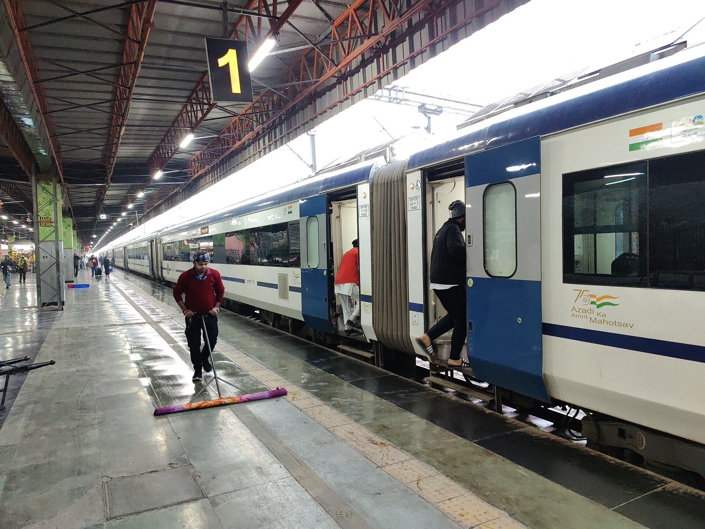
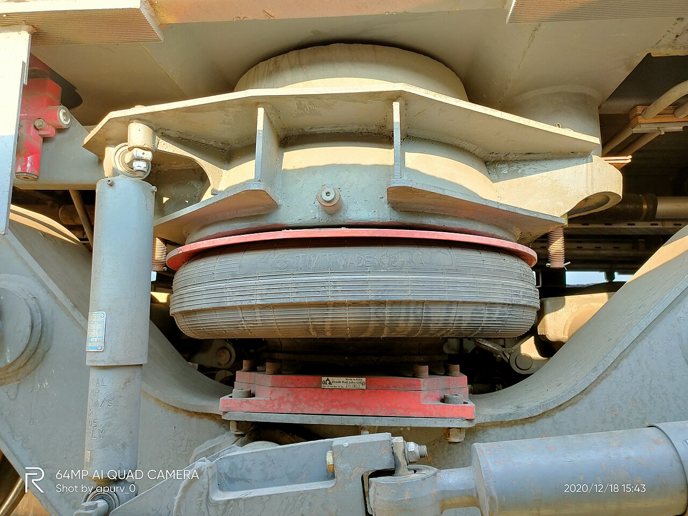
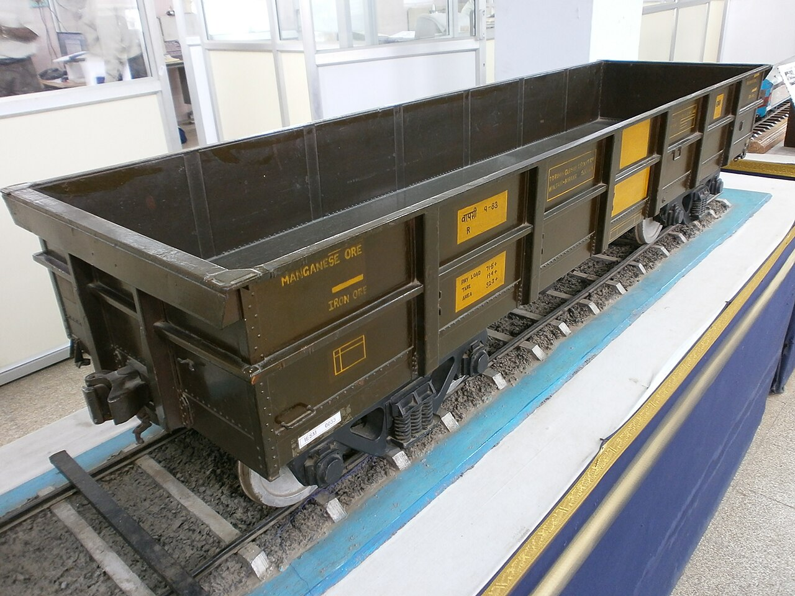
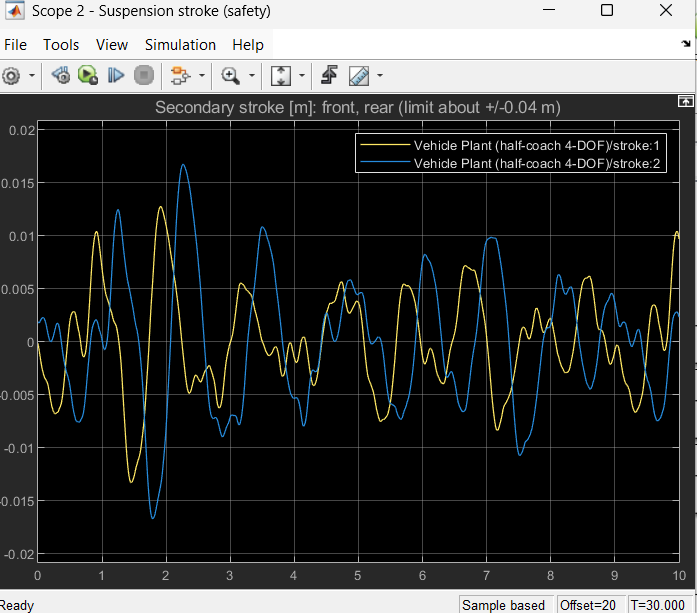
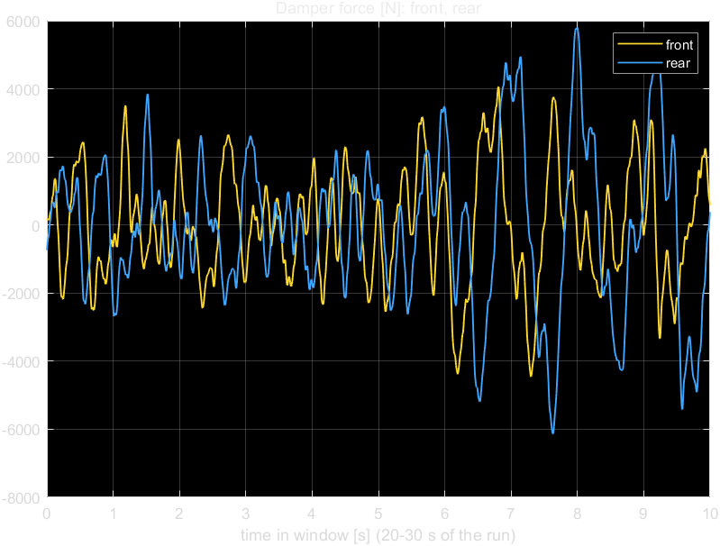
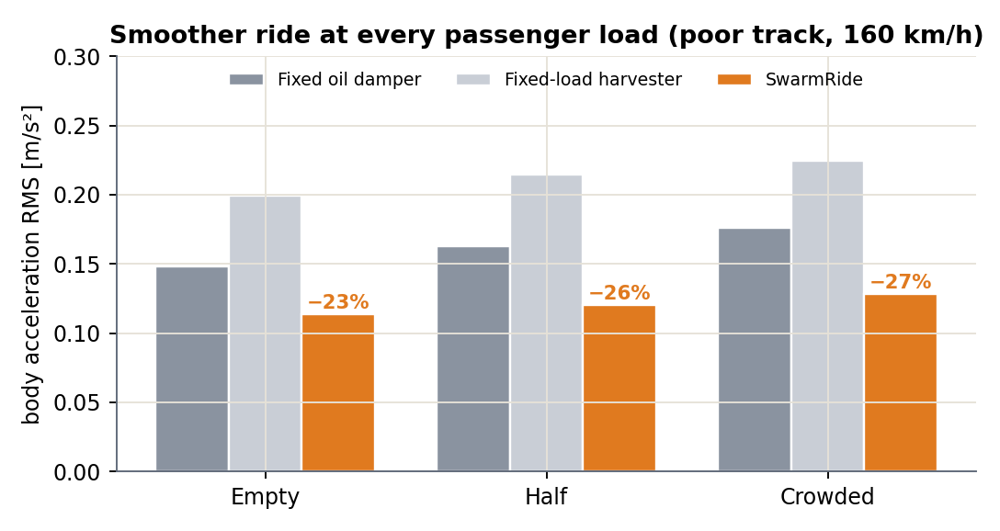

<div align="center">

# SwarmRide Bharat

### Self-powered, load-adaptive, train-synchronised suspension for Indian Railways

*Every coach and wagon turns track bumps into electricity, tunes its own ride to its load,<br>
and watches its own safety, while the locomotive warns every coach of the bump ahead.*



<sub>Vande Bharat Express. Photo: Ravi Dwivedi, CC BY-SA 4.0, via Wikimedia Commons</sub>

**Status:** concept complete · simulation Stage 1 complete and verified · Stage 2 (smart damper and power chain) next

</div>

---

> **Confidential.** This repository describes an invention not yet filed for patent protection. Keep the repository private until a provisional patent application is filed.

## Contents

- [The problem](#the-problem)
- [The idea](#the-idea)
- [How it works](#how-it-works)
- [Where it fits on today's trains](#where-it-fits-on-todays-trains)
- [Simulation: Stage 1 results](#simulation-stage-1-results)
- [Expected results](#expected-results)
- [Roadmap](#roadmap)
- [Repository structure](#repository-structure)
- [Getting started](#getting-started)
- [Documents](#documents)
- [Credits](#credits)

---

## The problem

| | Today on Indian Railways | Evidence |
|---|---|---|
| 🛤️ | **Track defects** are the largest cause of derailments; track-recording runs fall 30–100% short of schedule | CAG Report 22 of 2022 |
| 🔥 | **Hot axles**: about 3 cases a day, bearings checked at only about 25 trackside sites | Railway Board minutes, 2025 |
| 🔗 | **Train parting**: 643 partings and 2,059 wagon detachments in a single year | 2018–19 data |
| 🧍 | **Crowded coaches ride worse**: dampers are tuned for one load | Our simulation, below |
| ♨️ | **All damper energy becomes heat** | Our simulation, below |
| 🔌 | **Goods wagons have no electricity** for sensors | – |

## The idea

Replace the passive secondary damper with an **electromagnetic smart damper** (magnet + coil, Faraday's law). One device, three jobs:

| Job | How | Physics |
|---|---|---|
| ⚡ **Harvest** | Suspension motion drives the magnet through the coil and charges a per-bogie power bank | e = Kₑ · v |
| 🎚️ **Control the ride** | The power electronics set the coil current, which sets the damping, matched to the **measured load** (LPV control) | F = Kₑ · i, c = Kₑ² / R |
| 🛡️ **Power safety sensors** | Hot-axle, wheel, parting and track sensors run from the bogie's own power bank, with no wiring | stored energy > sensor use |

Plus the **Train Brain**: the locomotive feels every bump first and warns each coach behind it, which reaches the bump after **t = d / v** and prepares in advance.

## How it works


```
LEVEL 1  TRAIN BRAIN (loco / driving cab)   track ahead · timed bump warnings · health view
            │ data only
LEVEL 2  VEHICLE CONTROLLER (per coach)     weighs the vehicle · sets damping for its load
            │
LEVEL 3  BOGIE UNIT (self-powered)          smart dampers · power bank · sensors · fail-safe
```

**Power chain per bogie:** coil → active rectifier (sets damping) → DC-DC → supercapacitor → LiFePO4 → sensors and controller.
**Fail-safe:** on any fault, a relay switches the coil to a resistor, so the damper behaves like today's passive damper.

## Where it fits on today's trains

SwarmRide replaces **one part**, the secondary damper, on bogies already in service.

| LHB / Vande Bharat air-spring bogie | Goods bogie (Casnub type) |
|---|---|
|  |  |
| <sub>Air spring, LHB coach. Apurv013, CC0</sub> | <sub>Goods bogie model. Destination8infinity, CC BY-SA 3.0</sub> |

| Product | Market | Main value |
|---|---|---|
| **SwarmRide Freight** | BOXN wagons, Dedicated Freight Corridors | Safety with no wiring: every axle watched, partings located, track recorded |
| **SwarmRide Vande Bharat** | Vande Bharat chair car and sleeper | Comfort tuned to load and to the bump ahead |

## Simulation: Stage 1 results

A MATLAB/Simulink **test rig** of today's Indian trains: same coach, same rail, same speed, and only the damper changes between tests.


**Verified:** Simulink matches an independent state-space model within **0.004%**, and the bounce frequency matches a hand calculation (0.83 Hz).

**Baseline of today's trains** (poor track, top service speed):

| Vehicle | Load | Damping ζ | Ride index Wz | Max stroke | Heat wasted / bogie |
|---|---|---|---|---|---|
| LHB, 160 km/h | empty → 12 t | 0.14 → **0.10** | 1.73 → 1.83 | 17 → 20 mm | 67 → 73 W |
| Vande Bharat, 160 km/h | empty → 7.6 t | 0.12 → **0.10** | 1.74 → 1.79 | 17 mm | 78 → 80 W |
| ICF, 110 km/h | empty → 15 t | 0.08 → **0.06** | 1.54 → 1.42 | 12 mm | 29 → 35 W |
| BOXN, 100 km/h | empty → 67 t | friction | 2.21 → 2.09 | 4 mm | 34 → **209 W** |

| Fixed damper weakens as passengers board | Energy today's dampers waste as heat |
|---|---|
|  |  |

**Live scopes** (LHB, crowded, 160 km/h, poor track):

| Body vibration (comfort) | Suspension stroke (safety) |
|---|---|
|  |  |
| **Damper force (all heat today)** | **Rail under the 4 wheels (basis of preview)** |
|  |  |

**Findings**
1. Today's fixed dampers lose 17–30% of their damping ratio as load rises, on every coach type.
2. Passengers over the bogies feel about twice the vibration of those in the centre (pitch).
3. Damper power comes in bursts: peaks around 1.4 kW against a 73 W average, so a supercapacitor is needed.
4. Every bump reaches each later wheel after d/v. That delay is the window for Train Brain preview.
5. Goods wagons ride hardest and waste the most energy (about 210 W per bogie), yet have no power today.

Full explanation of every block, parameter and result: **[SwarmRide_Sim/Stage1.md](SwarmRide_Sim/Stage1.md)**

## Expected results

From a simplified preview model: **targets, to be confirmed in Simulink Stages 2–3.** Crowded coach, poor track, 160 km/h.

| Measure | Today's damper | Fixed-load harvester | **SwarmRide** |
|---|---|---|---|
| Body RMS acceleration | 0.165 m/s² | 0.224 m/s² | **0.125 m/s² (−24%)** |
| Sperling ride index Wz | 1.82 | 2.06 | **1.65** |
| Harvested power per bogie | 0 W | about 45 W | **about 10–40 W** |

| Comfort vs power | Ride at every load |
|---|---|
|  |  |

A plain harvester trades comfort for watts. SwarmRide improves comfort **and** powers its own bogie electronics and sensors (about 5–20 W needed).

## Roadmap


| Stage | Content | Status |
|---|---|---|
| Concept | Problem evidence, architecture, pitch, technical design | ✅ Done |
| Simulation 1 / 1b | Test rig, verification, baseline of LHB, Vande Bharat, ICF, BOXN | ✅ Done |
| Simulation 2 | Smart damper (designs A/B/C), rectifier, DC-DC, power bank, fail-safe | ⏳ Next |
| Simulation 3 | LPV load-adaptive and Train Brain preview controllers, head-to-head | Planned |
| Simulation 4 | Self-powered health sensors, investor dashboard | Planned |
| Prototype | Bench test of one smart damper | Planned |
| Pilot | Freight wagons, then Vande Bharat (with RDSO) | Planned |

## Repository structure

```
.
├── README.md                                   this file
├── CHANGELOG.md                                what was added, stage by stage
├── docs/
│   └── WHITEPAPER.md                           concise technical whitepaper
├── SwarmRide_Bharat_Pitch.md / .docx / .pdf    investor pitch, Indian Railways edition
├── SwarmRide_Bharat_Technical_Document.md      full technical design
├── SwarmRide_Bharat_Complete_Guide.md          from-scratch understanding + simulation guide
├── SwarmRide_Simulation_Results_Preview.pdf    expected results preview
├── images/                                     system overview and roadmap diagrams
├── pdf/                                        pitch builder, preview study, real photos
│   ├── photos/                                 Indian rolling stock photos (see CREDITS.md)
│   └── results/                                preview-study figures and summary.json
└── SwarmRide_Sim/                              MATLAB/Simulink simulation
    ├── sr_setup.m                              session setup
    ├── functions/                              physics, sensors, track, train library, ride index
    ├── scripts/                                parameters, model builder, checks
    ├── models/SR_Stage1.slx                    Simulink model (generated)
    ├── results/                                Stage 1 figures, reports, scope captures
    ├── Stage1.md                               Stage 1 report
    └── MODEL_GUIDE.md                          block-by-block reference
```

## Getting started

**Simulation** (MATLAB R2024b with Simulink, Control System Toolbox, Simscape, Simscape Electrical):

```matlab
cd SwarmRide_Sim
sr_setup
trainType = 'LHB';  v_kmh = 160;  mload_t = 12;  trackType = 'poor';
% press Run in Simulink: 4 live scopes open
run('scripts/check_stage1b.m')        % regenerate the baseline results
```

**Pitch and preview** (Python 3 with numpy, scipy, matplotlib; Microsoft Edge for PDF export):

```bash
python pdf/sim_preview.py
python pdf/build_results.py
python pdf/build_pitch.py
```

## Documents

| Document | For |
|---|---|
| [Whitepaper](docs/WHITEPAPER.md) | A concise technical overview |
| [Pitch](SwarmRide_Bharat_Pitch.md) ([PDF](SwarmRide_Bharat_Pitch.pdf), [Word](SwarmRide_Bharat_Pitch.docx)) | Investors and Indian Railways |
| [Technical Document](SwarmRide_Bharat_Technical_Document.md) | Engineers |
| [Complete Guide](SwarmRide_Bharat_Complete_Guide.md) | Learning the project from scratch |
| [Stage 1 report](SwarmRide_Sim/Stage1.md) | The simulation so far |
| [Results Preview](SwarmRide_Simulation_Results_Preview.pdf) | Expected results |

## Credits

Photographs of Indian rolling stock are from Wikimedia Commons under their stated licences; see [pdf/photos/CREDITS.md](pdf/photos/CREDITS.md). Model parameters cite IRIMEE and published studies; see [MODEL_GUIDE.md](SwarmRide_Sim/MODEL_GUIDE.md).

---

<div align="center">
<sub>© 2026 Sangeeth. All rights reserved.</sub>
</div>
