<p align="center">
  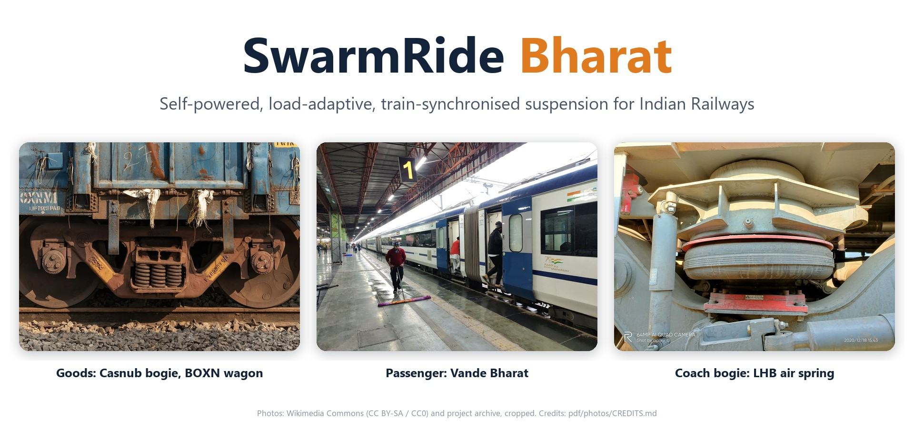
</p>

<p align="center">
  <a href="https://sangeeth0301.github.io/SwarmRide-Bharat/"></a>
  
  
  
  <a href="https://github.com/Sangeeth0301/SwarmRide-Bharat/actions/workflows/ci.yml"></a>
  <a href="SwarmRide_Sim/VERIFICATION.md"></a>
  
</p>

<p align="center">
  <b>Every bogie powers itself, tunes its own ride and watches its own safety,<br>
  while the locomotive warns every coach of the bump ahead.</b>
</p>

> **All rights reserved.** This repository is public for reference. No licence is granted to use, copy, manufacture or distribute the SwarmRide design, models or code (see *Credits and licence*).

---

## Overview

Every coach and wagon on Indian Railways carries **secondary dampers** that turn vibration into heat and are tuned for a single load. The same fleet loses trains to track defects, hot axles and train parting, and its goods wagons have **no electricity** to run sensors.

**SwarmRide Bharat** replaces the passive damper with an **electromagnetic smart damper**. That one device harvests energy, controls the ride, and powers the bogie's own safety sensors. A **Train Brain** in the locomotive shares each bump with every vehicle behind it, so each coach prepares before the bump arrives.

| | |
|---|---|
| **Replaces** | The passive secondary damper: one part, same mounting points |
| **Adds** | Energy harvesting · load-adaptive damping · train-wide bump preview · self-powered safety sensing |
| **Markets** | Freight wagons (BOXN, Dedicated Freight Corridors) · Vande Bharat trainsets |
| **Stage** | Simulation complete (Gate A met) · bench prototype designed: hardware ratings, bench model, C firmware and test plan ready · building and testing it is next (Gate B) |

---

## The problem

| Gap on today's railway | Evidence |
|---|---|
| **Track defects** are the largest cause of derailments | 171 derailments from poor track maintenance, 2017–21; track-recording runs 30–100% short of schedule *(CAG Report 22 of 2022)* |
| **Hot axles** are caught only at fixed trackside sites | About 3 cases a day *(Railway Board, 2025)*; bearings checked at about 25 OMRS sites |
| **Train parting** is detected only at the last wagon | 643 partings and 2,059 wagon detachments in 2018–19 |
| **Crowded coaches ride worse** | Fixed dampers lose 17–30% of their damping as load rises *(our simulation)* |
| **Damper energy is wasted** | 20–90 W per coach bogie, about 210 W per loaded wagon bogie, all heat *(our simulation)* |
| **Goods wagons have no power** | No continuous on-board monitoring is possible today |

---

## The solution

| Capability | How it works | Core relation |
|---|---|---|
| **Harvest** | Suspension motion moves magnets through a coil and charges a power bank on the bogie | e = Kₑ · v |
| **Control** | Power electronics set the coil current, and the current sets the damping, matched to the measured load (LPV) | F = Kₑ · i, c = Kₑ² / R |
| **Preview** | The locomotive meets every bump first; vehicle *n* receives it after tₙ = dₙ / v and prepares | tₙ = dₙ / v |
| **Protect** | The bank powers bearing, wheel, coupler and track sensors on every bogie, with no wiring | P_harvest > P_sensors |
| **Fail-safe** | On any fault a relay puts a resistor across the coil, and the damper behaves like today's | c_failsafe = c_today |

<p align="center">
  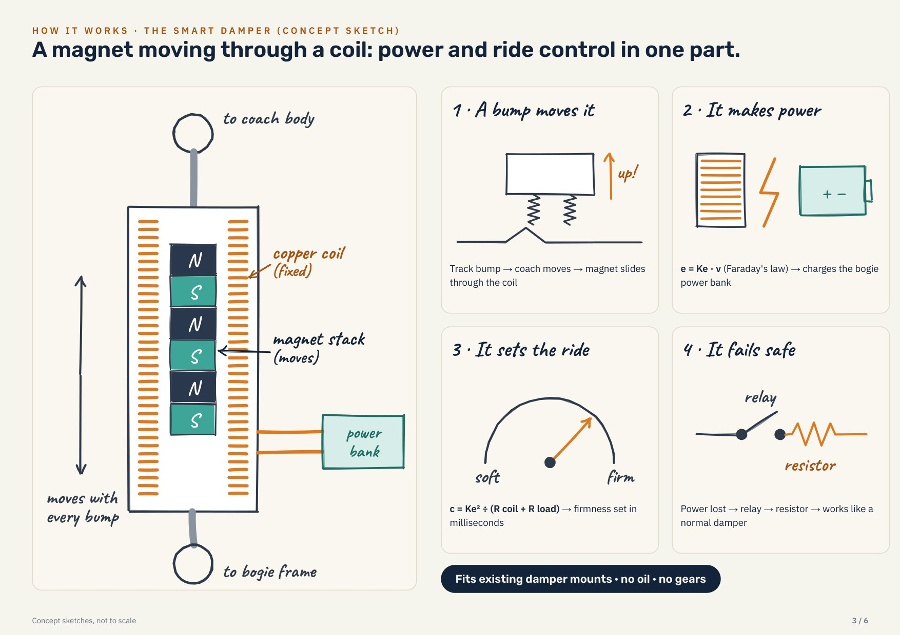
</p>
<p align="center"><sub>The smart damper: a bump moves the magnet stack through the fixed coil, which makes power, sets the ride and fails safe.</sub></p>

<p align="center">
  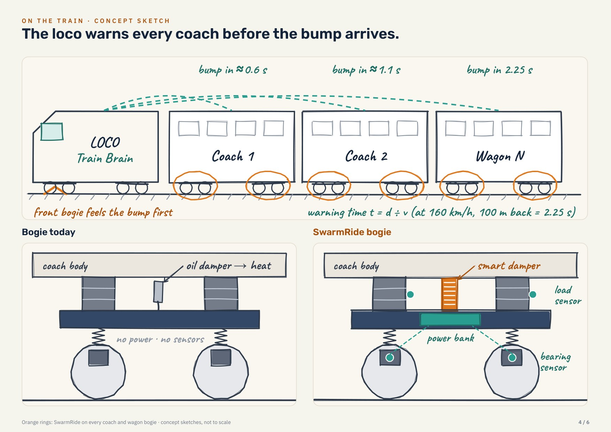
</p>
<p align="center"><sub>Train Brain preview: the front bogie feels the bump first and every coach behind is warned t = d / v in advance. Below, today's bogie compared with the SwarmRide bogie.</sub></p>

---

## System architecture

<p align="center">
  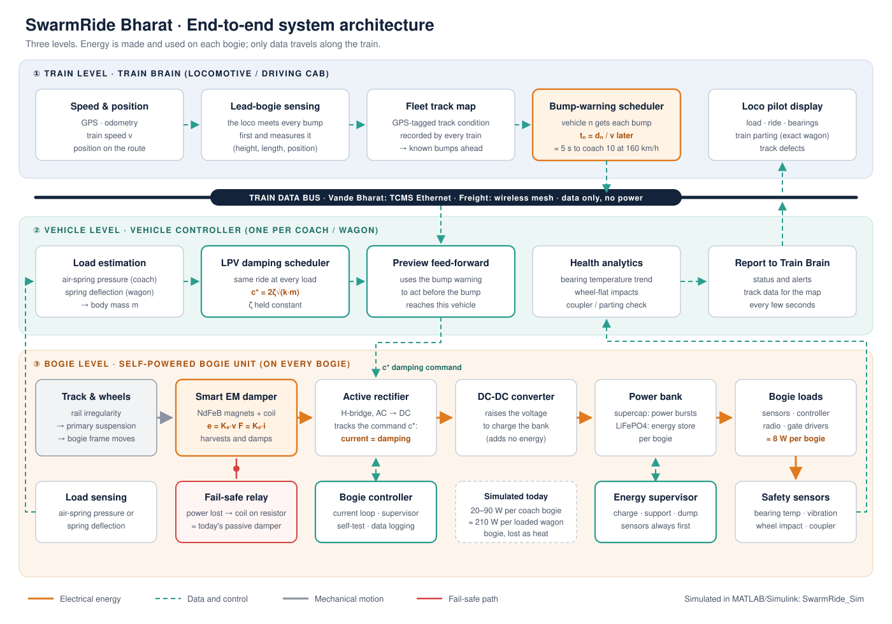
</p>

| Level | Where | Responsibility |
|---|---|---|
| **① Train** | Locomotive / driving cab | Speed and position, lead-bogie bump sensing, fleet track map, bump-warning scheduling, pilot display |
| **② Vehicle** | One controller per coach or wagon | Load estimation, LPV damping schedule, preview feed-forward, health analytics, reporting |
| **③ Bogie** | Every bogie, self-powered | Smart dampers, active rectifier, DC-DC converter, supercapacitor + LiFePO4 bank, safety sensors, fail-safe relay |

### Architecture vs simulation

How much of this architecture the simulation covers, box by box: **11 of 22 boxes are in Simulink**, 1 is partly simulated, 4 are ideal stand-ins (perfect preview, load estimate and states), 2 are checked in MATLAB after the run and 4 are not simulated (all at train level). Full table: [docs/ARCHITECTURE_VS_SIMULATION.md](docs/ARCHITECTURE_VS_SIMULATION.md).

<p align="center">
  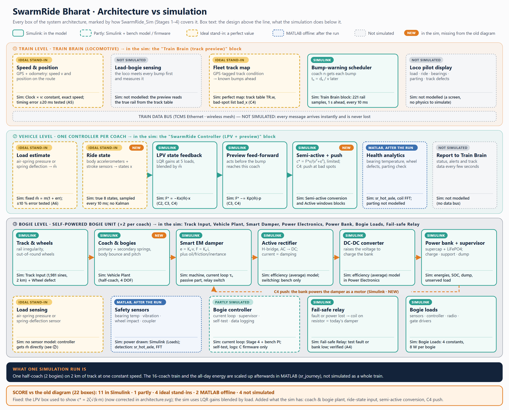
</p>

---

## On a real bogie

<p align="center">
  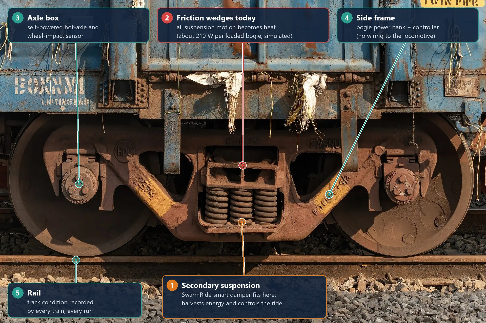
</p>
<p align="center"><sub>Casnub bogie of a BOXNM1 wagon, annotated with where each SwarmRide part goes.</sub></p>

<p align="center">
  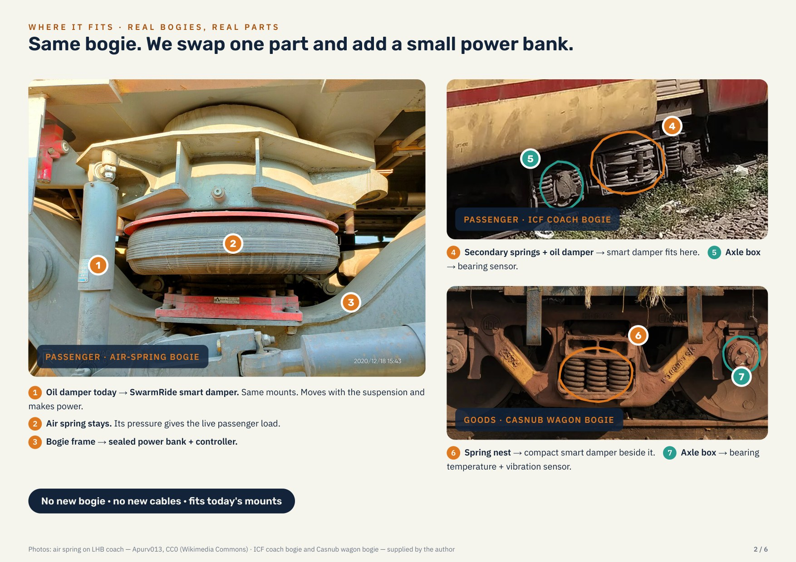
</p>
<p align="center"><sub>Same bogie, one part swapped: LHB air-spring bogie, ICF coach bogie and Casnub wagon bogie. No new bogie, no new cables, fits today's mounts.</sub></p>

| Vehicle | What SwarmRide replaces | Load signal for the control |
|---|---|---|
| **LHB / Vande Bharat coach** | The vertical secondary dampers beside the air springs | Air-spring pressure (already on board) |
| **ICF coach** | The secondary dampers on the bolster springs | Spring deflection sensor |
| **BOXN wagon (Casnub)** | Works beside the friction wedges (hybrid) or replaces them with a geared smart damper | Spring-nest deflection sensor |

---

## Two products, one technology

<p align="center">
  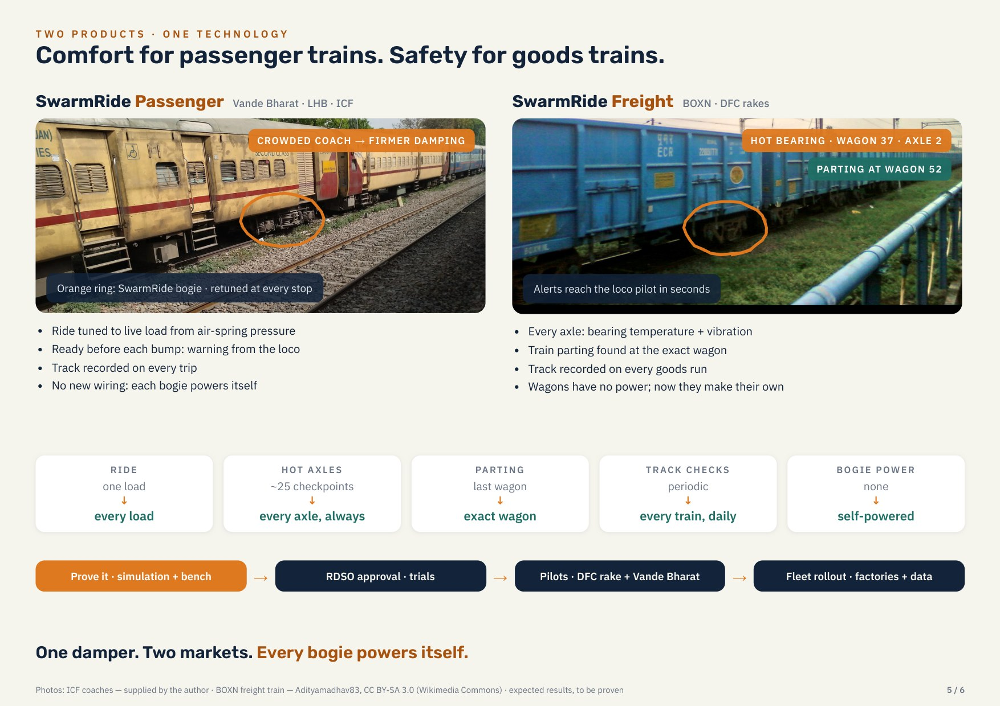
</p>

| | **SwarmRide Passenger** | **SwarmRide Freight** |
|---|---|---|
| Rolling stock | Vande Bharat, LHB, ICF | BOXN wagons, DFC rakes |
| Main value | Ride tuned to the live load and to the bump ahead | Every axle watched; train parting found at the exact wagon |
| Power today | Train power exists; SwarmRide removes new wiring | None; SwarmRide makes the wagon self-powered |
| Track data | Recorded on every trip | Recorded on every run |

---

## One bump, end to end

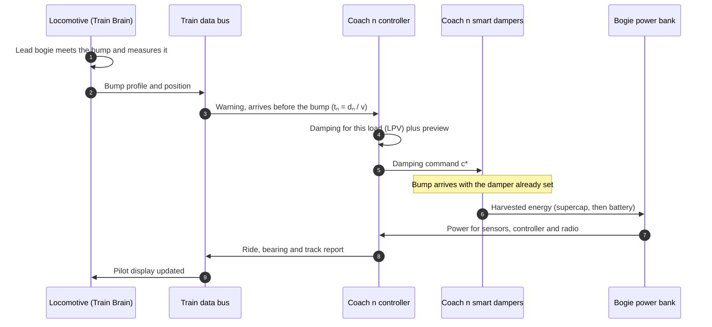

---

## Engineering validation

The whole system has been proven in **MATLAB/Simulink** before any hardware. Every stage uses the **same coach, rail, speed and load, and changes only the damper**, so every comparison is fair. A test suite (`scripts/run_all_checks.m`) checks the model against hand calculations, an independent state-space model, energy conservation and step-size convergence; see **[VERIFICATION.md](SwarmRide_Sim/VERIFICATION.md)** for what is proven and what is not.

```mermaid
flowchart LR
    S1["<b>Stage 1</b><br/>Test rig<br/>track · 4-DOF coach · today's damper"]
    S2["<b>Stage 2</b><br/>Smart damper<br/>designs A/B/C · power chain · fail-safe"]
    S3["<b>Stage 3</b><br/>Control<br/>LPV load-adaptive · Train Brain preview"]
    S4["<b>Stage 4</b><br/>Push, day, health<br/>active push · full-day power · sensing · dashboard"]
    S5["<b>Stage 5</b><br/>Bench prototype<br/>sizing · bench model · firmware · test plan"]
    S6["<b>Gate B</b><br/>Build and test<br/>one damper on a rig"]
    S1 --> S2 --> S3 --> S4 --> S5 --> S6
    classDef done fill:#2A9D8F,stroke:#1F6F66,color:#ffffff
    classDef now fill:#E07A1F,stroke:#A8520F,color:#ffffff
    classDef next fill:#EEF3FA,stroke:#9AA8BC,color:#13233A
    class S1,S2,S3,S4,S5 done
    class S6 now
```

### Stage 1: the baseline to beat (complete)

<p align="center">
  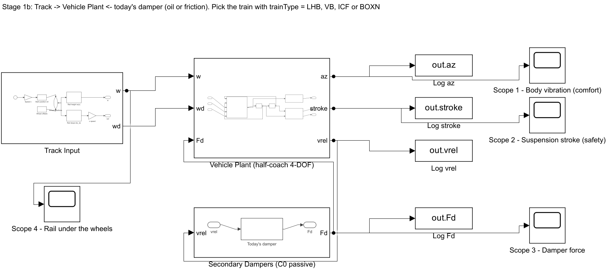
</p>

The Simulink model matches an independent state-space model within **0.003%**, and its bounce frequency matches a hand calculation (0.83 Hz).

| Vehicle | Load | Damping ratio ζ | Sperling Wz | Max stroke | Heat wasted per bogie |
|---|---|---|---|---|---|
| LHB, 160 km/h | empty → 12 t | 0.14 → **0.10** | 1.73 → 1.84 | 20 → 25 mm | 64 → 73 W |
| Vande Bharat, 160 km/h | empty → 7.6 t | 0.12 → **0.10** | 1.75 → 1.79 | 23 → 25 mm | 82 → 87 W |
| ICF, 110 km/h | empty → 15 t | 0.08 → **0.06** | 1.45 → 1.38 | 10 → 14 mm | 23 → 31 W |
| BOXN, 100 km/h | empty → 67 t | friction | 2.28 → 2.15 | 3 mm | 36 → **214 W** |

<table>
  <tr>
    <td width="50%">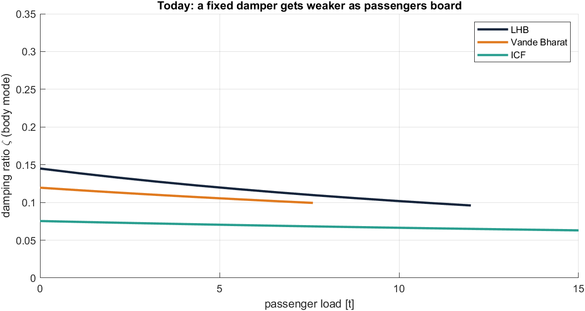<br><sub><b>Fixed dampers weaken as passengers board</b>, on every coach type.</sub></td>
    <td width="50%">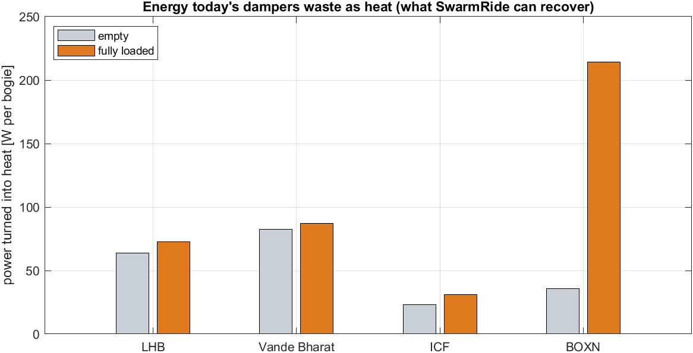<br><sub><b>Energy today's dampers turn into heat</b>: the ceiling on what can be recovered.</sub></td>
  </tr>
  <tr>
    <td>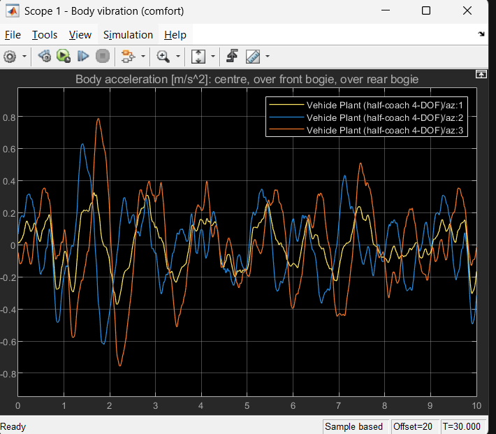<br><sub><b>Body vibration:</b> passengers over the bogies feel about twice the centre level (pitch).</sub></td>
    <td>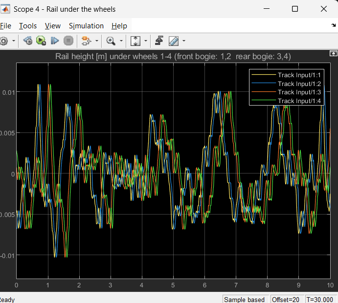<br><sub><b>Rail under the 4 wheels:</b> the same bump arrives at each wheel later, which is the window preview uses.</sub></td>
  </tr>
</table>

Full report, block by block: **[SwarmRide_Sim/Stage1.md](SwarmRide_Sim/Stage1.md)**

### Stage 2: the smart damper and power chain (complete)

Today's damper is replaced by an electromagnetic damper, an active rectifier, a DC-DC converter and a supercapacitor + LiFePO4 bank on every bogie. All four checks pass: **same ride as today** (Wz 1.846 vs 1.844), **damping law** (0.09%), **energy balance** (< 0.001%) and **fail-safe** (exactly today's damping after a fault).

| Same ride as today, crowded, top speed | Poor track: into the bank | Good track: into the bank | Bogie loads |
|---|---|---|---|
| LHB, 160 km/h | **46–51 W** per bogie | 17–18 W | 8 W |
| Vande Bharat, 160 km/h | **55–62 W** | 21–22 W | 8 W |
| ICF, 110 km/h | **21–23 W** | 7.3–8.6 W | 8 W |
| BOXN, 100 km/h (wedges replaced) | **78–90 W** | 29–33 W | 8 W |

<table>
  <tr>
    <td width="50%">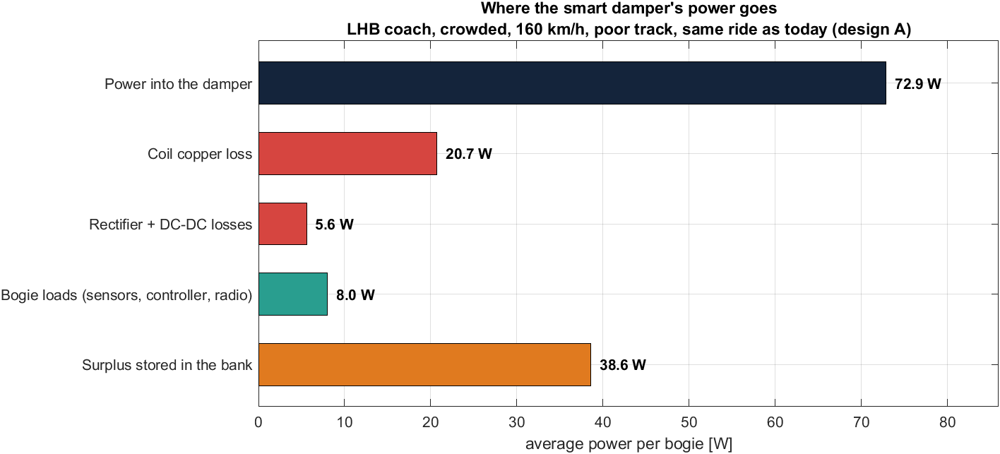<br><sub><b>Where the power goes</b> (LHB): 73 W in, 46 W into the bank, 8 W used, 38 W surplus.</sub></td>
    <td width="50%">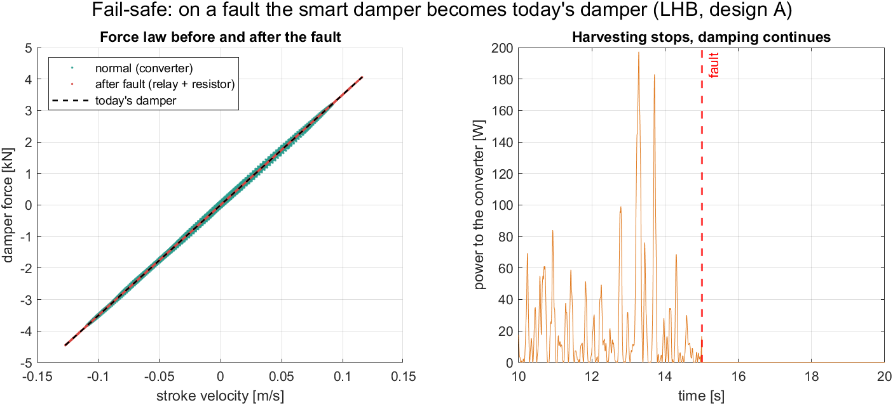<br><sub><b>Fail-safe:</b> after a fault the damper follows today's damper exactly, and harvesting stops.</sub></td>
  </tr>
</table>

**Key findings:** the bogie powers itself on normal track. Smooth track is the weak case (ICF only just covers its load). Maximising power transfer is the wrong goal, because it burns half the power in the coil. For freight the friction wedges must be replaced, which also cuts wagon body vibration by more than half (to be confirmed). **Design C (geared rotary)** leads.

Full report: **[SwarmRide_Sim/Stage2.md](SwarmRide_Sim/Stage2.md)**

### Stage 3: the SwarmRide controllers (complete)

The fixed damping command is replaced by the **SwarmRide Controller**: an LPV (load-scheduled) LQR running at 100 Hz, plus the **Train Brain** preview of the rail ahead. It is tested head to head against today's damper and a fixed-setting harvester at empty, half and full load.

| Sperling Wz, poor track (lower = better) | Empty | Half | Full | Into the bank (full) |
|---|---|---|---|---|
| LHB, today's damper | 1.73 | 1.78 | 1.84 | 0 W |
| **LHB, SwarmRide (C3)** | **1.49** | **1.50** | **1.53** | 33 W |
| Vande Bharat, today's damper | 1.75 | 1.77 | 1.79 | 0 W |
| **Vande Bharat, SwarmRide (C3)** | **1.47** | **1.48** | **1.50** | 38 W |

<table>
  <tr>
    <td width="50%">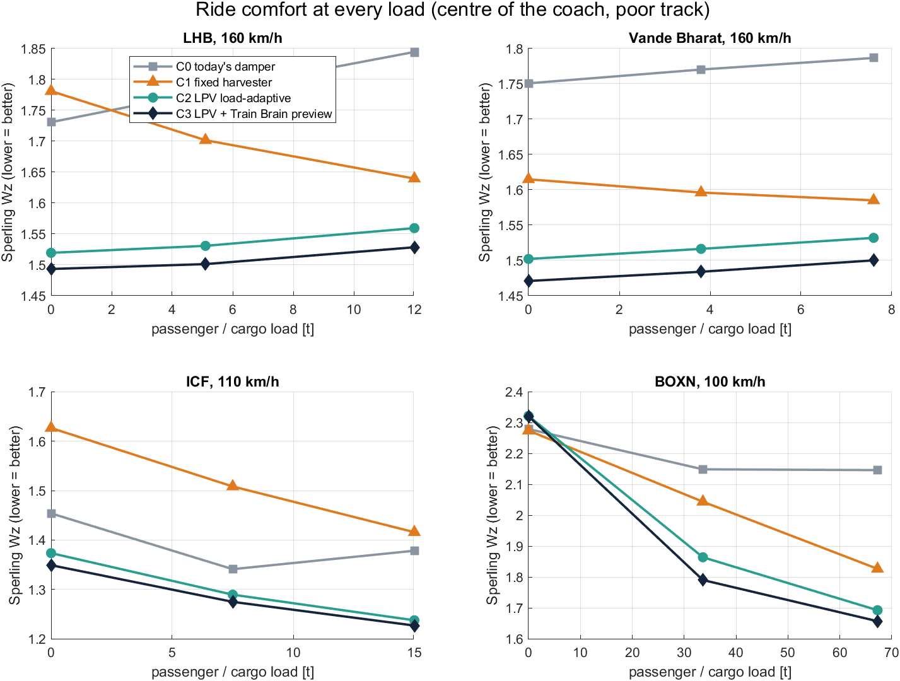<br><sub><b>Better at every load:</b> today's ride worsens as passengers board; SwarmRide's stays nearly flat and 14–17% better.</sub></td>
    <td width="50%">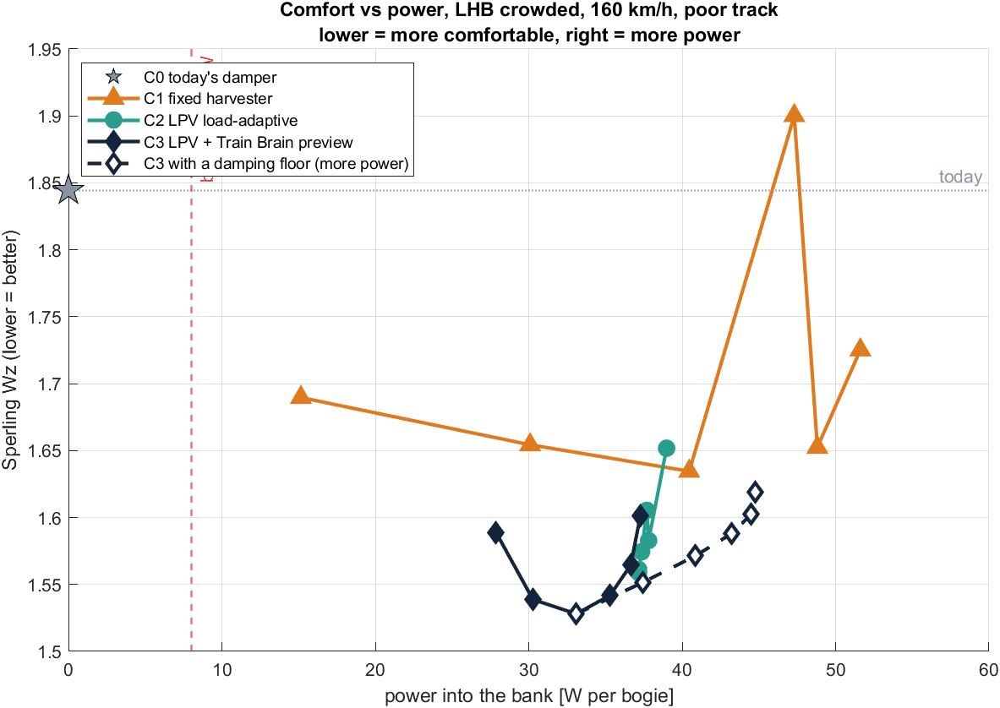<br><sub><b>Comfort vs power:</b> no fixed setting reaches SwarmRide's comfort; a damping floor trades comfort for power on one dial.</sub></td>
  </tr>
</table>

**Key findings:**
- Ride **15–17% better** on crowded LHB and Vande Bharat coaches (worst seat −19%), body vibration **about 40% lower**, suspension travel down by a third, still **33–38 W per bogie** into the bank.
- Robust to a ±20 ms late warning and a ±10% load-estimate error, and the fail-safe still works.
- **Honest limits:**
  - The preview adds only 1–2%, because a damper that can only resist cannot act before the motion starts. Making the warning count needs brief active pushing, which Stage 4 adds.
  - The empty goods wagon does not ride better.

Full report: **[SwarmRide_Sim/Stage3.md](SwarmRide_Sim/Stage3.md)**

### Stage 4: active push, a full day and health sensing (complete)

Stage 4 answers the three questions Stage 3 left open:
- Can the Train Brain warning really pay off?
- Does the bogie stay powered through a whole day and night?
- Can the self-powered bogie actually see faults?

| Question | Result |
|---|---|
| **Active push at known bad spots** (controller C4) | At a track settlement the damper briefly **pushes** with banked energy. The worst-seat jolt drops from 0.97 (today) and 0.76 (C3) to **0.20 m/s²**, i.e. **−80%**, for **345 J (0.1 Wh)**. At a short dip: −67% for 20 J |
| **A full day on one bogie's bank** (10 h parked at night) | Electronics left on at 8 W drain the battery to its floor. With a **1 W sleep when parked**: LHB 60% → 60%, Vande Bharat → 69%, freight wagon → 80%, and no load is ever unserved. The slow ICF (→ 36%) and all-smooth track need a small top-up |
| **Hot axle** | The on-bogie sensor alarms **within 10 s** at 90 °C. With trackside checkpoints every 250 km, **82%** of faults pass 180 °C before any check |
| **Wheel defect** | Seen in the damper's own coil signal: an eccentric wheel **×5** and a three-lobed wheel **×204** above healthy, and located to the front wheelset |

<table>
  <tr>
    <td width="50%">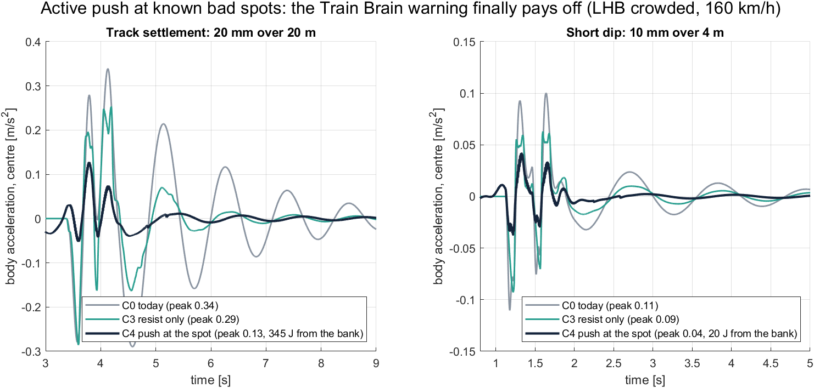<br><sub><b>The warning pays off:</b> at a known bad spot the damper pushes with its own banked energy, for about 0.1 Wh.</sub></td>
    <td width="50%">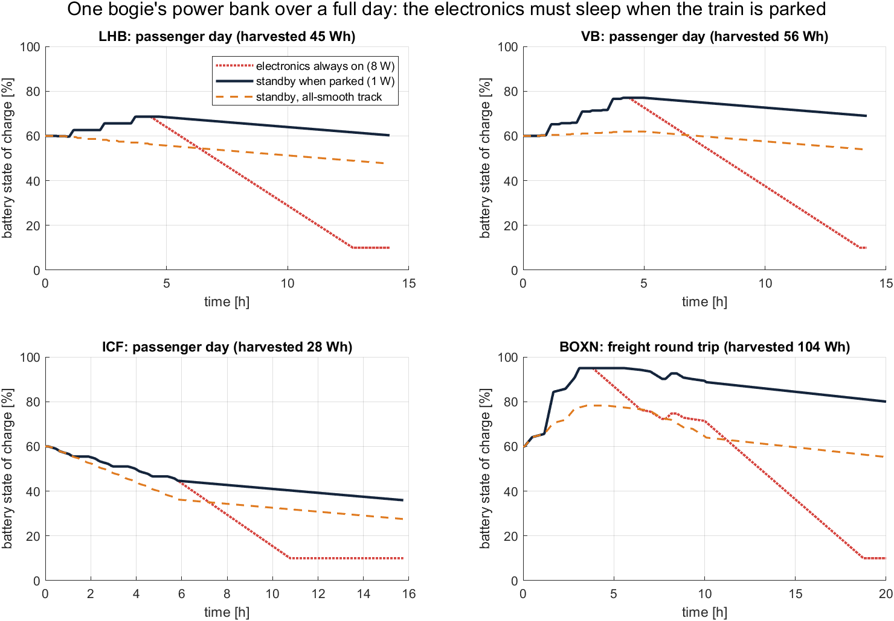<br><sub><b>A full day:</b> with a 1 W sleep when parked, the bank holds or gains charge on LHB, Vande Bharat and freight.</sub></td>
  </tr>
  <tr>
    <td>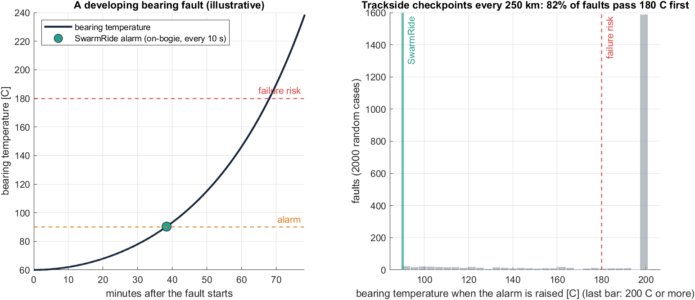<br><sub><b>Hot axle:</b> the danger window (30 min) is far shorter than the gap between trackside checkpoints (2.5 h).</sub></td>
    <td>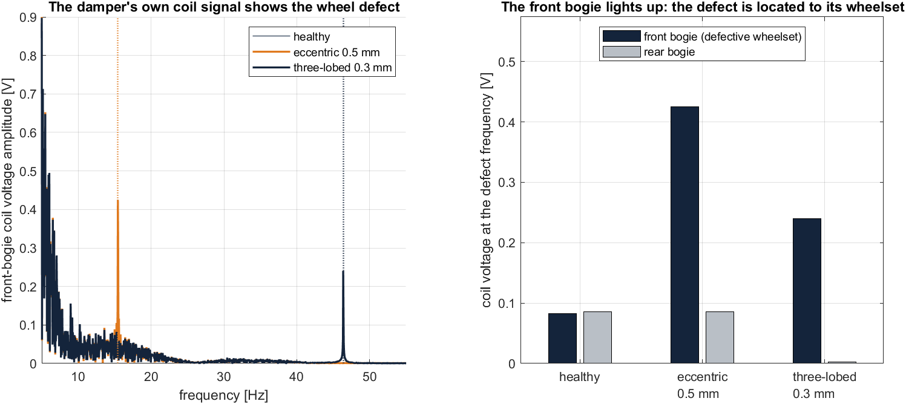<br><sub><b>Wheel defect:</b> a sharp peak at the wheel frequency, only on the bogie with the defective wheelset.</sub></td>
  </tr>
</table>

**Gate A is met in simulation:** a better ride than fixed dampers at every load, and more power made than used over a full day. **All 73 automatic checks of Stages 1–4 pass** (85 with the bench prototype). The investor dashboard ([`dashboard/index.html`](dashboard/index.html)) shows every result from the real simulation output.

Full report: **[SwarmRide_Sim/Stage4.md](SwarmRide_Sim/Stage4.md)**

### Stage 5: the bench prototype, ready to build (Gate B)

The next proof must come from hardware: **one real design-C damper on a test rig**. Stage 5 prepares everything for it.

<p align="center">
  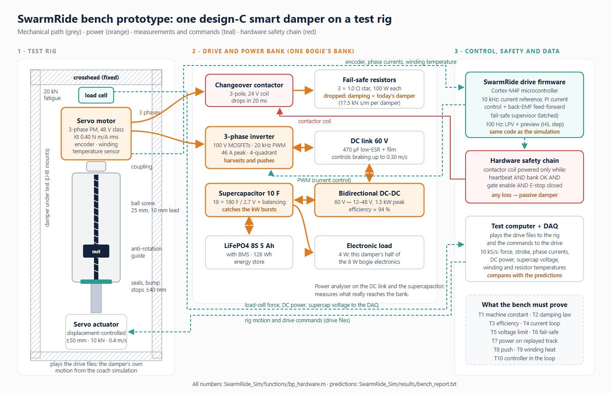
</p>

| Item | What was produced |
|---|---|
| **Hardware ratings** | From the damper's duty in the coach simulation: 48 V-class servo motor (Kt 0.40 N m/A rms, 14 N m peak), Ø25 mm × 10 mm-lead ball screw, 8 kN, 60 V / 46 A four-quadrant drive, 3 × 1.0 Ω fail-safe resistors, 10 F supercapacitor + 128 Wh LiFePO4 |
| **Bench model** (`SR_Bench.slx`) | The damper as it will be tested: 10 kHz current control with a voltage limit, inverter and DC-DC losses, a contactor that takes 20 ms, winding heat |
| **Predictions** | The damper's own motion from the coach, replayed on the rig: **14.4 W** into the bank (vehicle model 14.5 W). Fail-safe = today's damping, with a 20 ms gap. Push 800 W for 95 J. Winding at 42 °C |
| **Firmware in C** | Controller, drive and bank supervisor, ported from MATLAB. **10 of 10 host checks pass** in double and in float (microcontroller) arithmetic |
| **Test plan** | T1–T10 with drive files for the rig, predicted values and pass bands; budget ≈ ₹4.4–13.5 lakh; 16 weeks to Gate B |

**Finding:** the ball screw makes rotor inertia look like hundreds of kilograms at the rod. But the coach model shows the ride gets slightly better up to 16× the assumed inertia, and stays within 2% at 32×, so standard servo motors fit. Friction is the budget to control: 600 N would cost a fifth of the harvest.

Package: **[Bench_Prototype/](Bench_Prototype/README.md)** · Bench model report: **[SwarmRide_Sim/Stage5_Bench.md](SwarmRide_Sim/Stage5_Bench.md)**

### Early estimate (preview study)

Before the Simulink stages, a simplified Python model estimated the gains below. Stage 3 has now measured them in Simulink: a ride improvement of 17% and body vibration down 41% on a crowded LHB coach, at 33 W per bogie (Section *Stage 3* above). Crowded coach, poor track, 160 km/h.

| Measure | Today's damper | Research harvester (fixed load) | **SwarmRide (target)** |
|---|---|---|---|
| Body RMS acceleration | 0.165 m/s² | 0.224 m/s² | **0.125 m/s² (−24%)** |
| Sperling ride index Wz | 1.82 | 2.06 | **1.65** |
| Power into the bogie bank | 0 W | ≈ 45 W | **≈ 10–40 W**, enough for ≈ 8 W of bogie electronics |

<p align="center">
  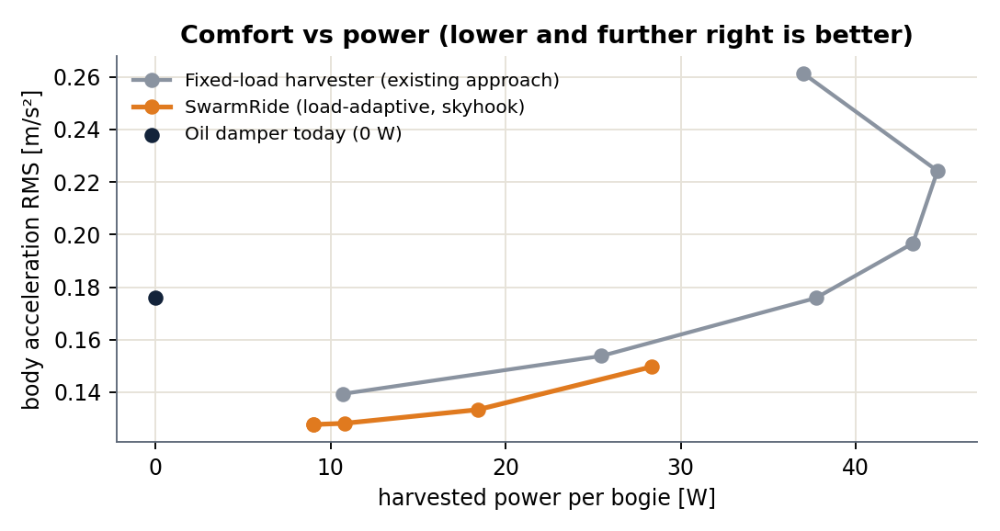
</p>

A plain harvester trades comfort for watts. SwarmRide is designed to improve comfort **and** make the bogie self-sufficient in power.

---

## Positioning

| In service today | Its limit | SwarmRide adds |
|---|---|---|
| Fixed oil dampers / friction wedges | Tuned for one load; all energy becomes heat | Ride tuned to live load; energy reused on the bogie |
| OMRS trackside bearing checks | Sees a wagon only when it passes about 25 sites | Every axle, all the time |
| End-of-train telemetry (EoTT) | Watches the last wagon only | Every wagon reports; parting located at the exact wagon |
| Track Recording Cars | Periodic, and behind schedule | Every train records the track on every run |
| Kavach | Collision prevention through signalling | Complementary: vehicle and track health |
| Energy-harvesting dampers (research) | Power at the cost of ride comfort | Comfort and power together, with preview and fail-safe |

---

## Roadmap

<p align="center">
  
</p>

| Phase | Scope | Status |
|---|---|---|
| Concept | Problem evidence, architecture, pitch, technical design | Done |
| Simulation 1 | Test rig, verification, baseline of LHB, Vande Bharat, ICF, BOXN | Done |
| Simulation 2 | Smart damper (A/B/C), rectifier, DC-DC, power bank, fail-safe | Done |
| Simulation 3 | LPV and preview control, head-to-head comparison | Done |
| Simulation 4 | Active push at known bad spots, full-day power, self-powered health sensing, investor dashboard | Done |
| Bench prototype design | Hardware ratings, bench model, C firmware, rig drive files, test plan T1–T10, budget | Done |
| Prototype | Build one design-C damper and test it on a rig (Gate B) | **Next** |
| Pilot | Freight wagons, then Vande Bharat, with RDSO | Planned |

---

## Repository

```
.
├── README.md                         project overview (this page)
├── docs/                             whitepaper, review, architecture vs simulation, base paper study
├── presentation/                     project review deck (.pptx) and its builder
├── SwarmRide_Bharat_Pitch.*          investor pitch: Markdown · Word · PDF
├── SwarmRide_Bharat_Technical_Document.md
├── SwarmRide_Bharat_Complete_Guide.md
├── SwarmRide_Simulation_Results_Preview.pdf
├── images/                           banner, architecture, annotated bogie, pitch sketches, roadmap
├── Bench_Prototype/                  bench prototype: requirements, designs, firmware (C), rig drive files, test plan, BOM
├── dashboard/                        investor dashboard (open index.html through a local web server)
├── frontend/                         project website: the whole story on one page
├── pdf/                              pitch builder, preview study, photographs and credits
├── tools/                            documentation checks, Markdown to Word, architecture-vs-simulation map
└── SwarmRide_Sim/                    MATLAB/Simulink simulation
    ├── sr_setup.m                    start here
    ├── functions/                    physics, sensors, track, rolling stock, damper design
    ├── builders/                     shared Simulink block builders
    ├── scripts/                      parameters, model builders, checks, run_all_checks
    ├── tests/                        verification tests (physics, convergence, power chain, track, control, Stage 4)
    ├── models/                       generated Simulink models
    └── results/                      figures, reports, scope captures
```

### Quick start

```matlab
cd SwarmRide_Sim
sr_setup                                                   % paths + opens the model
trainType = 'LHB';  v_kmh = 160;  mload_t = 12;  trackType = 'poor';
% press Run: live scopes open and the 30 s run plays in real time
designType = 'C';  ctrlMode = 'C3';                        % Stage 3: damper design and controller
run('scripts/check_stage3.m')                              % reproduce the Stage 3 study
ctrlMode = 'C4';  trackType = 'settlement';  stage = 4;   % Stage 4: push at a known bad spot
run('scripts/check_stage4.m')                              % reproduce the Stage 4 study
stage = 'bench';  sr_setup                                % bench prototype: one damper on a test rig
run('scripts/check_bench.m')                               % bench study: sizing, predictions, margins, exports
run('scripts/run_all_checks.m')                            % all 85 verification checks
```

Requires MATLAB R2024b with Simulink, Control System Toolbox, Simscape and Simscape Electrical.
The pitch and preview tooling use Python 3 (numpy, scipy, matplotlib, Pillow) and Microsoft Edge for PDF export.

---

## Documentation

| Document | Audience |
|---|---|
| [Whitepaper](docs/WHITEPAPER.md) | Technical overview |
| [Investor pitch](SwarmRide_Bharat_Pitch.md) · [PDF](SwarmRide_Bharat_Pitch.pdf) · [Word](SwarmRide_Bharat_Pitch.docx) | Investors and Indian Railways |
| [Technical document](SwarmRide_Bharat_Technical_Document.md) | Engineers |
| [Complete guide](SwarmRide_Bharat_Complete_Guide.md) | Learning the project from scratch |
| [Architecture vs simulation](docs/ARCHITECTURE_VS_SIMULATION.md) | Which architecture boxes the simulation covers, block by block, and what is still ideal |
| [Base paper study](docs/Base_Paper_Study.md) · [Word](docs/Base_Paper_Study.docx) | The IEEE TVT 2022 base paper in simple English, and how SwarmRide upgrades each of its limits |
| [Project review deck](presentation/SwarmRide_Bharat_Project_Review.pptx) | 24-slide Control Systems project review (PowerPoint), built by `presentation/build` |
| [Stage 1 report](SwarmRide_Sim/Stage1.md) · [Stage 2 report](SwarmRide_Sim/Stage2.md) · [Stage 3 report](SwarmRide_Sim/Stage3.md) · [Stage 4 report](SwarmRide_Sim/Stage4.md) · [Stage 5 bench model](SwarmRide_Sim/Stage5_Bench.md) · [Model guide](SwarmRide_Sim/MODEL_GUIDE.md) · [Verification](SwarmRide_Sim/VERIFICATION.md) | Simulation |
| [Project review](docs/REVIEW.md) | Code Analyzer, firmware static analysis and verification results, and recommendations |
| [Project website](frontend/index.html) | The whole project explained on one page, with the photos, figures and a warning-time calculator (run `python -m http.server` in the repository root, then open `/frontend/index.html`) |
| [Bench prototype](Bench_Prototype/README.md) | Building and testing the first damper: requirements, mechanical and electronics design, firmware, test plan, budget |
| [Dashboard](dashboard/index.html) | All simulation results on one page (run `python -m http.server` in the repository root, then open `/dashboard/index.html`) |
| [Results preview](SwarmRide_Simulation_Results_Preview.pdf) | Early estimate, before the Simulink stages |

---

## Credits and licence

Photographs of Indian rolling stock are from Wikimedia Commons under their stated licences, plus project-archive images; full list in [pdf/photos/CREDITS.md](pdf/photos/CREDITS.md). Model parameters cite IRIMEE and published studies; see the [model guide](SwarmRide_Sim/MODEL_GUIDE.md).

© 2026 Sangeeth. All rights reserved. No licence is granted to use, copy or distribute this work.
