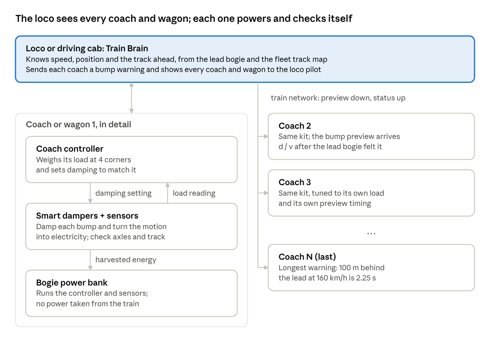
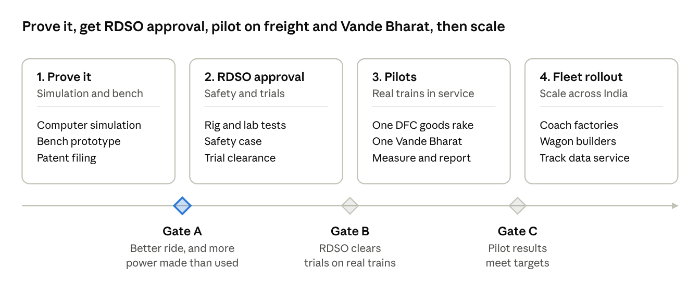

# SwarmRide Bharat: Self-Aware Trains for Indian Railways

Oct 2, 2026 · Jaganath

SwarmRide Bharat makes every coach and wagon a smart vehicle that powers itself. Its suspension turns track bumps into electricity. That electricity runs sensors that watch the track, the axles and the ride. The ride adjusts itself to how full the coach is, and the loco pilot sees everything on one screen.

## The problem

Indian Railways loses trains to track defects, hot axles and broken couplings, and crowded coaches ride badly. Today most checks happen only at fixed places or from time to time. Problems that start in between go unseen.

| # | Problem | What the evidence says | Source |
| --- | --- | --- | --- |
| 1 | **Track defects: the biggest cause of derailments** | 2017–21: 171 derailments from poor track maintenance and 156 from track out of limits. Track Recording Car checks fell 30–100% short of schedule. | [CAG Report 22 of 2022](https://cag.gov.in/webroot/uploads/download_audit_report/2022/Report-No.-22-of-2022_Railway_English_DSC-063a2dda55f3ce6.38649271.pdf) |
| 2 | **Hot axles (overheated wheel bearings)** | About 3 hot-axle cases every day, according to Railway Board minutes (2025). Earlier: 468 cases in 9 months (2018–19). Bearings are checked by OMRS at only about 25 trackside sites (industry source, to confirm). | [Amar Ujala, 2025](https://english.amarujaladigital.com/national/increasing-train-parting-hot-axle-cases-have-safety-implications-need-investigation-railways); [The Wire, 2019](https://m.thewire.in/article/government/equipment-failure-at-indian-railways-raises-questions-over-long-term-safety-strategy); [IndoAI](https://indo.ai/content/IndoAI_AI_Indian_Railways.html) |
| 3 | **Coach and wagon defects** | 182 derailments (2017–21) were caused by the Mechanical Department. 37% of those came from wheel-size differences and coach or wagon defects. | [CAG summary](https://indiafacts.in/cag-report-derailments-in-indian-railways-summary-and-recommendations/) |
| 4 | **Train parting (couplings breaking)** | 643 train partings and 2,059 wagon detachments in 2018–19. Railway Board said in 2025 that partings are still "on the higher side". | [The Wire, 2019](https://m.thewire.in/article/government/equipment-failure-at-indian-railways-raises-questions-over-long-term-safety-strategy); [Amar Ujala, 2025](https://english.amarujaladigital.com/national/increasing-train-parting-hot-axle-cases-have-safety-implications-need-investigation-railways) |
| 5 | **Crowded coaches ride badly** | General coaches are often overcrowded. Dampers are tuned for one load, so a packed coach bounces more. | [The Wire, 2024](https://m.thewire.in/article/government/cost-of-neglect-the-rising-toll-of-train-accidents-in-india) |
| 6 | **Vande Bharat ride quality** | A passenger review says you can feel the track, with more vibration and noise than European trains. | [Madras Musings](https://madrasmusings.com/vol-32-no-19/chennai-mysuru-vande-bharat-a-review/) |

## Our idea in one picture

Each coach or wagon looks after itself: it makes its own power, weighs itself and checks itself. The loco or driving cab adds what one coach cannot do alone: the warning of the bump ahead, and one view of the whole train.

## How it works

The system runs by itself. The crew does nothing extra.

1. **At the station.** Each coach or wagon weighs itself. Vande Bharat coaches use air-spring pressure; goods wagons use a small sensor on the springs. No cameras are needed.
2. **On the move.** Each smart damper turns bumps into electricity. A small power bank on the bogie stores it.
3. **Self-powered.** That stored power runs the damper's controller, the axle bearing sensors, the track sensing and the radio.
4. **Bump warning.** The front bogie feels each bump first. The Train Brain tells every coach behind when that bump will reach it, so each one gets ready.
5. **Alerts.** The loco pilot is told at once about a hot bearing, a wheel flat, a parting at a named wagon, an overloaded coach or a track defect at a given kilometre.
6. **Every day.** The train uploads its track map, so maintenance teams know where to go.

## Two products, one technology

The same smart damper and power bank serve two markets. Only the main job changes.

| | **SwarmRide Freight** | **SwarmRide Vande Bharat** |
| --- | --- | --- |
| For | Goods wagons, starting on the Dedicated Freight Corridors | Vande Bharat chair car and sleeper trainsets |
| Main job | Safety: every axle watched, partings found at the exact wagon, track recorded | Comfort: ride tuned to load and to the bump ahead, track recorded at high speed |
| Why self-power matters | Wagons have no electricity at all | No new wiring across a large fleet; each bogie works on its own |
| Works with | OMRS, EoTT and Track Recording Cars | The train's own control network (TCMS) |
| Problems solved (table above) | 1, 2, 3, 4 | 1, 5, 6 |

Why Vande Bharat fits so well: the coach body sits directly on air springs, the bogie already has vertical, lateral and yaw dampers, and it is built for 160 km/h ([IRIMEE trainset bogie notes](https://rskr.irimee.in/sites/default/files/Introduction%20to%20Trainset%20bogie%20(1).pdf)). Our smart dampers replace those dampers, and air-spring pressure gives the load directly. The fixed trainset also means bogie distances are known exactly, so the bump warning is precise.

## The core technology

Five simple parts work together as one system.

| # | Part | What it is | Why it matters |
| --- | --- | --- | --- |
| 1 | **Smart damper** | A magnet moves inside a coil and makes electricity (Faraday's law). By changing the electrical load, it also makes the ride softer or firmer. | It **replaces** the existing damper; it is not an extra part. No oil and no gears. |
| 2 | **Bogie power bank** | Supercapacitors plus a small battery, charged only by the dampers. | Everything on the bogie runs on its own power. No cables from the train. |
| 3 | **Sensors** | Axle bearing temperature and vibration, load sensing, and the damper's own signal for track and wheel health. | Problems are seen while the train runs, not only at checkpoints. |
| 4 | **Train Brain** | Software in the loco or driving cab. On Vande Bharat it runs on the train's existing control network (TCMS). | Sends bump warnings and shows every coach or wagon on one screen. |
| 5 | **Fail-safe switch** | If power or electronics fail, a relay closes the coil circuit. The smart damper then works like a normal damper. | The train is never less safe than today, even if the software stops. |

## The science, in simple words

**1. A heavier coach needs a firmer damper.** How well a damper controls bouncing is measured by the damping ratio ζ. Here c is the damping, m the coach mass and ω the bounce frequency, which air springs keep roughly constant:

$$\zeta = \frac{c}{2\,m\,\omega} \qquad\Rightarrow\qquad c_{needed} = 2\,\zeta_{best}\,\omega\,m_{measured}$$

If a coach goes from 40 t empty to 55 t crowded (approximate figures), a fixed damper becomes about 27% too weak. SwarmRide makes it 37.5% firmer to match, so the ride stays the same.

**2. Electricity and ride control come from the same coil.** The faster the magnet moves, the more voltage it makes. Changing the electrical load changes how firm the damper feels, in milliseconds:

$$e = K_e\,v, \qquad c = \frac{K_e^{2}}{R_{coil} + R_{load}}$$

**3. The bump warning comes from the front of the train.** A bogie d metres behind the front one meets the same bump after this time, at speed v:

$$t = \frac{d}{v}$$

At 160 km/h, a bogie 100 m back gets 2.25 seconds of warning, which is plenty of time to prepare.

**4. A voltage booster does not create energy.** A DC-DC booster raises voltage so the power bank can charge, but current drops by the same ratio. 50 W in gives about 47 W out. More energy only comes from more vibration or more dampers.

## Energy: honest numbers

Each bogie makes enough electricity to run itself, with some to spare. It will not run fans or AC, and it does not need to. Its job is to make the bogie independent.

| Item | Amount | Basis |
| --- | --- | --- |
| Best rail damper ever built | 63 W per damper | [Dong et al.](https://doi.org/10.1177/1045389X231200146) |
| Possible on rail, in theory | 33–960 W per damper | Same study (loaded freight wagon, 90 km/h) |
| Needed by electronics and sensors per bogie | About 5–20 W | Our estimate, to be measured |
| Power bank to cover 30 minutes with no bumps | About 5 Wh | 10 W × 0.5 h, our estimate |
| **Result** | **More made than used** | To be proven on the bench |

Two points to be clear about:

- **On goods wagons**, self-power is essential. Wagons have no electricity, and braking energy does not reach them.
- **On Vande Bharat**, the train already has power. There, self-power means no new wiring and independent bogies, not saving electricity.

## Why it is better than what is used today

SwarmRide does not replace Indian Railways' safety systems. It fills the gaps between them, all the time and on every vehicle.

| Used today | Its limit | What SwarmRide adds |
| --- | --- | --- |
| **OMRS** (trackside bearing checks, about 25 sites) | Checks a wagon only when it passes a site | Watches every axle all the time |
| **EoTT** (5,085 sets, about ₹500 crore) ([Business Standard](https://www.business-standard.com/article/pti-stories/new-system-to-do-away-with-guard-at-rear-end-of-coaches-116080901705_1.html)) | Watches only the last wagon | Every wagon reports, so a parting is found at the exact wagon; works alongside EoTT |
| **Track Recording Cars** | Run from time to time; checks fell 30–100% short of schedule (CAG) | Every train records the track, every day |
| **Fixed dampers** | Tuned for one load; turn energy into heat | Tuned to the live load; energy reused |
| **Kavach** | Prevents collisions through signalling | A different job: vehicle and track health; works alongside |
| **Research energy harvesters** | Make some power but often make the ride worse (63 W came with only 20% shock absorption) | Better ride and power together |

## What is new (patent)

No single part is new. What is new is putting them together: suspension power that runs the suspension and the safety sensors on every bogie, a ride tuned to live load, a bump warning shared across the train, and track recording by every train. File a provisional patent with the Indian Patent Office **before** any paper, competition, public demo or open pitch.

Main claim, in plain words for a patent attorney:

> A train in which every vehicle's suspension dampers make electricity and store it on the bogie. That stored power runs the vehicle's own damper control and safety sensors. Each vehicle tunes its damping to its measured load. A controller at the front of the train sends each vehicle a bump warning timed by its distance from the front bogie and the train's speed.

Supporting claims:

1. Damping set in proportion to measured load, to keep the ride the same at any load.
2. Axle bearing and wheel health sensors powered only by suspension energy.
3. Every wagon reporting to the loco, so a parting is located at the exact wagon.
4. A daily track map built from the damper signals of every train.
5. A fail-safe relay that turns the smart damper into a normal damper if power fails.

What already exists, so we must not claim it alone:

- A self-powered end-of-train unit using an air turbine on the brake pipe ([US patent 5,267,473](https://patents.google.com/patent/US5267473), 1991)
- OMRS trackside monitoring, EoTT and Track Recording Cars
- Load weighing from air-spring pressure
- Energy-harvesting dampers in research (Dong et al.; Wang et al., 2023; Cheng et al., 2024)

## Who will buy, and how we earn

We sell a smart-damper kit per bogie, then earn every year from software and track data.

| Buyer | Why they need it | What they buy |
| --- | --- | --- |
| Railway Board and zonal railways (after RDSO approval) | Fewer derailments from hot axles, wheel defects and track faults | Kits for wagons and coaches, plus track data |
| DFCCIL (Dedicated Freight Corridors) | Long, heavy goods trains with no power on wagons | SwarmRide Freight on every rake |
| Coach factories: ICF, RCF, MCF | Better ride on Vande Bharat and LHB coaches | Smart dampers fitted at the factory |
| Wagon builders: Titagarh, Jupiter Wagons, Texmaco | Safer wagons that monitor themselves | Self-powered sensing fitted at the factory |
| Track maintenance teams | Track checks fall short of schedule | A daily track condition map |

How we earn:

1. **Hardware:** smart dampers and power bank, priced per bogie.
2. **Software:** Train Brain licence, priced per train.
3. **Data:** track and fleet health service, priced per route or per train.

It also fits national goals: made in India, and aimed squarely at rail safety. Prices will be set once the prototype is costed.

## Rollout plan

Gate A matters most. The simulation must show a better ride than fixed dampers at every load, and more power made than used. Freight comes first because wagons have no power and the safety need is greatest. Vande Bharat follows for comfort. Timing depends on funding and RDSO trials.

## Risks and how we handle them

| Risk | How we handle it |
| --- | --- |
| Less power than expected on smooth track | Smooth track needs little control. The power bank covers the gap. |
| Bump warning arrives at the wrong moment (at 160 km/h, 1 m of position error is about 23 ms) | Match each coach's signal to the front bogie's signal, not GPS alone |
| Radio link to the loco is lost | Each coach keeps working on its own, without the bump warning |
| Load reading shaken by vibration | Weigh mainly at stations, and filter the signal slowly while moving |
| Getting RDSO approval | Safety rests on the fail-safe relay, not on software. Test to railway standards for electronics, shock and vibration, running behaviour and ride comfort. |
| Harsh conditions: heat, dust, monsoon water | Sealed (IP67) units and wide-temperature parts; bench and field tests in Indian conditions |
| Promising too much power | Quote only watts we have measured ourselves |

## What we need

Three things take us from idea to a working pilot:

1. **Funding** for the computer simulation, a bench prototype and the patent filing. The amount will be set once the prototype is costed.
2. **Pilot partners:** one Dedicated Freight Corridor goods rake and one Vande Bharat trainset, with permission to share the data.
3. **Test support:** access to a damper test rig, and RDSO guidance for trials.

In return, partners get first use of the technology, all data from their own pilot, and better terms for the full rollout.

## Sources

- [CAG Report No. 22 of 2022: Performance Audit on Derailment in Indian Railways](https://cag.gov.in/webroot/uploads/download_audit_report/2022/Report-No.-22-of-2022_Railway_English_DSC-063a2dda55f3ce6.38649271.pdf) (figures checked through [this summary](https://indiafacts.in/cag-report-derailments-in-indian-railways-summary-and-recommendations/); cite the PDF directly)
- [Amar Ujala, "Increasing train parting, hot axle cases have safety implications", 21 Oct 2025](https://english.amarujaladigital.com/national/increasing-train-parting-hot-axle-cases-have-safety-implications-need-investigation-railways)
- [The Wire, "Equipment failure at Indian Railways...", 29 Mar 2019](https://m.thewire.in/article/government/equipment-failure-at-indian-railways-raises-questions-over-long-term-safety-strategy)
- [The Wire, "Cost of neglect: the rising toll of train accidents in India", 10 Aug 2024](https://m.thewire.in/article/government/cost-of-neglect-the-rising-toll-of-train-accidents-in-india)
- [IndoAI, AI models in Indian Railways 2025](https://indo.ai/content/IndoAI_AI_Indian_Railways.html) (OMRS site count; confirm with Railway Board)
- [Business Standard, EoTT to replace guards on goods trains](https://www.business-standard.com/article/pti-stories/new-system-to-do-away-with-guard-at-rear-end-of-coaches-116080901705_1.html)
- [India Infra Hub, how EoTT works](https://indiainfrahub.com/featured/indian-railways-to-equip-all-freight-trains-with-cutting-edge-end-of-train-telemetry-technology/)
- [IRIMEE, Introduction to trainset (Vande Bharat) bogie](https://rskr.irimee.in/sites/default/files/Introduction%20to%20Trainset%20bogie%20(1).pdf)
- [Madras Musings, Chennai–Mysuru Vande Bharat review](https://madrasmusings.com/vol-32-no-19/chennai-mysuru-vande-bharat-a-review/)
- [Dong, Zhang, Yu, Hu, energy-regenerative shock absorbers on railway freight wagons, J. Intelligent Material Systems and Structures](https://doi.org/10.1177/1045389X231200146)
- [Wang et al., energy harvesting shock absorber for freight trains, iScience, 2023](https://pmc.ncbi.nlm.nih.gov/articles/PMC10457534/)
- K. Cheng et al., "A novel self-powered PMSM electromagnetic damper based on adaptive economic model predictive control", IEEE Transactions on Transportation Electrification, 2024 (confirmed through reference 8 of [arXiv 2509.11346](https://arxiv.org/pdf/2509.11346))
- [US patent 5,267,473, Self-powered end of train unit](https://patents.google.com/patent/US5267473)
