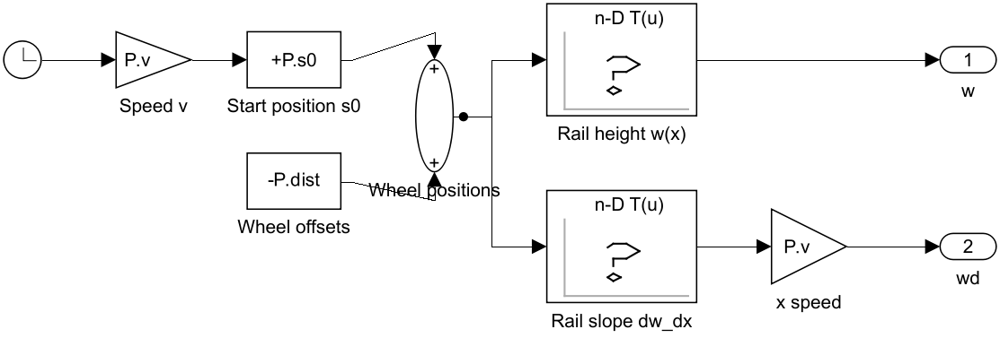
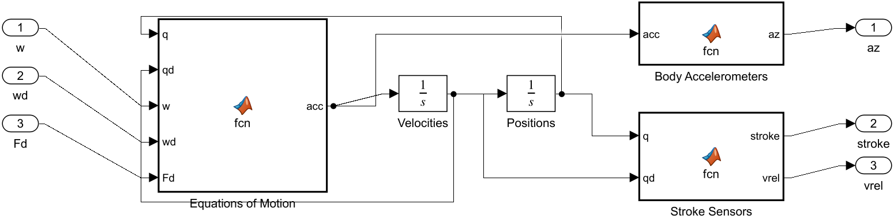
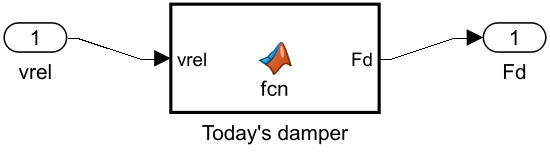
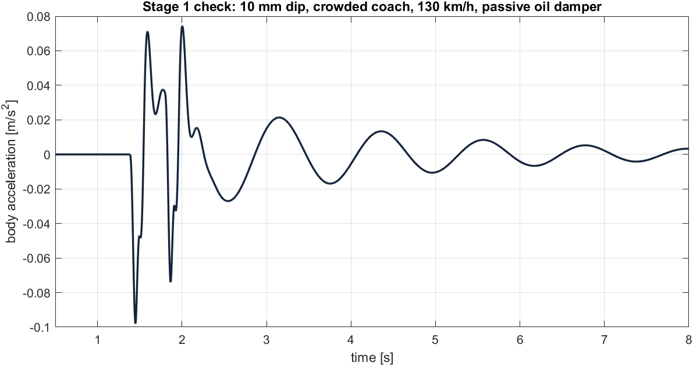
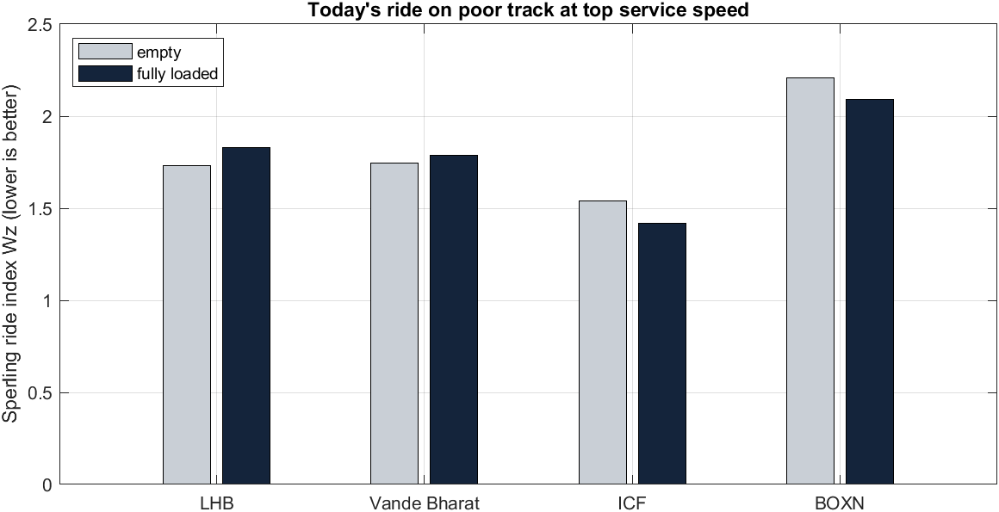

# Stage 1: The Test Rig (today's Indian trains in Simulink)

**Project:** SwarmRide Bharat, a regenerative, load-adaptive, self-powered train suspension
**Model:** `models/SR_Stage1.slx` (built by `scripts/build_stage1.m`)
**Status:** Stage 1 and Stage 1b complete and verified

> **In one line:** we built a virtual Indian train coach that rides on a virtual rail with **today's damper**, proved the physics is correct, and measured how today's trains perform. These are the numbers SwarmRide has to beat.

---

## Contents

1. [Objective](#1-objective)
2. [What has been done](#2-what-has-been-done)
3. [How to run it](#3-how-to-run-it)
4. [The model at a glance and the flow](#4-the-model-at-a-glance-and-the-flow)
5. [Block 1: Track Input (the virtual rail)](#5-block-1-track-input-the-virtual-rail)
6. [Block 2: Vehicle Plant (the coach)](#6-block-2-vehicle-plant-the-coach)
7. [Block 3: Secondary Dampers (today's damper)](#7-block-3-secondary-dampers-todays-damper)
8. [Logs, scopes and model settings](#8-logs-scopes-and-model-settings)
9. [Train parameters: LHB, Vande Bharat, ICF, BOXN](#9-train-parameters-lhb-vande-bharat-icf-boxn)
10. [Results](#10-results)
11. [What the results mean for SwarmRide](#11-what-the-results-mean-for-swarmride)
12. [Limits (honest notes)](#12-limits-honest-notes)
13. [Glossary](#13-glossary)
14. [Next: Stage 2](#14-next-stage-2)

---

## 1. Objective

### 1.1 Objective of the whole project

Today every Indian coach and wagon has a **fixed damper** in its secondary suspension: an oil damper on LHB, ICF and Vande Bharat, and friction wedges on BOXN goods wagons. It has four weaknesses:

| # | Weakness today | SwarmRide's answer |
|---|---|---|
| 1 | All suspension motion becomes **heat** | **Harvest** it with an electromagnetic damper (magnet + coil, Faraday's law: e = Kₑ·v) into a per-bogie power bank |
| 2 | Tuned for **one load**, so it gets weaker as passengers or cargo board | **Load-adaptive control (LPV)**: damping follows the measured load |
| 3 | **Goods wagons have no electricity**, so they have no safety sensors | **Self-powered sensors** (hot axle, wheel flat, track map, train parting) |
| 4 | Each coach reacts **after** it hits a bump | **Train Brain preview**: the locomotive warns the coaches behind, which reach the bump t = d/v later |

### 1.2 Objective of Stage 1

To prove SwarmRide is better, the comparison must be fair:

> **Same coach, same rail, same speed, same load. Change only the damper.**

So Stage 1 builds the **test rig**:
1. a virtual rail
2. a virtual coach
3. a damper slot that holds **today's damper** now and the **SwarmRide smart damper** later

Then it **proves** the rig is physically correct and **measures** today's trains. These measurements are the **baseline** to beat.

---

## 2. What has been done

| Step | What was built | Proof or result |
|---|---|---|
| **Stage 1** | Track generator, 4-DOF coach physics, passive oil damper, logging, automatic checks (generic coach) | Bounce frequency 0.83 Hz equals the hand calculation; Simulink and an independent model agree within **0.002%** |
| **Stage 1b** | Real Indian vehicles (LHB, Vande Bharat, ICF, BOXN) with their real spring types (air, coil, Casnub), friction-wedge model, 4 live scopes, real-time playback, baseline study | Wiring re-checked on LHB: **0.003%** difference. Baseline table and 3 figures (Section 10) |

### Files

| File | Role |
|---|---|
| `sr_setup.m` | Run once per MATLAB session: sets paths and the cache folder, opens the model |
| `functions/sr_trains.m` | **Train library**: numbers for each vehicle, with sources |
| `scripts/sr_params.m` | Turns your choice (train, speed, load, track) into one parameter set `P` |
| `functions/sr_track.m` | Generates the rail (good, poor or bump) |
| `functions/sr_eom.m` | The physics: Newton's law for the coach |
| `functions/sr_measure.m` | The sensors: acceleration, stroke, stroke velocity |
| `functions/sr_linear_model.m` | Independent state-space copy of the coach, used for checks and frequencies |
| `functions/sr_sperling.m` | Sperling ride-comfort index Wz |
| `scripts/build_stage1.m` | **Builds the Simulink model from code** (edit this, not the `.slx`) |
| `scripts/check_stage1.m` | Stage 1 checks (generic coach) |
| `scripts/check_stage1b.m` | Stage 1b baseline of today's Indian trains |
| `results/` | All figures and reports |

**Why build the model from a script?** It can be rebuilt exactly, every block and number can be traced, and Stage 2 can swap the damper box without touching anything else.

---

## 3. How to run it

```matlab
sr_setup                                              % once per session
trainType = 'LHB';                                    % LHB | VB | ICF | BOXN | GENERIC
v_kmh = 160;  mload_t = 12;  trackType = 'poor';      % speed [km/h], load [t], track: good | poor | bump
% then press Run in Simulink: 4 scope windows open and the 30 s run plays in real time
```

If you don't set them, the defaults are: LHB, top service speed, full load, poor track.

Batch checks (no windows; results go to `results/`):

```matlab
run('scripts/check_stage1b.m')    % baseline of today's Indian trains
run('scripts/check_stage1.m')     % physics and wiring checks
```

---

## 4. The model at a glance and the flow


```
Track Input ──w (4)──► Vehicle Plant ──az (3)──────► Log az     + Scope 1 (comfort)
            ──wd (4)─►   (coach)     ──stroke (2)──► Log stroke + Scope 2 (safety)
     │                   ▲ Fd (2)    ──vrel (2)──┐─► Log vrel
     │                   │                       │
     │           Secondary Dampers ◄─────────────┘
     │                   └──Fd──► Log Fd + Scope 3 (damper force)
     └──w──► Scope 4 (rail under the wheels)
```

### 4.1 The signals (wires)

| Wire | Size | Meaning | Unit |
|---|---|---|---|
| **w** | 4 | Rail height under wheels 1–4 (1, 2 front bogie; 3, 4 rear bogie) | m |
| **wd** | 4 | Vertical speed of each wheel | m/s |
| **Fd** | 2 | Damper force, front and rear bogie (positive = resists extension) | N |
| **az** | 3 | Body vertical acceleration: centre, over front bogie, over rear bogie | m/s² |
| **stroke** | 2 | Secondary suspension stroke (body minus bogie), front and rear | m |
| **vrel** | 2 | Stroke velocity, the speed the damper is moved at | m/s |

### 4.2 Why it is connected this way

It copies the real load path of a train:

```
rail ─► wheels ─► primary springs/dampers ─► bogie frame ─► secondary springs + DAMPER ─► coach body ─► passengers
```

The damper is in a **feedback loop**. Its force depends on how fast the suspension moves (vrel), and that movement depends on the damper force. vrel goes **out** of the Plant into the Damper, and Fd comes **back** into the Plant. This loop is the slot where SwarmRide's smart damper and controller plug in later.

### 4.3 What happens in every 1 ms step

1. **Clock** gives time t. **Track Input** finds each wheel's position and gives **w** and **wd**.
2. The **integrators** already hold the coach's current position and velocity. **Stroke Sensors** compute **vrel**, the **Damper** computes **Fd**, and Fd goes back into the Plant.
3. **Equations of Motion** use w, wd, Fd and the current state to compute the 4 **accelerations** (Newton's law).
4. The **integrators** turn accelerations into the next velocity and position.
5. **Body Accelerometers** give az. All signals go to the logs and scopes.

---

## 5. Block 1: Track Input (the virtual rail)



### 5.1 Blocks inside

```
Clock ─► Speed v ─► Start position s0 ─► Wheel positions ─┬─► Rail height w(x) ─────────► w
                    Wheel offsets ──────────┘             └─► Rail slope dw_dx ─► x speed ─► wd
```

| Block | Simulink type | What it does | Parameter (LHB example) | Why |
|---|---|---|---|---|
| **Clock** | Clock | Gives time t | – | Everything moves with time |
| **Speed v** | Gain | Distance travelled = v·t | `P.v` = 160/3.6 = **44.4 m/s** | Turns time into position on the track |
| **Start position s0** | Bias | s = 150 + v·t | `P.s0` = **150 m** | Starts inside the generated rail, so even the last wheel (17.5 m behind) is on real track |
| **Wheel offsets** | Constant | Distance of each wheel behind the first | `−P.dist` = −[0, 2.56, 14.9, 17.46] m | Every wheel meets the same bump, later |
| **Wheel positions** | Sum | Position of each of the 4 wheels | – | 4 positions at once |
| **Rail height w(x)** | 1-D Lookup Table | Rail height at each wheel position | Table `TR.w`, breakpoints `TR.x` (every 5 cm), clip at ends | The disturbance that shakes the coach |
| **Rail slope dw_dx** | 1-D Lookup Table | Rail slope at each wheel position | Table `TR.dwdx` | Needed for wheel speed |
| **x speed** | Gain | wd = slope × v | `P.v` | Chain rule: dw/dt = (dw/dx)(dx/dt). The primary dampers need wheel speed |
| **w, wd** | Outports | Send to the Plant | – | – |

### 5.2 Where the rail comes from (`functions/sr_track.m`)

The rail is built **before** each run (in the model's InitFcn).

| trackType | How it is made | Used for |
|---|---|---|
| **poor** | Sum of **1,981 sine waves**, one on every harmonic of a 2 km period with wavelength **1 m to 100 m**, sized by the standard vertical track spectrum S(Ω) = A_v·Ω_c² / ((Ω² + Ω_r²)(Ω² + Ω_c²)), with **A_v = 1.08e-6** m·rad, Ω_c = 0.8246 rad/m, Ω_r = 0.0206 rad/m | Main comfort comparison (realistic worn track) |
| **good** | Same, with **A_v = 4.032e-7** (smoother) | Good-track comparison |
| **bump** | Flat rail with a single **10 mm deep, 4 m long** dip at x = 200 m | Watching one clear event; the preview demo later |

- **Long waves are big and short waves are small**, like a real rail.
- **Fixed random seed (7):** every damper we test drives over **exactly the same rail**, so the comparison is fair.
- **Coverage at 160 km/h:** a 100 m wave shakes at 0.44 Hz and a 1 m wave at 44 Hz. That covers both the body bounce (~1 Hz) and the bogie vibrations (~5 Hz).
- **Every band carries the right power:** each sine sits on a harmonic of the 2 km period, so the sines are exactly independent and the rail follows the spectrum within 3.4% in every wavelength band (checked by `tests/test_track.m`).
- **Same rail for every speed:** the rail repeats every 2 km, independent of train or speed; the run uses about the first 1.6 km at 160 km/h.

---

## 6. Block 2: Vehicle Plant (the coach)



### 6.1 Why "half-coach, 4 DOF"

For **vertical** comfort, four movements matter:

| Symbol | Movement | Why it matters |
|---|---|---|
| **z** | Body bounce (up and down) | Main comfort mode, about 1 Hz |
| **θ** | Body pitch (nose up and down) | Passengers over the bogies feel this the most |
| **z₁** | Front bogie frame bounce | Passes rail shocks to the body; about 5 Hz |
| **z₂** | Rear bogie frame bounce | Same, for the rear |

Each movement has a position and a velocity, so there are **8 states**. The model is "half" because it looks at the coach from the side (vertical plane) and leaves out roll and lateral motion. It is the standard model for vertical ride studies: small enough to check by hand, detailed enough to show bounce, pitch, bogie motion and the 4-wheel timing that preview needs.

### 6.2 Blocks inside

```
w, wd, Fd ──► Equations of Motion ──acc──► Velocities (∫) ──qd──► Positions (∫) ──q
                    ▲    ▲                     │                     │
                    │    └────── qd ───────────┘                     │
                    └─────────── q ──────────────────────────────────┘
          acc ──► Body Accelerometers ──► az
       q, qd ──► Stroke Sensors      ──► stroke, vrel
```

| Block | Type | What it does | Why |
|---|---|---|---|
| **w, wd, Fd** | Inports | Rail input and damper force | – |
| **Equations of Motion** | MATLAB Function, calls `sr_eom.m` | Newton's law: forces give 4 accelerations | The physics of the coach |
| **Velocities** | Integrator (4 values, start 0) | ∫ acceleration gives velocity | – |
| **Positions** | Integrator (4 values, start 0) | ∫ velocity gives position | – |
| **Body Accelerometers** | MATLAB Function | Floor acceleration at centre, over front bogie, over rear bogie | **Comfort** measure |
| **Stroke Sensors** | MATLAB Function | Secondary stroke and its velocity | **Safety** (stroke limit) and **what the damper feels** |
| **az, stroke, vrel** | Outports | Results out | – |

### 6.3 The physics (inside Equations of Motion, `functions/sr_eom.m`)

```
1. Secondary stroke (stretch of the air/coil spring):
     front  d1 = (z + l·θ) − z1          rear  d2 = (z − l·θ) − z2

2. Secondary force per bogie = spring + damper:
     S1 = ks·d1 + Fd1                     S2 = ks·d2 + Fd2

3. Coach body:
     bounce   m · z̈  = −(S1 + S2)
     pitch    I · θ̈  =  l·(S2 − S1)

4. Primary force per bogie (2 wheelsets, each a spring + damper):
     Pr1 = kp·[(z1−w1) + (z1−w2)] + cp·[(ż1−ẇ1) + (ż1−ẇ2)]
     Pr2 = kp·[(z2−w3) + (z2−w4)] + cp·[(ż2−ẇ3) + (ż2−ẇ4)]

5. Bogie frames:
     mbg · z̈1 = S1 − Pr1                 mbg · z̈2 = S2 − Pr2
```

### 6.4 The sensors (inside Body Accelerometers and Stroke Sensors, `functions/sr_measure.m`)

```
az     = [ z̈ ,   z̈ + l·θ̈ ,   z̈ − l·θ̈ ]       centre, over front, over rear   (comfort)
stroke = [ d1 ,  d2 ]                                                       (safety)
vrel   = [ ḋ1 ,  ḋ2 ]                         speed through the damper
```

### 6.5 Parameters used (LHB, crowded 12 t example; all vehicles in Section 9)

| Param | Meaning | Value | Source or reason |
|---|---|---|---|
| `P.m` | Body + passengers | 28.3 + 12 = **40.3 t** | Coach tare 41.6 t minus 2 bogies × 6.635 t |
| `P.I` | Pitch inertia | m·L²/12 ≈ **1.86e6 kg·m²** | Uniform-bar estimate, body length 23.5 m |
| `P.lb` | Half distance between bogie centres | **7.45 m** | Bogie centres 14.9 m |
| `P.ab` | Half wheelbase | **1.28 m** | FIAT bogie wheelbase 2.56 m (IRIMEE) |
| `P.mbg` | Bogie frame (sprung part) | **3.54 t** | IRIMEE bogie table |
| `P.ks` | Secondary stiffness per bogie | 0.60 MN/m × 40.3/28.3 = **0.85 MN/m** | Air spring stiffens with load (base value assumed) |
| `P.kp`, `P.cp` | Primary stiffness and damping per wheelset | **1.3 MN/m, 20 kN·s/m** | Assumed |

### 6.6 Three design choices explained

1. **Integrators start at 0.** Motion is measured **around the resting position**. Gravity and the static spring compression cancel, so gravity does not appear in the equations. Static sag is computed separately (Section 10.3).
2. **Accelerometers and Stroke Sensors are separate blocks.** vrel is computed from the integrator states, which are already known at each step. If it were computed from the accelerations, the damper would need the acceleration and the acceleration would need the damper: a circular calculation called an *algebraic loop*. Splitting the blocks removes it.
3. **The physics lives in one file (`sr_eom.m`).** The same file feeds the Simulink block **and** the independent checking model, so their agreement proves the Simulink wiring is correct.

---

## 7. Block 3: Secondary Dampers (today's damper)



**Inside:** `vrel ──► Today's damper (MATLAB Function) ──► Fd`

```
Fd = P.cs · vrel   +   P.Ffr · tanh(vrel / P.veps)
      oil damper         friction wedges (Casnub)
```

| Param | Meaning | LHB | VB | ICF | BOXN |
|---|---|---|---|---|---|
| `P.cs` | Oil damper coefficient per bogie | 35 kN·s/m | 50 kN·s/m | 30 kN·s/m | **0** (no oil damper) |
| `P.Ffr` | Friction wedge force = μ·m·g/2 | **0** | **0** | **0** | 0.1 × 79.25 t × 9.81 / 2 ≈ **38.9 kN** (loaded) |
| `P.veps` | Friction smoothing speed | – | – | – | 0.02 m/s |

- **Coaches:** force is proportional to speed, like a real hydraulic damper.
- **BOXN Casnub:** a friction force proportional to load that flips direction with motion. Real friction flips suddenly, which makes the solver struggle, so `tanh(v / 0.02)` smooths the flip over ±2 cm/s. This is an approximation.
- **Sign:** Fd is added to the spring force, so it always **opposes** the motion. That is what damping means.
- **Power:** Fd × vrel ≥ 0 always. This is the power the damper turns into **heat**, which is exactly what SwarmRide wants to recover.
- **Why a separate box:** in Stage 2 this box is replaced by the **smart damper** (magnet + coil + power electronics). Nothing else changes.

---

## 8. Logs, scopes and model settings

### 8.1 Logging blocks (To Workspace, Timeseries)

| Block | Saves | Used for |
|---|---|---|
| **Log az** → `out.az` | Body acceleration | RMS acceleration and Sperling Wz |
| **Log stroke** → `out.stroke` | Stroke | Maximum stroke (safety) |
| **Log vrel** → `out.vrel` | Stroke velocity | Heat: mean(Fd × vrel) |
| **Log Fd** → `out.Fd` | Damper force | Heat; later, harvested power |

When scoring, the first 3 s are skipped, while the coach settles from the start.

### 8.2 Scopes (open on Run, 10 s window, legend + grid)

| Scope | Signal | Look for |
|---|---|---|
| **1 Body vibration (comfort)** | az (3 lines) | Smaller = smoother ride |
| **2 Suspension stroke (safety)** | stroke (2 lines) | Must stay within about ±40 mm |
| **3 Damper force** | Fd (2 lines) | Today all of this force makes heat |
| **4 Rail under the wheels** | w (4 lines) | The same bump arriving at each wheel in turn |

### 8.3 Model settings

| Setting | Value | Why |
|---|---|---|
| **InitFcn** | `sr_params; TR = sr_track(P, trackType);` | Before each run: load the chosen train, speed and load, and build the rail |
| **Solver** | ode4 (Runge–Kutta 4th order), **fixed step** | Accurate; matches a digital controller running at a fixed rate; every comparison is step-for-step identical |
| **Step `P.Ts`** | **1 ms** coaches, **0.5 ms** BOXN | Must be much faster than the fastest vibration. BOXN primary pads are very stiff (98 MN/m), so it needs smaller steps |
| **Stop time `P.Tend`** | **30 s** | Long enough for a stable comfort score (about 1.3 km at 160 km/h) |
| **Pacing** | On, rate 1 (real time) | So you can watch the scopes; batch checks switch it off |
| **Note** (top text) | – | Reminder of the flow and how to pick a train |

---

## 9. Train parameters: LHB, Vande Bharat, ICF, BOXN

Defined in `functions/sr_trains.m` and turned into one scenario by `scripts/sr_params.m`.
**"Assumed" values are engineering estimates and must be replaced with RDSO or manufacturer data before external use.**

### 9.1 Why each vehicle has a different spring model

| Spring type | Vehicles | Real behaviour | Model |
|---|---|---|---|
| **Air spring** | LHB, Vande Bharat | Air pressure rises with load, so stiffness grows with mass; a levelling valve keeps the floor height | k = k₀·m/m_tare, sag = 0 |
| **Coil spring** | ICF | Fixed stiffness; the coach sinks when crowded | k = constant |
| **Casnub spring nest** | BOXN | Outer springs only when empty; inner springs join as the load grows (two-stage) | k blends from empty to loaded value |

### 9.2 Values

| Parameter | LHB | Vande Bharat (trailer) | ICF | BOXN (Casnub) |
|---|---|---|---|---|
| Body tare | 28.3 t (derived [3]−[1]) | 46 t (assumed; within 53.6 t max from 17 t axle load [2]) | 33 t (assumed) | 12 t [4] |
| Load range | 0 / 5.1 [3] / 12 t (crowded, assumed) | 0 / 3.8 / 7.6 t (derived) | 0 / 7.5 / 15 t (assumed) | 0 / 33.6 / 67.25 t [4] |
| Bogie centres (2l) | 14.9 m (assumed) | 14.9 m [2] | 14.783 m (assumed) | 6.5 m (assumed) |
| Wheelbase (2a) | 2.56 m [1] | 2.70 m [1] | 2.896 m [1] | 2.0 m (assumed) |
| Bogie frame (sprung) | 3.54 t [1] | 3.45 t [1] | 3.0 t (assumed) | 1.2 t (assumed) |
| Secondary stiffness, empty, per bogie | 0.60 MN/m (assumed) | 0.90 MN/m (assumed) | 1.10 MN/m (assumed) | 4.01 → 6.73 MN/m loaded [4] |
| Today's damping, per bogie | 35 kN·s/m (assumed) | 50 kN·s/m (assumed) | 30 kN·s/m (assumed) | Friction μ = 0.1 [4] |
| Primary, per wheelset | 1.3 MN/m, 20 kN·s/m (assumed) | 1.3 MN/m, 20 kN·s/m (assumed) | 1.3 MN/m, 15 kN·s/m (assumed) | Pads 98 MN/m [4], 50 kN·s/m (assumed) |
| Body length (for pitch inertia) | 23.5 m (assumed) | 24 m [2] | 21.3 m (assumed) | 10 m (assumed) |
| Service speeds | 110 / 130 / 160 km/h [1] | 130 / 160 km/h [2] | 80 / 110 km/h [1] | 75 / 100 km/h (assumed) |
| Time step | 1 ms | 1 ms | 1 ms | 0.5 ms |

**Sources**
1. IRIMEE, *Introduction to Trainset bogie* (FIAT / Train-18 / EMU bogie comparison table)
2. IRIMEE, *Introduction of Train 18* (160 km/h, max design axle load 17 t)
3. *Dynamic Response of LHB Rail Coach Considering Suspended Equipments* (coach tare 41,600 kg, gross 46,720 kg), ResearchGate
4. *Parametric Study of Suspension Elements for Ride Index Analysis of an Indian Railway Freight Vehicle* (Casnub spring rates, wedge friction 0.1, tare 12 t, loaded 79.25 t), ResearchGate

Sources 3 and 4 were read from search summaries; confirm the numbers in the full papers before citing them.

---

## 10. Results

### 10.1 Verification: is the model right? (Stage 1, generic coach)

| Check | Result | Meaning |
|---|---|---|
| **Vibration modes** (empty → crowded) | Body bounce 0.87 → 0.83 Hz, pitch 0.94 → 0.90 Hz, bogies 5.2 → 5.5 Hz | Realistic: coach bodies are designed for about 1 Hz (pitch inertia I = m·L²/12, L = 24 m) |
| **Hand check** | f = (1/2π)·√(k_eff/m) = **0.83 Hz**, the same as the model | The physics matches textbook theory |
| **Simulink vs independent model** | Max difference **0.002%** of peak → **PASS** | The Simulink wiring is correct |
| **Wiring re-check on LHB (Stage 1b)** | **0.003%** → **PASS** | Still correct after adding real trains |
| **Damping drops with load** | Body bounce ζ 0.11 → 0.07 | First sign of the fixed-damper problem |

#### Single-bump test (10 mm dip, crowded coach, 130 km/h, oil damper)



**How to read it:**
- **About 1.4–2.2 s:** four sharp spikes. The 4 wheels hit the dip one after another: two quick hits from the front bogie, then about 0.4 s later two from the rear bogie.
- **After 2.2 s:** the body keeps **swinging** at about 0.83 Hz (one cycle every 1.2 s) and dies away **slowly**. It takes more than 5 s and 5 swings.
- **What it means:** today's fixed damper is too weak for a crowded coach, so the body "rings" after every bump. SwarmRide aims to stop the ringing faster (adaptive damping) and to prepare before the bump using the warning from the coaches in front (preview).

### 10.2 The four live scopes: what each one means

These are from the default run: **LHB coach, 12 t crowded, 160 km/h, poor track**, showing the window 20–30 s. They are drawn from the logged signals by `scripts/plot_scopes_stage1.m` (same signals as the live scopes), so they always match the current model and track.

#### Scope 1: Body vibration (comfort)


| Line | Where | Seen |
|---|---|---|
| centre (yellow) | Floor at the **centre** | Up to about ±0.68 m/s² |
| over front bogie (blue) | Floor over the **front bogie** | Up to about ±0.94 m/s² |
| over rear bogie (orange) | Floor over the **rear bogie** | Up to about ±1.24 m/s² |

**What it means:**
- Passengers **above the bogies feel about twice the shaking** of passengers in the middle. That is the **pitch** motion added on top of bounce, and it's why the model needs pitch (4 DOF), not just bounce.
- The slow, big waves (about 1 s period) are the **body bounce mode**. SwarmRide's adaptive damping targets these.
- The blue (front) and orange (rear) peaks are offset in time, because the rear bogie meets each bump about 0.34 s later.
- Over the whole run, the centre RMS is **0.174 m/s²** and Sperling **Wz = 1.84** (Section 10.3).

#### Scope 2: Suspension stroke (safety)


| Line | Meaning | Seen |
|---|---|---|
| front (yellow) | Front secondary spring stretch | Within about ±25 mm |
| rear (blue) | Rear secondary spring stretch | Within about ±25 mm |

**What it means:**
- The stroke stays **well inside the ±40 mm limit**. The largest in the full run is **25.2 mm**, about 60% of the allowed travel.
- This spare travel is **room SwarmRide can use**. The controller can let the suspension move a little more freely, giving a softer ride, without hitting the bump stops.
- The stroke is also what drives the generator in Stage 2: **more stroke speed means more voltage** (e = Kₑ·v).
- Front and rear often move in **opposite directions**, which is pitch again.

#### Scope 3: Damper force


| Line | Meaning | Seen |
|---|---|---|
| front (yellow) | Front damper force | Up to about ±6 kN |
| rear (blue) | Rear damper force | Up to about ±6 kN |

**What it means:**
- For the oil damper, Fd = 35,000 × vrel, so this graph is simply the **stroke speed scaled up**. A 6.1 kN peak means the damper is moving at about 0.17 m/s.
- **Every newton here makes heat.** The instantaneous power is Fd × vrel: at the 6.1 kN peak that is about **1 kW** for a moment, but the **average is only about 73 W per bogie**. The power comes in **short bursts**, so Stage 2 needs a **supercapacitor** to catch the peaks before the battery.
- This is the force SwarmRide's smart damper will **produce electrically** (F = Kₑ·i) while **harvesting** the energy instead of burning it.

#### Scope 4: Rail under the wheels


| Line | Wheel | Delay behind wheel 1 at 160 km/h |
|---|---|---|
| wheel 1 (yellow) | Wheel 1, front bogie | 0 |
| wheel 2 (blue) | Wheel 2, front bogie | 2.56 m ÷ 44.4 m/s = **0.058 s** |
| wheel 3 (orange) | Wheel 3, rear bogie | 14.9 m ÷ 44.4 m/s = **0.335 s** |
| wheel 4 (green) | Wheel 4, rear bogie | 17.46 m ÷ 44.4 m/s = **0.393 s** |

**What it means:**
- All 4 lines have the **same shape, shifted in time**. Every wheel rolls over the same rail, just later. The rail moves up to about ±15 mm (poor track).
- Wheels 1 and 2 almost overlap (same bogie). Wheels 3 and 4 are clearly delayed (the other bogie).
- **This is the key to SwarmRide's "Train Brain" preview.** If the front of the train already knows the bump, every point behind it receives that bump after **t = d / v**. Within one coach the warning is 0.34 s; from the locomotive to coach 10 it is about **5 s** at 160 km/h, which is plenty of time to prepare.

### 10.3 Baseline of today's Indian trains (Stage 1b)

Poor track, top service speed, today's damper. Full text: `results/stage1b_baseline_report.txt`.

| Vehicle | Load | Body mode | Damping ζ | Static sag | Body RMS [m/s²] | Sperling Wz | Max stroke | Heat wasted per bogie |
|---|---|---|---|---|---|---|---|---|
| LHB, 160 km/h | empty | 0.93 Hz | 0.14 | levelled (air) | 0.148 | 1.73 | 20.0 mm | 64 W |
| LHB, 160 km/h | 12 t | 0.90 Hz | **0.10** | levelled (air) | 0.174 | 1.84 | 25.2 mm | 73 W |
| Vande Bharat, 160 km/h | empty | 0.86 Hz | 0.12 | levelled (air) | 0.151 | 1.75 | 23.3 mm | 82 W |
| Vande Bharat, 160 km/h | 7.6 t | 0.84 Hz | **0.10** | levelled (air) | 0.159 | 1.79 | 24.9 mm | 87 W |
| ICF, 110 km/h | empty | 1.08 Hz | 0.08 | 147 mm | 0.085 | 1.45 | 9.6 mm | 23 W |
| ICF, 110 km/h | 15 t | 0.90 Hz | **0.06** | **214 mm** | 0.070 | 1.38 | 13.5 mm | 31 W |
| BOXN, 100 km/h | empty | 4.07 Hz | friction | 14.7 mm | 0.405 | **2.28** | 3.2 mm | 36 W |
| BOXN, 100 km/h | 67 t | 2.04 Hz | friction | 57.7 mm | 0.344 | 2.15 | 2.8 mm | **214 W** |

#### Figure 1: Fixed damper gets weaker as passengers board


**Why it happens:** the damping ratio is ζ = c / (2·√(k·m)), and today c is fixed.
- **Air spring** (k grows with m): ζ ∝ 1/m. For LHB, 28.3 → 40.3 t gives ζ 0.14 → 0.10, about **30% weaker**.
- **Coil spring** (k fixed): ζ ∝ 1/√m. ICF goes 0.08 → 0.06.

**What it means:** on every coach type, the more crowded the train, the less control the damper has. That's when comfort matters most (crowded Indian trains). **SwarmRide fix:** set c = 2ζ·√(k·m) from the measured load, so ζ stays constant.

#### Figure 2: Ride comfort today



**What it means:**
- Coaches score **Wz 1.38–1.84**; the scale runs 1 = very good, 2 = good, 3 = satisfactory, 4 = limit. The **BOXN goods wagon is worst (2.15–2.28)**: stiff springs and friction wedges.
- LHB and Vande Bharat get worse when loaded, because their damping drops (Figure 1).
- ICF scores slightly better loaded in this model. Its heavier body moves its bounce frequency lower (1.08 → 0.90 Hz), away from the band people feel most, but it **sags 67 mm** to do it.
- **Honest note:** today's coaches already score "good" on this vertical-only model, so SwarmRide's comfort gain will be a **reduction** in Wz and RMS, measured in Stage 3. The bigger wins are **consistency at all loads, recovered energy, and self-powered safety**.

#### Figure 3: Energy wasted as heat (what SwarmRide can recover)


**What it means:**
- Today's dampers turn about **20–90 W per bogie** (coaches) and up to about **210 W per bogie** (loaded BOXN) into heat.
- This is the **upper limit** of what can be harvested. The real figure after the coil, rectifier, DC-DC and battery losses is measured in **Stage 2**.
- It is **small power**. It cannot run the train, and it does not need to. It is enough to run the bogie's own control and **sensors** (a few watts each).
- **Goods wagons have the most energy and no power supply today.** That makes self-powered safety sensors (hot axle, wheel flat, train parting) a strong case for freight.

---

## 11. What the results mean for SwarmRide

| Finding today | Evidence | SwarmRide's answer | Proven in |
|---|---|---|---|
| Fixed damper weakens with load | ζ falls 0.14 → 0.10 (LHB), 0.12 → 0.10 (VB), 0.08 → 0.06 (ICF) | LPV load-adaptive damping, ζ held constant | Stage 3 |
| Body keeps swinging after bumps | Bump test: more than 5 slow swings | Adaptive damping + preview | Stage 3 |
| Passengers over bogies get nearly double the shaking | Scope 1: 1.24 vs 0.68 m/s² | Control front and rear dampers separately | Stage 3 |
| Every bump reaches every wheel later | Scope 4: 0.34 s inside a coach, about 5 s from the locomotive to coach 10 | Train Brain preview (t = d/v) | Stage 3 |
| Energy becomes heat | 20–90 W per bogie (coach), up to 210 W (BOXN) | Electromagnetic damper + power bank | Stage 2 |
| Power arrives in short bursts | Peaks around 1 kW vs 73 W average | Supercapacitor buffer | Stage 2 |
| Spare suspension travel | Max stroke 25 mm of about 40 mm | Room for softer controlled ride | Stage 3 |
| Goods wagons ride worst, no power | Wz 2.15–2.28, 210 W wasted | Self-powered sensors + smart damper | Stage 2 + 4 |

---

## 12. Limits (honest notes)

- **Vertical motion only:** no lateral, roll or yaw yet.
- **Wheels follow the rail exactly:** no wheel–rail contact model.
- **Rigid body:** body bending is not modelled.
- **Many parameters are assumed** (marked in Section 9). In particular the assumed damper values may make today's damping look a little weak (ζ 0.06–0.14). Real RDSO data may show more.
- **Casnub friction is smoothed** (no true stick-slip), so the BOXN heat figure is approximate. The spring grouping is also assumed.
- **Static sag is calculated, not simulated:** the model runs around the loaded resting position.
- **Sperling Wz** uses the frequency method; check it against EN 12299 / RDSO practice before external use.

---

## 13. Glossary

| Term | Meaning |
|---|---|
| **DOF** | Degree of freedom: one independent way the system can move (bounce, pitch, …) |
| **Primary suspension** | Springs and dampers between the wheelsets and the bogie frame |
| **Secondary suspension** | Springs and dampers between the bogie frame and the coach body (where SwarmRide goes) |
| **Stroke** | How much the secondary suspension is compressed or extended |
| **vrel** | Stroke velocity, the speed through the damper |
| **ζ (damping ratio)** | How quickly vibrations die out. 0 = never; 1 = no overshoot; 0.2–0.3 is a typical good target for ride |
| **Body mode** | The natural frequency the coach body likes to bounce at (about 1 Hz) |
| **RMS acceleration** | Average shaking level, √mean(a²) |
| **Sperling Wz** | Railway ride-comfort index: 1 very good, 2 good, 3 satisfactory, 4 limit |
| **Static sag** | How far the body sinks when loaded |
| **Baseline** | Today's performance that SwarmRide must beat |
| **InitFcn** | Script Simulink runs before each simulation |
| **ode4, fixed step** | Runge–Kutta solver taking equal 1 ms steps |

---

## 14. Next: Stage 2

Replace **only** the Secondary Dampers box with the **SwarmRide smart damper** and add the power chain:

1. **Electromagnetic damper**: magnet + coil, e = Kₑ·v, F = Kₑ·i. Three design variants: A direct-drive linear, B hybrid (small oil damper + smart damper), C geared/rotary.
2. **Active rectifier (H-bridge)**: sets the current, which sets the damping.
3. **DC-DC converter**: raises the voltage for storage.
4. **Power bank**: supercapacitor for the bursts + LiFePO4 battery, with a state of charge.
5. **Loads**: controller and safety sensors.
6. **Fail-safe**: on power loss, a relay switches the coil to a sized resistor so the damper still works passively.

**Stage 2 checks:** damping matches Kₑ²/R; energy is conserved (heat today = harvested + losses); fail-safe equals passive behaviour; **watts reaching the power bank** for each train.
