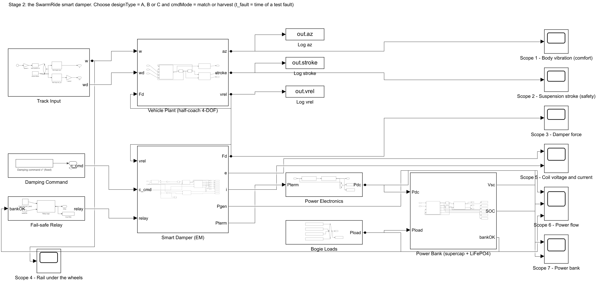
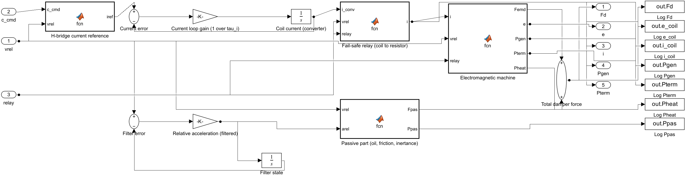
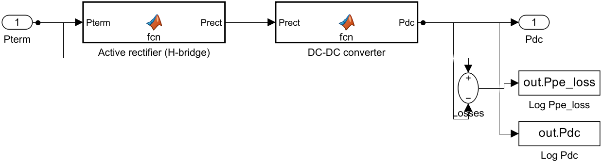
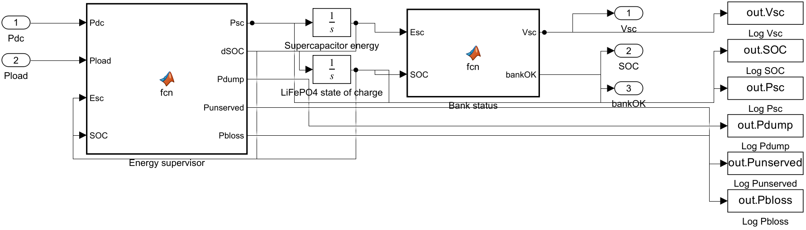
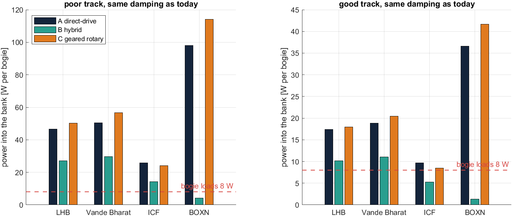
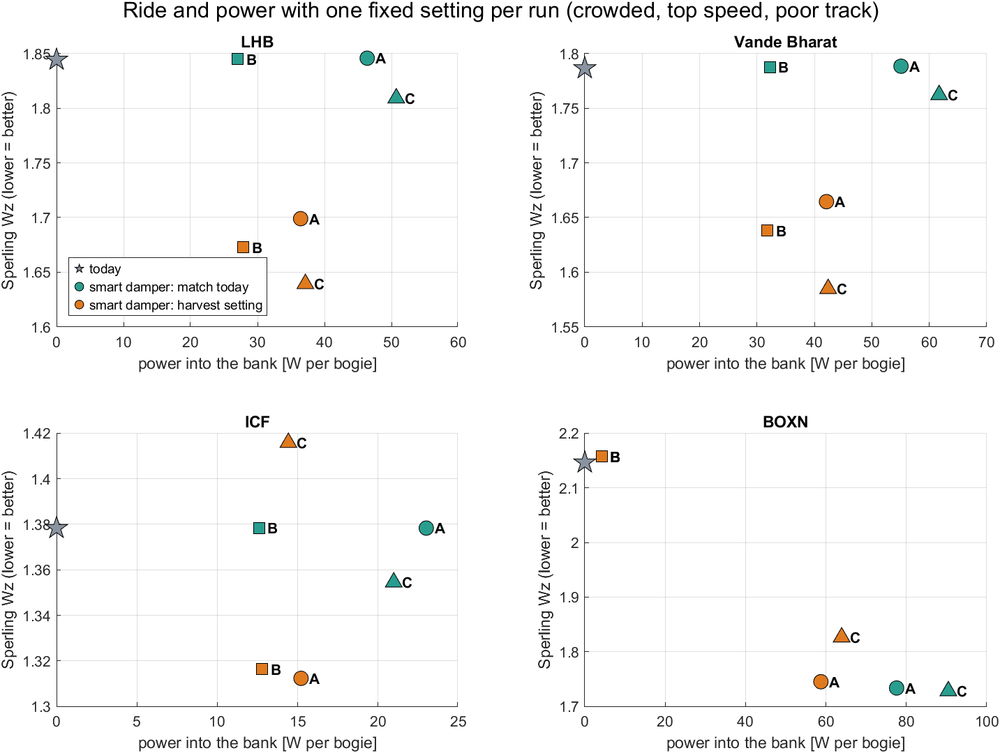
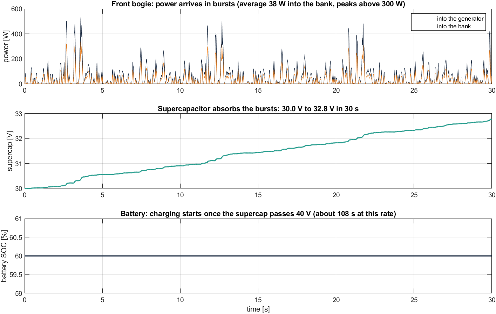

# Stage 2: The SwarmRide Smart Damper and Power Chain

**Project:** SwarmRide Bharat, a regenerative, load-adaptive, self-powered train suspension
**Model:** `models/SR_Stage2.slx` (built by `scripts/build_stage2.m`)
**Status:** complete and verified (4 of 4 checks passed)

> **In one line:** we replaced today's damper with an electromagnetic smart damper, a rectifier, a DC-DC converter and a power bank on every bogie. With the **same ride as today**, a crowded LHB bogie at 160 km/h on poor track puts **about 46–51 W into its bank**, which is **about 6× the 8 W its sensors, controller and radio need**.

---

## Contents

1. [Objective](#1-objective)
2. [What was done](#2-what-was-done)
3. [How to run it](#3-how-to-run-it)
4. [The model at a glance and the flow](#4-the-model-at-a-glance-and-the-flow)
5. [Damping Command](#5-damping-command)
6. [Smart Damper (EM)](#6-smart-damper-em)
7. [Fail-safe Relay](#7-fail-safe-relay)
8. [Power Electronics](#8-power-electronics)
9. [Bogie Loads](#9-bogie-loads)
10. [Power Bank and energy supervisor](#10-power-bank-and-energy-supervisor)
11. [Scopes, logs and settings](#11-scopes-logs-and-settings)
12. [Damper designs A, B, C and how they are sized](#12-damper-designs-a-b-c-and-how-they-are-sized)
13. [Results](#13-results)
14. [What the results mean for SwarmRide](#14-what-the-results-mean-for-swarmride)
15. [Limits (honest notes)](#15-limits-honest-notes)
16. [Glossary (new terms)](#16-glossary-new-terms)
17. [Next: Stage 3](#17-next-stage-3)

---

## 1. Objective

Stage 1 built a verified test rig and measured today's trains. Stage 2 answers four questions:

| # | Question | How we answer it |
|---|---|---|
| 1 | Can an electromagnetic damper give **exactly today's ride**? | Copy today's damping electrically and compare with Stage 1 |
| 2 | How much power actually **reaches the bank** after every loss? | Model the coil, rectifier, DC-DC and bank; count every watt |
| 3 | Is the power enough to run the **bogie's own electronics**? | Compare power into the bank with the 8 W bogie load |
| 4 | Is it **safe if anything fails**? | Trip a fault mid-run and check the damper becomes today's damper |

The rule from Stage 1 still holds: **same coach, same rail, same speed, same load; only the damper changes.** The Track Input and Vehicle Plant are built by the same shared code (`builders/`) as Stage 1.

---

## 2. What was done

| File | Role |
|---|---|
| `scripts/build_stage2.m` | Builds `SR_Stage2.slx` from code |
| `functions/sr_damper_design.m` | **Sizes the smart damper** for each vehicle and design (A, B, C) |
| `functions/sr_spring_rate.m` | Secondary spring stiffness at any load (air, coil, Casnub) |
| `scripts/sr_params.m` | Now also sets the damper, power-electronics, bank and load parameters (sections 9–10) |
| `functions/sr_energy_balance.m` | Energy bookkeeping: where every joule went |
| `functions/sr_sig.m` | Reads logged signals in a common format |
| `scripts/check_stage2.m` | Verification checks and the full results study (46 simulations) |
| `scripts/plot_stage2.m` | All Stage 2 figures |
| `builders/` | Shared block builders: track, coach, scopes, logs, MATLAB Function blocks |

The Stage 1 builder was moved to the shared `builders/` code. After the move, the Stage 1 baseline was re-run and is **identical** (wiring check 0.004%, same table), so nothing in Stage 1 changed.

---

## 3. How to run it

```matlab
sr_setup                                              % opens SR_Stage2 (use stage = 1; sr_setup for Stage 1)
trainType = 'LHB';  v_kmh = 160;  mload_t = 12;  trackType = 'poor';
designType = 'A';                                     % A direct-drive | B hybrid | C geared rotary
cmdMode = 'match';                                    % match = today's damping | harvest = coil load = coil resistance
t_fault = Inf;                                        % e.g. 15 to drop the fail-safe relay at 15 s
% press Run: 7 scope windows open
```

Batch study (about 11 minutes, results in `results/stage2_*`):

```matlab
run('scripts/check_stage2.m')
```

---

## 4. The model at a glance and the flow



```
Track Input ──w, wd──► Vehicle Plant ──vrel──► Smart Damper (EM) ──Fd──► back to the Plant
                                                 ▲   ▲      │ Pterm
                          Damping Command ──c*───┘   │      ▼
                          Fail-safe Relay ──relay────┘   Power Electronics ──Pdc──► Power Bank ◄── Bogie Loads
                                ▲                                                     │
                                └──────────────────── bankOK ─────────────────────────┘
```

### 4.1 New signals (all per bogie: front, rear)

| Signal | Meaning | Unit |
|---|---|---|
| **c_cmd** | Damping the smart damper should give | N s/m |
| **relay** | 0 = normal (converter in control), 1 = fail-safe (coil on the resistor) | – |
| **e** | Coil voltage of one damper, e = Kₑ·v | V |
| **i** | Coil current of one damper | A |
| **Pgen** | Mechanical power turned into electricity by the generator | W |
| **Pterm** | Electrical power delivered to the converter (after coil loss) | W |
| **Pdc** | Power into the bank (after rectifier and DC-DC) | W |
| **Pload** | Bogie electronics load | W |
| **Vsc, SOC** | Supercapacitor voltage, battery state of charge | V, 0–1 |
| **bankOK** | 1 while the bank can still power the controller | – |

### 4.2 What happens in every 1 ms step

1. **Track Input** and **Vehicle Plant** work exactly as in Stage 1. The Plant gives the stroke velocity **vrel**.
2. The **Damping Command** gives the wanted damping **c***.
3. Inside the **Smart Damper**, the H-bridge works out the current that gives that damping. The current loop follows it, the machine makes the force **Fd**, and Fd goes back into the coach.
4. The power the coil delivers (**Pterm**) goes through the **rectifier and DC-DC converter** into the **power bank** (**Pdc**).
5. The **energy supervisor** shares the power between the supercapacitor, the battery and the **bogie loads**.
6. If there is a fault, or the bank cannot run the controller, the **Fail-safe Relay** drops. The coil then drives a resistor, and the damper behaves like today's damper.

---

## 5. Damping Command

| Block | What it does | Parameter |
|---|---|---|
| **Damping command c\* (fixed)** (Constant) | Gives the damping the smart damper should produce, the same for both bogies | `P.c_cmd_emd` |

Two settings (`cmdMode`):

| Mode | c* | Meaning |
|---|---|---|
| **match** | Today's damping minus any passive part kept (design B) | An **electromagnetic copy of today's damper**: same ride, plus energy |
| **harvest** | Half the most the coil can give (load resistance = coil resistance) | The classic "fixed-load harvester" from research papers |

**Why it is fixed here:** Stage 2 tests the hardware. In **Stage 3** this block becomes the **LPV load-adaptive controller plus the Train Brain preview**.

---

## 6. Smart Damper (EM)



### 6.1 Blocks inside

```
c_cmd, vrel ──► H-bridge current reference ──iref──► Current error ─► Current loop gain ─► Coil current (∫) ─┐
                                                          ▲──────────────────────────────────────────────────┘
                                                          │ i_conv
vrel, relay ─────────────────────────────────► Fail-safe relay (coil to resistor) ──i──► Electromagnetic machine ──Femd──┐
vrel ─► Filter error ─► Relative acceleration (filtered) ─► Passive part (oil, friction, inertance) ──Fpas────────────────┴─► Total damper force ─► Fd
```

| Block | Type | What it does | Why |
|---|---|---|---|
| **H-bridge current reference** | MATLAB Function | Works out the current that gives the commanded damping: i = c·v / (n·Kₑ). Limits c to 0…Kₑ²/R_c and i to the rated current | **The current sets the damping.** The limits mean the damper never needs power from the bank and never exceeds its rating |
| **Current error, Current loop gain, Coil current (converter)** | Sum, Gain 1/τᵢ, Integrator | The converter's current loop: the coil current follows the reference with a 2 ms time constant | A real converter cannot change current instantly; this makes the model honest |
| **Fail-safe relay (coil to resistor)** | MATLAB Function | Normal: current from the converter. Relay dropped: current from the coil driving the fail-safe resistor, i = Kₑ·v / (R_c + R_fs) | The safety path needs no electronics and no power |
| **Electromagnetic machine** | MATLAB Function | Faraday and Lorentz laws, plus the power bookkeeping | The physics of the generator |
| **Filter error, Relative acceleration (filtered), Filter state** | Sum, Gain 1/τ_d, Integrator | Estimates the stroke acceleration from vrel | Needed for the inertance of design C, without a circular calculation |
| **Passive part (oil, friction, inertance)** | MATLAB Function | Design B: half-size oil damper or kept Casnub wedges. Design C: screw friction and rotor inertance | Each design's non-electric forces |
| **Total damper force** | Sum | Fd = F_EM + F_passive | The force that goes back into the coach |
| **Log …** | To Workspace | Saves Fd, e, i, Pgen, Pterm, Pheat, Ppas | Used by the checks and figures |

### 6.2 The physics (per bogie, n = 2 dampers)

```
Back-EMF (Faraday)          e     = Kₑ · v                       per damper [V]
Force (Lorentz)             F_EM  = n · Kₑ · i                   per bogie [N]
Damping set by the current  c     = F_EM / v = n·Kₑ·i / v
Most damping (coil shorted) c_max = n · Kₑ² / R_c                (no power harvested at this point)
Generator power             Pgen  = F_EM · v
Coil copper loss            Pcu   = n · R_c · i²
Power to the converter      Pterm = Pgen − Pcu
Electrical efficiency       η_e   = Pterm / Pgen = 1 − c / c_max
```

**The key trade-off:** the closer c gets to c_max, the more of the generated power is burnt in the coil itself. A damper needs **c_max well above the damping it normally uses** to harvest efficiently.

### 6.3 Parameters

| Param | Meaning | LHB design A | Source |
|---|---|---|---|
| `P.nd` | EM dampers per bogie | 2 | One per side (vertical secondary) |
| `P.Ke` | Machine constant per damper | 248 V·s/m (= N/A) | Sized (Section 12) |
| `P.Rc` | Coil resistance per damper | 1.0 Ω | Assumed winding |
| `P.cmax_emd` | Most EM damping per bogie | 123 kN·s/m | 1.25 × c needed for ζ = 0.25 at full load |
| `P.imax` | Current limit per damper | 60 A | 15 kN rated force ÷ Kₑ |
| `P.tau_i` | Current-loop time constant | 2 ms | Typical converter bandwidth |
| `P.c_oil` | Oil damper kept (design B) | 0 | Half of today's for B |
| `P.Fc`, `P.b_in` | Screw friction, inertance (design C) | 0, 0 | 150 N, 59 kg for C |
| `P.tau_d` | Acceleration filter | 2 ms | Small lag, adds a little damping |

---

## 7. Fail-safe Relay

| Block | What it does | Parameter |
|---|---|---|
| **Fault test (at t_fault)** (Step) | A test fault that switches from 0 to 1 at `t_fault` | `P.t_fault` (Inf = never) |
| **Relay logic** (MATLAB Function) | relay = 1 if there is a fault **or** the bank cannot power the controller | – |
| **Log relay** | Saves the relay state | – |

**The fail-safe resistor** is sized so the damper falls back to **exactly today's damping**:

```
c_failsafe = c_oil + n · Kₑ² / (R_c + R_fs) = c_today     →     R_fs = n·Kₑ² / (c_today − c_oil) − R_c
```

LHB design A: R_fs = 2.52 Ω. The relay is "normally closed" onto the resistor in hardware, so losing power **drops it automatically**. No software is needed to be safe.

---

## 8. Power Electronics



| Block | What it does | Parameter | Why |
|---|---|---|---|
| **Active rectifier (H-bridge)** | Turns the coil's alternating output into DC. Loses 5% | `P.eta_rect` = 0.95 | Same H-bridge that sets the current in Section 6 |
| **DC-DC converter** | Raises the voltage to charge the bank. Loses 6% | `P.eta_dcdc` = 0.94 | **Raises voltage, not energy**: power out = 94% of power in |
| **Losses** | Pterm − Pdc | – | For the energy balance |

These are **average models**: they keep the power flow and losses but skip 20 kHz switching, so a 30 s run takes seconds instead of hours.

---

## 9. Bogie Loads

| Block | Power | Covers |
|---|---|---|
| **Safety sensors (bearing, vibration, wheel)** | 4 W | Axle-box temperature, accelerometers, wheel-impact sensing |
| **Bogie controller** | 2 W | Microcontroller running the current loop and supervisor |
| **Radio to Train Brain** | 1 W | Data link to the locomotive |
| **Gate drivers and housekeeping** | 1 W | Power-electronics drivers, monitoring |
| **Total** | **8 W per bogie** | The pitch estimated 5–20 W |

---

## 10. Power Bank and energy supervisor



| Block | What it does | Parameter |
|---|---|---|
| **Energy supervisor** (MATLAB Function) | Decides where the power goes, every step (rules below) | Voltage thresholds, power limits |
| **Supercapacitor energy** (Integrator) | Energy stored in the supercap; V = √(2E/C) | 10 F, 12–48 V, starts at 30 V |
| **LiFePO4 state of charge** (Integrator) | Battery charge, 0–1 | 120 Wh (24 V × 5 Ah), starts at 60% |
| **Bank status** (MATLAB Function) | Supercap voltage, and bankOK = 1 while either store can run the loads | – |
| **Log …** | Saves Vsc, SOC, Psc, Pdump, Punserved, Pbloss | – |

**Energy supervisor rules** (a MATLAB Function in place of a Stateflow chart):

1. Harvested power and loads meet on the **supercapacitor** (the DC link).
2. Supercap above **40 V**: charge the **battery** (up to 300 W).
3. Supercap below **20 V**: the battery **supports** the loads (up to 100 W).
4. Supercap full (48 V) **and** battery full: **dump** the surplus into a resistor.
5. Both empty: loads cannot be served, and the relay drops to fail-safe.

**Why two stores:** the damper's power comes in **bursts**: peaks above 300 W against an average of about 36 W. A supercapacitor takes bursts without wear; a battery stores energy for stops and smooth track.

---

## 11. Scopes, logs and settings

| Scope | Shows |
|---|---|
| 1 Body vibration | Comfort (as Stage 1) |
| 2 Suspension stroke | Safety (as Stage 1) |
| 3 Damper force | The smart damper's force |
| 4 Rail under the wheels | Rail input (as Stage 1) |
| **5 Coil voltage and current** | e = Kₑ·v and the coil current, front and rear |
| **6 Power flow** | Into the generator, into the bank, bogie loads |
| **7 Power bank** | Supercap voltage and battery state of charge |

Each block logs its own signals (`out.<name>`), so the top level shows only the real flow. The solver is the same as Stage 1: ode4, fixed 1 ms step (0.5 ms for BOXN), 30 s.

---

## 12. Damper designs A, B, C and how they are sized

**Sizing rule** (`functions/sr_damper_design.m`), done once per vehicle at **full load**, because hardware cannot change with the passengers:

1. Find the damping **c_req** that gives the body mode a damping ratio of **ζ = 0.25** at full load, using the Stage 1 eigenvalue model. This is the most the Stage 3 controller is expected to ask for.
2. Size each design from c_req:

| Design | Idea | EM damping range | Passive part | Strength | Weakness |
|---|---|---|---|---|---|
| **A: direct-drive linear** | Magnets slide straight through the coil | 1.25 × c_req | none | Simple, no moving mechanism | Heavy copper |
| **B: hybrid** | Smaller EM damper + half-size oil damper (coaches) or kept friction wedges (BOXN) | 1.25 × c_req − c_oil | oil or wedges | Low risk, passive damping always there | Harvests about half |
| **C: geared rotary** | Ball screw spins a compact generator | 2.5 × c_req | screw friction 150 N, inertance 59 kg | Compact, big damping range | Wear, friction, rotor inertia |

**Sizes per vehicle** (per damper, 2 dampers per bogie):

| Vehicle | c_req (ζ = 0.25) | Today | A: Kₑ, copper | B: Kₑ, copper | C: Kₑ, peak torque |
|---|---|---|---|---|---|
| LHB | 98 kN·s/m | 35 | 248 N/A, **26 kg** | 230 N/A, 23 kg | 175 N/A, **27 N·m** |
| Vande Bharat | 137 kN·s/m | 50 | 292 N/A, **37 kg** | 270 N/A, 31 kg | 207 N/A, 27 N·m |
| ICF | 137 kN·s/m | 30 | 293 N/A, **37 kg** | 279 N/A, 33 kg | 207 N/A, 27 N·m |
| BOXN | 271 kN·s/m | 108 (assumed equivalent) | 411 N/A, **72 kg** | 260 N/A, 29 kg | 291 N/A, **71 N·m** |

Today's dampers deliver only 22–36% of c_req on coaches. That is why their ζ is 0.06–0.10 when crowded (Stage 1).

---

## 13. Results

### 13.1 Verification: is Stage 2 right?

| Check | Result | Meaning |
|---|---|---|
| **A1 Same ride as today** (design A, match) | Body acceleration within **1.10%** of peak; Wz **1.846 vs 1.844** | The EM copy of today's damper rides like today's damper. The small difference is the 2 ms current loop → **PASS** |
| **A2 Damping law** | Fitted c = 34,967 vs commanded 35,000 N·s/m (**0.09%**) | The H-bridge really sets the damping through the current → **PASS** |
| **A3 Energy balance** (design A match, design C harvest) | Residual **< 0.001%** | Every joule is accounted for: coil + converters + loads + bank + dump → **PASS** |
| **A4 Fail-safe** (designs A and B, fault at 15 s) | Damping after the fault = **35,000 N·s/m = today (0.00%)**; harvest 35.3 W → **0 W** | On any fault the damper becomes today's damper instantly → **PASS** |


**Left:** the force-versus-speed points before (teal) and after (red) the fault lie on today's damper line. **Right:** harvesting stops at the fault; damping continues.

### 13.2 Where the power goes (LHB, crowded, 160 km/h, poor track, same ride as today)


| Step | Power per bogie |
|---|---|
| Power the coach puts into the damper | **72.6 W** (same as the heat today's damper makes, 72.7 W) |
| Lost in the coil copper | 20.6 W |
| Lost in the rectifier and DC-DC | 5.6 W |
| **Into the bank** | **46.4 W** (64% of the input) |
| Bogie loads | 8.0 W |
| **Surplus stored** | **38.4 W** (about 38 Wh per hour of running; the 120 Wh battery fills in about 3 hours) |

### 13.3 All vehicles and designs (crowded, top speed, per bogie)

**Power into the bank, same ride as today (match):**



| Vehicle | Track | Today: heat | A | B | C | Loads |
|---|---|---|---|---|---|---|
| LHB, 160 km/h | poor | 73 W | **46 W** | 27 W | **51 W** | 8 W |
| LHB, 160 km/h | good | 27 W | 17 W | 10 W | 18 W | 8 W |
| Vande Bharat, 160 km/h | poor | 87 W | **55 W** | 32 W | **62 W** | 8 W |
| Vande Bharat, 160 km/h | good | 33 W | 21 W | 12 W | 22 W | 8 W |
| ICF, 110 km/h | poor | 31 W | 23 W | 13 W | 21 W | 8 W |
| ICF, 110 km/h | good | 12 W | **8.6 W** | **4.7 W** | **7.3 W** | 8 W |
| BOXN, 100 km/h | poor | 214 W | **78 W** | 4 W | **90 W** | 8 W |
| BOXN, 100 km/h | good | 85 W | 29 W | 1 W | 33 W | 8 W |

**Ride versus power with one fixed setting:**



| Vehicle | Today Wz | Match A / B / C | Harvest A / B / C |
|---|---|---|---|
| LHB | 1.84 | 1.85 / 1.85 / **1.81** | 1.70 / 1.67 / **1.64** |
| Vande Bharat | 1.79 | 1.79 / 1.79 / 1.76 | 1.66 / 1.64 / **1.58** |
| ICF | 1.38 | 1.38 / 1.38 / 1.35 | 1.31 / 1.32 / 1.42 |
| BOXN | 2.15 | **1.73** / 2.16 / **1.73** | 1.75 / 2.16 / 1.83 |

**The power bank over a run:**



The power arrives in **bursts above 300 W** against an average of 36 W (front bogie). The supercapacitor rises smoothly from 30 V to 32.6 V in 30 s; at this rate the battery starts charging after about 2 minutes.

---

## 14. What the results mean for SwarmRide

| # | Finding | Evidence | Meaning |
|---|---|---|---|
| 1 | **Same ride, plus power** | Wz 1.846 vs 1.844; 46–62 W into the bank per LHB and Vande Bharat bogie on poor track | The smart damper can replace today's damper with **no comfort penalty** |
| 2 | **Self-powered bogie on normal track** | LHB, VB and BOXN put 2–11× their 8 W load into the bank | The bogie can run its own sensors, controller and radio |
| 3 | **Smooth track is the weak case** | ICF on good track: 7.3–8.6 W against 8 W of load; B and C fall short | The battery must cover long smooth stretches; ICF needs the efficient designs or a smaller load |
| 4 | **"Maximum power transfer" is the wrong goal** | Harvest setting takes more mechanical power (82 vs 73 W) but delivers less to the bank (36 vs 46 W) | Half the power then heats the coil. Keeping c well below c_max harvests more. **This is a design rule for Stage 3** |
| 5 | **More damping helps crowded coaches** | Harvest setting improves Wz on LHB 1.84 → 1.64–1.70 and VB 1.79 → 1.58–1.66 | Today's crowded coaches are under-damped (Stage 1). Stage 3's load-adaptive control can **improve comfort and keep efficiency high** at the same time |
| 6 | **For freight, the wedges must go** | BOXN B (EM damper beside the wedges): 4 W in, net −4 W, because the wedges lock the suspension | The freight product must **replace** the friction wedges, not sit beside them |
| 7 | **Replacing the wedges transforms the wagon ride** | BOXN A/C: RMS 0.344 → 0.140 m/s² (−59%), Wz 2.15 → 1.73, with 78–90 W into the bank | A very strong freight result, **to be confirmed with better Casnub data** (Section 15) |
| 8 | **Design C is the lead candidate** | Most power on LHB, Vande Bharat and BOXN (51–90 W), chain efficiency 61–71%, slightly better ride, compact (27–71 N·m generator) | **C for both products**, A as the reference, B as a low-risk coach retrofit |
| 9 | **Design A is heavy** | 26–37 kg copper per coach damper, 72 kg for BOXN | Direct-drive is not practical for freight |
| 10 | **It is safe** | Fail-safe gives exactly today's damping (0.00% error) | A failed SwarmRide damper is never worse than today's |

**Recommendation for Stage 3:** carry **design C** (and A as the reference) forward. Replace the fixed command with the **LPV load-adaptive controller**, keeping the damping well below c_max for efficiency, and add the **Train Brain preview**.

---

## 15. Limits (honest notes)

- **Average-model electronics:** fixed efficiencies (95%, 94%). Real converters are less efficient at light load, which matters most on smooth track.
- **Coil inductance is not modelled separately.** The 2 ms current loop stands in for it.
- **Design C:** the screw friction (150 N), rotor inertia and the 0.9 screw efficiency used for the torque estimate are assumptions. Wear and backlash are not modelled.
- **Copper and torque figures are first estimates** (effective flux density 0.6 T), not machine designs.
- **BOXN:** today's friction is smoothed, and the viscous "match" target (ζ = 0.10) is an assumption. The wedges also do lateral and warp jobs not in this vertical model, so removing them needs a full bogie study.
- **Battery behaviour over a journey** is extrapolated from 30 s runs; a long-run energy study is planned for Stage 4.
- **Vertical model only**, as in Stage 1, and many parameters remain assumed (see `MODEL_GUIDE.md`).

---

## 16. Glossary (new terms)

| Term | Meaning |
|---|---|
| **Kₑ (machine constant)** | Volts per m/s of stroke speed, and newtons per amp. The same number for both |
| **Back-EMF** | The voltage a moving magnet induces in the coil |
| **c_max** | The most damping the coil can give (coil shorted); no power is harvested there |
| **H-bridge / active rectifier** | Four switches that control the coil current and turn it into DC |
| **DC-DC converter** | Changes voltage level; cannot create energy |
| **Supercapacitor** | Stores energy in an electric field; takes fast bursts without wear |
| **LiFePO4** | Lithium iron phosphate battery: long life, safe chemistry |
| **SOC** | State of charge of the battery, 0–1 |
| **Fail-safe relay** | Switch that puts a resistor across the coil whenever power or control is lost |
| **Inertance** | A force proportional to relative acceleration, from the spinning rotor in design C |
| **Chain efficiency** | Power into the bank ÷ power into the damper |

---

## 17. Next: Stage 3

Replace the fixed **Damping Command** with the SwarmRide controllers and compare them head to head on the same rail:

| Controller | What it does |
|---|---|
| C0 | Today's passive damper (Stage 1) |
| C1 | Fixed-load harvester (Stage 2 harvest setting) |
| **C2 LPV load-adaptive** | Damping scheduled on measured load to hold ζ constant; passivity limit and efficiency limit |
| **C3 LPV + Train Brain preview** | C2 plus a feed-forward from the bump warning, t = d / v |

**Stage 3 outputs:** ride at empty, half and crowded load; power into the bank; and the comfort-versus-power curve for each controller.
