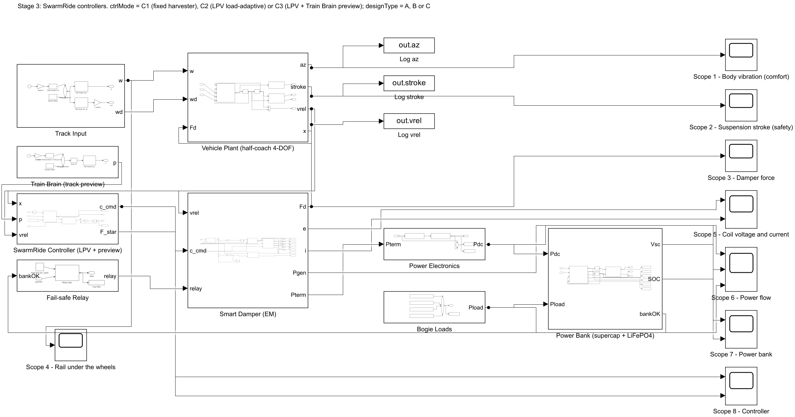
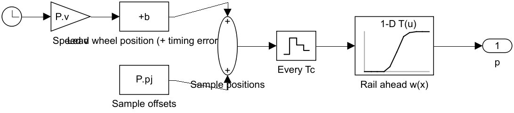
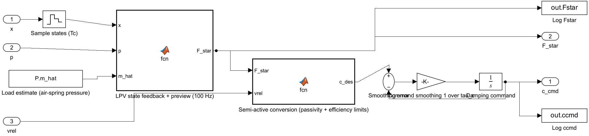
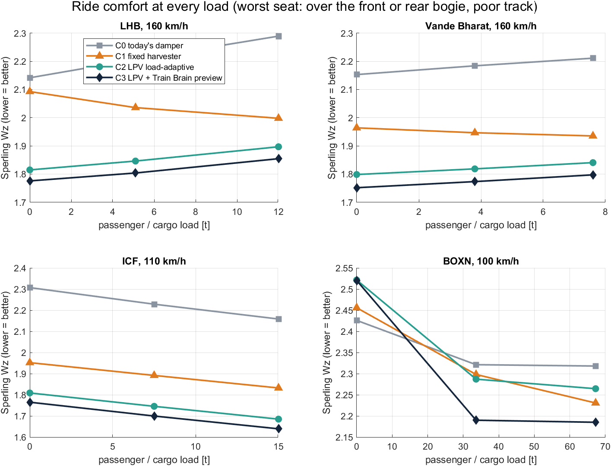
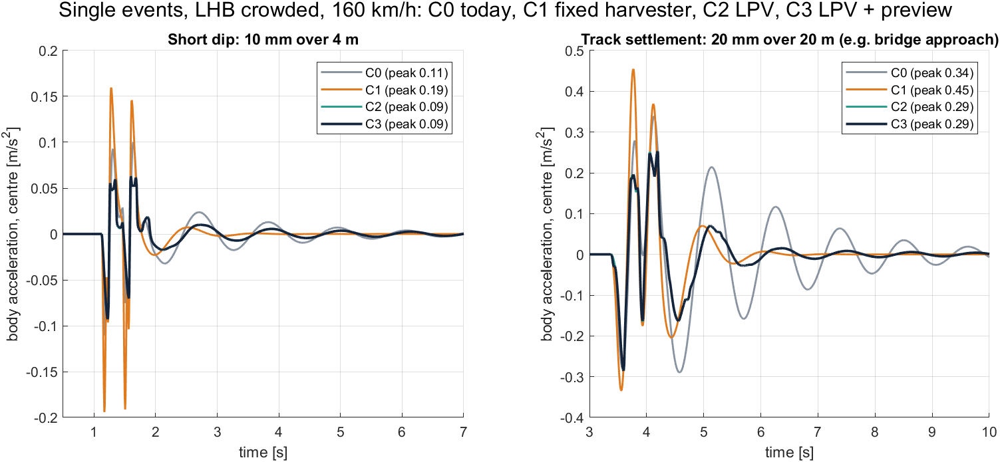
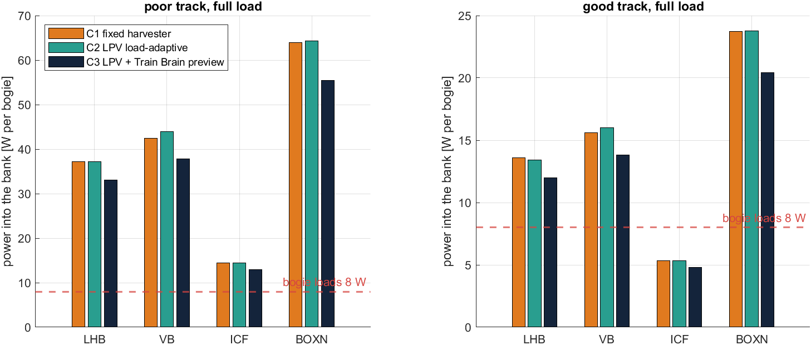
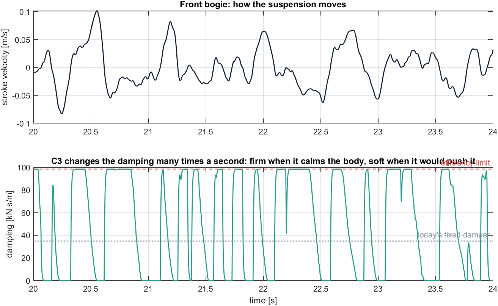

# Stage 3: The SwarmRide Controllers

**Project:** SwarmRide Bharat, a regenerative, load-adaptive, self-powered train suspension
**Model:** `models/SR_Stage3.slx` (built by `scripts/build_stage3.m`)
**Status:** complete and verified

> **In one line:** SwarmRide's load-adaptive controller keeps the ride **the same at every load** and about **20% better than today's damper** on LHB and Vande Bharat coaches (Sperling Wz 1.84 → 1.44 when crowded). It **halves body vibration**, halves the suspension travel, and still puts **28–30 W per bogie** into the bank, 3.5× what the bogie electronics need.

---

## Contents

1. [Objective](#1-objective)
2. [What was done](#2-what-was-done)
3. [How to run it](#3-how-to-run-it)
4. [The model at a glance and the flow](#4-the-model-at-a-glance-and-the-flow)
5. [Train Brain (track preview)](#5-train-brain-track-preview)
6. [SwarmRide Controller](#6-swarmride-controller)
7. [How the controller is designed (LPV + preview LQR)](#7-how-the-controller-is-designed-lpv--preview-lqr)
8. [Parameters](#8-parameters)
9. [Results](#9-results)
10. [What the results mean for SwarmRide](#10-what-the-results-mean-for-swarmride)
11. [Limits (honest notes)](#11-limits-honest-notes)
12. [Glossary (new terms)](#12-glossary-new-terms)
13. [Next: Stage 4](#13-next-stage-4)

---

## 1. Objective

Stage 2 showed the smart damper can **copy** today's damper and make power. Stage 3 shows it can ride **better** than today's damper, at **every load**, while still powering the bogie.

| Controller | What it does | Why it is in the test |
|---|---|---|
| **C0** Today's damper | Fixed oil damper (coaches) or friction wedges (BOXN); the Stage 1 model | The baseline to beat |
| **C1** Fixed-load harvester | The smart damper at one fixed setting (coil load = coil resistance) | What research harvesters do |
| **C2** LPV load-adaptive | Measures the load, picks the best gains for that load, and sets the damping every 10 ms | SwarmRide's core |
| **C3** LPV + Train Brain preview | C2 plus a warning of the rail ahead, from the locomotive and the fleet track map | SwarmRide's full system |

The golden rule still holds: **same coach, same rail, same speed, same load; only the damper and its controller change.** All runs use smart damper **design C** (geared rotary), the lead design from Stage 2.

---

## 2. What was done

| File | Role |
|---|---|
| `scripts/build_stage3.m` | Builds `SR_Stage3.slx` from the Stage 2 model, replacing the fixed damping command with the Train Brain and the SwarmRide Controller |
| `functions/sr_controller_design.m` | **Designs the controller:** an LQR at five loads (the LPV grid), with the preview of the rail ahead |
| `functions/sr_stage3_consts.m` | Fixed sizes: 100 Hz controller, 1 s preview, 5 load points |
| `scripts/sr_params_stage3.m` | Stage 3 settings (controller, load estimate, weights, limits); caches each design |
| `scripts/check_stage3.m` | Verification and the head-to-head study |
| `scripts/plot_stage3.m` | All Stage 3 figures |
| `tests/test_stage3.m` | Stage 3 checks in the verification suite |

---

## 3. How to run it

```matlab
stage = 3; sr_setup                                   % opens SR_Stage3
trainType = 'LHB';  v_kmh = 160;  mload_t = 12;  trackType = 'poor';
designType = 'C';                                     % smart damper design (C = lead design)
ctrlMode = 'C3';                                      % C1 fixed harvester | C2 LPV | C3 LPV + preview
load_err = 0.02;  preview_dt = 0;                     % load-estimate error, warning timing error [s]
c_floor_frac = 0;                                     % damping floor (0 = best comfort, higher = more power)
% press Run: 8 scope windows open (Scope 8 shows the controller)
```

To compare with today's damper, run the same scenario in Stage 1: `stage = 1; sr_setup`.
Full study (results in `results/stage3_*`): `run('scripts/check_stage3.m')`.

---

## 4. The model at a glance and the flow



```
Track Input ──► Vehicle Plant ──vrel──► Smart Damper (EM) ──Fd──► back to the Plant
                  │ x (8 states)            ▲ c_cmd
                  ▼                         │
Train Brain ──p──► SwarmRide Controller ────┘          (power electronics, bank, fail-safe: as Stage 2)
(rail around the train)   (LPV + preview, 100 Hz)
```

**What happens every step:**
1. The **Vehicle Plant** reports its 8 states x (body bounce and pitch, both bogies; positions and speeds) and the stroke speed vrel.
2. The **Train Brain** supplies the rail heights from 1.2 s behind to 1 s ahead of the lead wheel (p, 221 samples).
3. Every **10 ms** the **SwarmRide Controller** blends its gains for the measured load and computes the ideal force F* = −Kx·x − Kp·p.
4. The **semi-active conversion** turns F* into a damping command c the damper can actually give: it can only resist motion, and it stays below an efficiency limit. The command is smoothed (5 ms).
5. The **Smart Damper** sets its coil current to give that damping, harvests the power, and the rest is exactly Stage 2.

---

## 5. Train Brain (track preview)



| Block | What it does | Parameter |
|---|---|---|
| **Clock, Speed v, Lead wheel position (+ timing error)** | Where the lead wheel is, shifted by the warning's timing error | `P.v`, `P.s0`, `P.preview_dt` |
| **Sample offsets** | Positions of the 221 rail samples, from 120 samples behind to 100 ahead, one every Tc of travel | `P.pj` (0.44 m apart at 160 km/h) |
| **Sample positions, Every Tc** | Adds the offsets to the lead-wheel position; updates every 10 ms | `P.Tc` = 10 ms |
| **Rail ahead w(x)** | Reads the rail height at each sample position | Same rail as the Track Input |

**In the real train** this information comes from the locomotive's lead bogie and the fleet track map, sent over the train data bus. The samples behind the lead wheel are what the rear wheels are about to meet.

---

## 6. SwarmRide Controller



| Block | What it does | Why |
|---|---|---|
| **Sample states (Tc)** | Holds the coach states every 10 ms | A real bogie controller runs at a fixed rate (100 Hz) |
| **Load estimate (air-spring pressure)** | The body mass the controller believes: true mass × (1 + error) | Coaches already measure air-spring pressure; 2% error assumed |
| **LPV state feedback + preview (100 Hz)** | Finds the two load-grid points around the measured load, blends their gains, and computes F* = −Kx·x (C2) or −Kx·x − Kp·p (C3) | **Load-adaptive:** different gains for empty and crowded. **Preview:** acts on the rail ahead |
| **Semi-active conversion (passivity + efficiency limits)** | c = F*·v / (v² + ε²), limited to c_floor … c_cap (c_floor = 0 by default). C1 uses one fixed c | A damper cannot push, only resist; above c_cap the coil wastes too much power as heat (Stage 2 finding) |
| **Smoothing error, Command smoothing, Damping command** | First-order filter, τ = 5 ms | Removes chatter so the damper does not add high-frequency harshness |
| **Log Fstar, Log ccmd** | Save F* and the damping command | For the figures |

---

## 7. How the controller is designed (LPV + preview LQR)

`functions/sr_controller_design.m`, run once per vehicle and speed (then cached):

1. **Five load points** from empty to full. At each, the coach is linearised **without a secondary damper**, because the controller provides all the damping. The air springs stiffen with load, so every point has its own model. This set of models is the **LPV** (linear parameter-varying) description of the coach.
2. **Discretise** each model at the controller rate (10 ms).
3. **Add the rail as states.** A shift register holds the 221 rail samples. Each step the samples move one place, and a new one enters 1 s ahead. The 8 wheel inputs (height and speed under each wheel) are a fixed interpolation of these samples.
4. **LQR** (linear-quadratic regulator) on the coach plus rail states minimises:

   ```
   J = Σ  (a_front/0.1)² + (a_rear/0.1)²   +   (stroke_1/0.02)² + (stroke_2/0.02)²   +   rw·(|F|/5000)²
          comfort over both bogies             safety (stroke)                         damper effort
   ```

   The result is F* = −Kx·x − Kp·p:
   - **Kx** is the feedback part, the same for C2 and C3.
   - **Kp** is the preview part, used only by C3. It weighs the rail ahead most strongly just before the wheels reach it.
5. **Check:** every load point must be stable in closed loop (spectral radius < 1).

**Why this design:**
- **LQR** balances comfort, safety and effort in one number, and is a standard, provable method.
- **Gain scheduling on load (LPV)** keeps the ride equally good empty or crowded. That's the weakness found in Stage 1.
- **Preview LQR** is the textbook way to use known future disturbances.
- **Clipping to what the damper can do** ("clipped-optimal" semi-active control) keeps it passive and safe.

---

## 8. Parameters

| Param | Meaning | Value | Why |
|---|---|---|---|
| `P.Tc` | Controller sample time | 10 ms (100 Hz) | Realistic bogie microcontroller rate |
| `P.Na`, `P.Nb` | Preview samples ahead / behind | 100 / 120 | 1 s ahead; behind covers the rear wheels down to about 50 km/h |
| `P.m_hat` | Load estimate | m × (1 + 0.02) | 2% weighing error assumed |
| `P.a_ref`, `P.s_ref`, `P.F_ref` | Reference acceleration, stroke, force | 0.1 m/s², 20 mm, 5 kN | Normalise the LQR weights |
| `P.rw` | Force weight | 3 | Best comfort in the sweep (Section 9.4) for both C2 and C3 |
| `P.c_floor` | Damping floor | 0 (default) | Raising it trades comfort for power (Section 9.4) |
| `P.c_cap` | Efficiency limit on the EM damping | c_req (ζ = 0.25 damping) | Keeps the coil at least 60% efficient for design C |
| `P.eps_v` | Velocity smoothing in c = F/v | 5 mm/s | Avoids dividing by zero |
| `P.tau_c` | Command smoothing | 5 ms | Removes chatter |
| `P.c_fix` | C1 fixed setting | 0.5 × c_max | Load resistance = coil resistance |

---

## 9. Results

All runs: smart damper design C, top service speed, crowded unless stated. Today's damper (C0) is the Stage 1 model on the same rail.

### 9.1 Verification

| Check | Result | Meaning |
|---|---|---|
| **A1 Stable at every load** | Closed-loop spectral radius 0.94–0.9999 at all 5 load points, all 4 vehicles | Every LPV gain set is stable → **PASS** |
| **A2 Passive** | The damper never needs bank power (min −0.2 W, current-loop lag only); command always within 0 … c_cap | The controller only ever resists motion → **PASS** |
| **A3 Energy balance** | Residual 0.0004% | Every joule still accounted for → **PASS** |
| **A4 Fail-safe under the controller** | After a fault the damping is 35,085 vs today 35,000 N·s/m (the difference is screw friction and inertance); harvesting 0 W | A failed SwarmRide damper is today's damper → **PASS** |
| **A5 Warning timing ±20 ms** | Wz 1.440–1.441 (exact timing 1.440, no preview 1.464) | Insensitive to small timing errors → **PASS**. A 0.5 s error does hurt (Wz 1.48) |
| **A6 Load estimate ±10% (half load)** | Wz 1.436 either way (today 1.780) | Robust to weighing errors → **PASS** |

The verification suite (`scripts/run_all_checks.m`) now includes these Stage 3 checks; the latest results are in `results/verification_report.txt`.

### 9.2 Ride at every load (the core result)


**Sperling Wz at the centre of the coach, poor track** (lower = better; 1 very good, 2 good):

| Vehicle | Load | C0 today | C1 fixed harvester | C2 LPV | **C3 LPV + preview** | C3 vs today |
|---|---|---|---|---|---|---|
| LHB, 160 km/h | empty | 1.73 | 1.74 | 1.46 | **1.44** | −17% |
| | 5.1 t | 1.78 | 1.66 | 1.46 | **1.44** | −19% |
| | 12 t | 1.84 | 1.59 | 1.46 | **1.44** | **−22%** |
| Vande Bharat, 160 km/h | empty | 1.75 | 1.57 | 1.43 | **1.40** | −20% |
| | 3.8 t | 1.77 | 1.54 | 1.43 | **1.41** | −20% |
| | 7.6 t | 1.79 | 1.52 | 1.44 | **1.42** | **−21%** |
| ICF, 110 km/h | empty | 1.45 | 1.62 | 1.38 | **1.36** | −7% |
| | 7.5 t | 1.34 | 1.50 | 1.29 | **1.28** | −4% |
| | 15 t | 1.38 | 1.41 | 1.25 | **1.24** | −10% |
| BOXN, 100 km/h | empty | 2.28 | 2.25 | 2.31 | 2.31 | **+1%** |
| | 33.6 t | 2.15 | 2.03 | 1.86 | **1.79** | −17% |
| | 67.2 t | 2.15 | 1.82 | 1.69 | **1.66** | **−23%** |

**How to read it:** today's ride gets worse as the coach fills up (LHB 1.73 → 1.84). SwarmRide's stays flat (1.44 empty, half or crowded). That is the **load-adaptive (LPV) promise, proven**. The fixed harvester (C1) helps some cases and hurts others: it makes the empty ICF coach ride worse than today. One fixed setting cannot suit every load.

### 9.3 Worst seat (over the bogies)



| Vehicle (full load) | Today | C3 | Change |
|---|---|---|---|
| LHB | 2.29 | 1.75 | **−24%** |
| Vande Bharat | 2.21 | 1.67 | **−24%** |
| ICF | 2.16 | 1.67 | **−23%** |
| BOXN | 2.32 | 2.19 | −6% |

Passengers over the bogies gain the most, because the controller damps pitch as well as bounce.

**Body vibration (RMS, full load):**
- LHB 0.174 → 0.086 m/s² (**−51%**)
- Vande Bharat 0.159 → 0.082 (**−48%**)
- ICF 0.070 → 0.052 (−26%)
- BOXN 0.344 → 0.126 (**−63%**)

**Suspension travel:** LHB 25 → 12 mm, Vande Bharat 25 → 13 mm.

### 9.4 Comfort vs power


| Setting (LHB crowded, poor track) | Wz | Into the bank |
|---|---|---|
| C0 today's damper | 1.84 | 0 W |
| C1 fixed harvester, best setting | 1.555 | 43 W |
| C1 fixed harvester, most power | 1.570 | 43 W |
| **C2 LPV (force weight 3)** | 1.464 | 31 W |
| **C3 LPV + preview (force weight 3)** | **1.440** | 28 W |
| C3 with damping floor 0.3 × c_req | 1.486 | 36 W |
| C3 with damping floor 0.6 × c_req | 1.524 | 40 W |

**How to read it:**
- No fixed setting can reach SwarmRide's comfort. The best fixed setting is Wz 1.555, against 1.44.
- At the same power (about 40 W), SwarmRide still rides better (1.52 vs about 1.57).
- The **damping floor** is a single dial: an operator can choose more comfort (passenger service) or more power (freight, where sensors matter most).

### 9.5 Single events



| Event (LHB crowded) | Today: peak (worst seat) | C2 / C3: peak (worst seat) | Body RMS over the event |
|---|---|---|---|
| Short dip, 10 mm over 4 m | 0.110 (0.246) m/s² | 0.093 (0.205) | 0.0142 → 0.0102 (−28%) |
| Track settlement, 20 mm over 20 m | 0.339 (0.967) m/s² | 0.286 (0.761) | 0.077 → 0.047 (**−39%**) |

SwarmRide calms the coach faster after every event. **The preview (C3) adds nothing here.** A damper that can only resist motion cannot act before the motion starts (Section 10).

### 9.6 Power into the bank



| Vehicle (full load) | Poor track: C1 / C2 / C3 | Good track: C1 / C2 / C3 | Bogie loads |
|---|---|---|---|
| LHB | 35 / 31 / 28 W | 13 / 11 / 10 W | 8 W |
| Vande Bharat | 38 / 35 / 30 W | 14 / 13 / 11 W | 8 W |
| ICF | 14 / 15 / 13 W | 5.2 / 5.5 / 4.9 W | 8 W |
| BOXN | 63 / 65 / 56 W | 24 / 24 / 21 W | 8 W |

### 9.7 How the controller works in time



The damping changes many times a second. It is firm when resisting the motion calms the body, and soft when resisting would push the body. A fixed damper cannot do this.

---

## 10. What the results mean for SwarmRide

| # | Finding | Evidence | Meaning |
|---|---|---|---|
| 1 | **Same ride at every load** | LHB C3 Wz 1.44 empty, half and crowded; today 1.73 → 1.84 | The load-adaptive (LPV) design works; this was today's weakness in Stage 1 |
| 2 | **About 20% better ride on modern coaches** | LHB −22%, Vande Bharat −21% when crowded; worst seat −24% | A clear, measurable comfort gain for passengers |
| 3 | **Body vibration halved** | RMS −48% to −51% (LHB, VB), −63% (loaded BOXN) | Less fatigue for passengers and less load on the body and cargo |
| 4 | **Still self-powered** | 28–30 W per coach bogie, 56 W per loaded wagon bogie on poor track | 3.5–7× the 8 W bogie load on normal track |
| 5 | **Comfort and power on one dial** | Damping floor: 28 W at Wz 1.44 up to 40 W at Wz 1.52 | Operators choose; SwarmRide beats every fixed setting on comfort |
| 6 | **Preview adds little with a resist-only damper** | C3 vs C2: 1–2% on rough track, 0% on single events | Honest finding: to use the Train Brain warning fully, the damper must briefly push |
| 7 | **Robust** | Timing ±20 ms, load estimate ±10%: no meaningful change; fail-safe intact | Safe for real-world sensor errors |
| 8 | **Empty goods wagon: no ride gain** | BOXN empty Wz 2.28 → 2.31 | For empty wagons the value is self-powered sensing (17 W), not comfort |
| 9 | **Smooth track on ICF still short of power** | 4.9–5.5 W against 8 W | The battery must cover it, or ICF needs a lower-power sensor set |

**What would make the preview count (next step):** the smart damper's H-bridge can also drive the coil as a motor. Spending a little banked energy for a fraction of a second at known bad spots (bridge approaches, points, settlements) would let the Train Brain warning *lift or lower* the body before the bump. In effect: **harvest everywhere, spend at the worst places.** This is a natural Stage 4 experiment.

---

## 11. Limits (honest notes)

- **Full-state feedback:** the controller uses all 8 coach states from the simulation. A real bogie needs an estimator (accelerometers + stroke sensors → states); that adds some error.
- **Gains designed for one speed per vehicle** (its top service speed). Other speeds need their own gain table (cheap to compute and cached).
- **Vertical model only**, as in Stages 1–2. Lateral comfort and stability are not yet modelled.
- **Average-model electronics and assumed parameters** (Stage 2 limits still apply).
- **Preview with a resist-only damper is weak** (finding 6); active preview is untested.
- **Empty goods wagon** is not improved; frequency-weighted tuning might help.

---

## 12. Glossary (new terms)

| Term | Meaning |
|---|---|
| **LPV (linear parameter-varying)** | A set of linear models that change with a measured parameter (here: load) |
| **Gain scheduling** | Choosing controller gains from that measured parameter, blending between grid points |
| **LQR** | Linear-quadratic regulator: the controller that minimises a weighted sum of comfort, safety and effort |
| **Preview control** | Using known future inputs (the rail ahead) in the controller |
| **Semi-active** | A damper whose strength can change, but which can only resist motion, never push |
| **Clipped-optimal** | Compute the ideal force, then keep only the part the semi-active damper can produce |
| **Spectral radius** | Largest magnitude of the closed-loop eigenvalues of a discrete system; below 1 means stable |
| **Damping floor** | Minimum damping, used to trade comfort for harvested power |
| **Worst seat** | The worse of the floor over the front bogie and over the rear bogie |

---

## 13. Next: Stage 4

1. **Self-powered health sensing:** bearing temperature, wheel impacts and coupler checks powered by the bank over a long journey (energy over hours, smooth and rough stretches).
2. **Active preview at known bad spots:** spend banked energy to push briefly, using the Train Brain warning.
3. **Investor dashboard:** a live web view of the coach, the damper, the bank and the controllers side by side.
