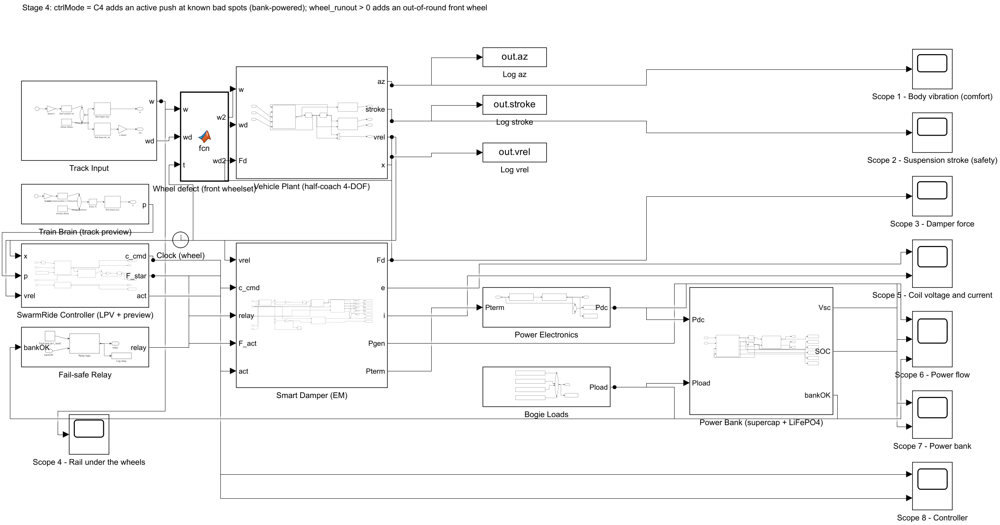

# Stage 4: Active Push, Long Journeys and Self-Powered Health Sensing

**Project:** SwarmRide Bharat, a regenerative, load-adaptive, self-powered train suspension
**Model:** `models/SR_Stage4.slx` (built by `scripts/build_stage4.m`)
**Status:** complete and verified

> **In one line:** at a known bad spot the smart damper now **pushes** with its own banked energy and cuts the worst-seat jolt by **80%** for about 0.1 Wh. With a simple sleep rule the bogie **stays self-powered through a whole day and night** on every vehicle tested. The same coil also **catches a hot axle and an out-of-round wheel** that trackside checks would miss or catch late.

---

## Contents

1. [Objective](#1-objective)
2. [What was done](#2-what-was-done)
3. [How to run it](#3-how-to-run-it)
4. [What is new in the model](#4-what-is-new-in-the-model)
5. [Active push at known bad spots (C4)](#5-active-push-at-known-bad-spots-c4)
6. [A full day on one bogie's power bank](#6-a-full-day-on-one-bogies-power-bank)
7. [Self-powered health sensing](#7-self-powered-health-sensing)
8. [Verification](#8-verification)
9. [Investor dashboard](#9-investor-dashboard)
10. [What the results mean for SwarmRide](#10-what-the-results-mean-for-swarmride)
11. [Limits (honest notes)](#11-limits-honest-notes)
12. [Next steps](#12-next-steps)

---

## 1. Objective

Stage 3 left three open questions:

| # | Question | Stage 4 answer |
|---|---|---|
| 1 | The Train Brain warning added almost nothing, because a resist-only damper cannot act before the bump. **Can a brief push fix that, and what does it cost?** | Controller **C4**: inside a short window around known bad spots, the smart damper may **push**, using its own banked energy |
| 2 | 30 s runs prove power in, but **does the bogie stay powered for a whole day**, with stations, smooth track and a night parked? | A **journey simulator** runs the bogie bank for 24 h on representative passenger and freight days |
| 3 | The pitch promises **self-powered safety sensing**. Can the bogie actually see faults? | **Hot axle**: on-bogie sensor vs trackside checkpoints. **Wheel defect**: an out-of-round wheel seen in the damper's own coil signal |

---

## 2. What was done

| File | Role |
|---|---|
| `scripts/build_stage4.m` | Builds `SR_Stage4.slx` from Stage 3: active windows, force path in the smart damper, wheel-defect input |
| `scripts/sr_params_stage4.m` | Known bad spots, push window, wheel defect |
| `functions/sr_bank_step.m` | The Simulink energy-supervisor rules as a function (one step) |
| `functions/sr_journey.m` | Runs a bogie bank over a whole route from Simulink-measured power tables |
| `functions/sr_hot_axle.m` | Bearing heat model with a developing fault; on-bogie vs trackside detection (Monte Carlo) |
| `scripts/check_stage4.m`, `scripts/plot_stage4.m` | Verification, results and figures |
| `tests/test_stage4.m` | Stage 4 checks in the verification suite |
| `scripts/export_dashboard.m`, `dashboard/index.html` | The investor dashboard |

---

## 3. How to run it

```matlab
stage = 4; sr_setup                                   % opens SR_Stage4 (or open models/SR_Stage4.slx)
trainType = 'LHB';  v_kmh = 160;  mload_t = 12;  designType = 'C';
trackType = 'settlement';  ctrlMode = 'C4';           % push at the known bad spot
act_window_s = 1;                                     % push allowed 1 s before to 1 s after the spot
wheel_runout = 0;                                     % e.g. 0.5e-3 for an out-of-round front wheel
% press Run
```

Full study: `run('scripts/check_stage4.m')`. Dashboard data: `run('scripts/export_dashboard.m')`, then open `dashboard/index.html`.

---

## 4. What is new in the model



| Block | Where | What it does | Why |
|---|---|---|---|
| **Active windows (known bad spots)** | SwarmRide Controller | For C4, outputs 1 for a bogie whose centre is within the window around a known bad spot (from the fleet track map) | The push is spent only where it matters, and only for a few seconds |
| **H-bridge current reference** (updated) | Smart Damper | Outside a window: the damping law, as in Stage 3. Inside: the coil current follows the ideal force F* directly, so the coil runs as a **motor** when F* pushes | The same H-bridge that harvests can also push; the power comes from the bogie bank |
| **Wheel defect (front wheelset)** | Between Track Input and the coach | Adds a radial run-out of order n to the front wheelset (n times per revolution) | Health-sensing demo; off by default |
| **Log act** | Controller | Saves the windows | For the checks and figures |

With the active windows off (C3) and no wheel defect, Stage 4 reproduces Stage 3 exactly (Section 8).

---

## 5. Active push at known bad spots (C4)

**Test:** crowded LHB coach (12 t of passengers) at 160 km/h, design C. Two known bad spots from the fleet track map:
a **track settlement** (20 mm deep over 20 m) and a **short dip** (10 mm over 4 m). Same rail and same coach every time; only the damper changes.


| Event | Controller | Peak at the centre [m/s²] | Worst seat [m/s²] | RMS [m/s²] | Bank energy spent | Peak push power |
|---|---|---|---|---|---|---|
| Settlement | C0 today's damper | 0.339 | 0.967 | 0.077 | — | — |
| Settlement | C3 resist only | 0.286 | 0.764 | 0.047 | — | — |
| Settlement | **C4 push** (1 s window) | **0.128** | **0.196** | **0.016** | 345 J (0.1 Wh) | 1.5 kW |
| Short dip | C0 today's damper | 0.110 | 0.246 | 0.014 | — | — |
| Short dip | C3 resist only | 0.093 | 0.205 | 0.010 | — | — |
| Short dip | **C4 push** (1 s window) | **0.042** | **0.082** | **0.005** | 20 J | 0.13 kW |

**What this means**

- **The worst seat improves by 80% at the settlement and 67% at the dip, compared with today.** Against Stage 3 (C3), the push removes three quarters of the jolt that was left. In Stage 3 the Train Brain preview added only about 2%. Now the warning really pays off, because the damper can act *before* the wheel reaches the spot.
- **The cost is tiny.** 345 J is about 0.1 Wh, less than 0.1% of the 120 Wh battery. On rough track at 120 km/h an LHB bogie harvests that back in about 25 s.
- **The power is short and sharp.** It peaks at 1.5 kW for under a second, so the **supercapacitor** supplies it (10 F at 32 V holds about 5 kJ), not the battery. The H-bridge and coil must be rated for this peak (Section 11).
- **The window length hardly matters.** A push allowed 0.5 s, 1 s or 2 s around the spot gives the same result (worst seat 0.200 / 0.196 / 0.196). The controller only pushes when the spot is near, so a wider window costs nothing. 1 s is the default.
- **No known spot, no push.** With no bad spots listed, C4 is identical to C3 (Section 8). The push is a targeted tool, not an always-on active suspension.

---

## 6. A full day on one bogie's power bank

A 30 s Simulink run proves power in. **A day proves self-powered.** Running Simulink for 24 h is too slow, so the journey simulator does it in two steps:

1. **Power tables from Simulink (Stage 3, C3, design C).** These give the power into the bank at three speeds, on good and on poor track:

| Vehicle | Speeds [km/h] | Good track [W] | Poor track [W] |
|---|---|---|---|
| LHB coach, half load | 80 / 120 / 160 | 2.2 / 5.2 / 10.7 | 5.9 / 14.3 / 29.5 |
| Vande Bharat, half load | 80 / 120 / 160 | 3.1 / 6.4 / 13.2 | 8.2 / 17.6 / 36.0 |
| ICF coach, half load | 60 / 90 / 110 | 1.4 / 2.8 / 4.6 | 3.6 / 7.5 / 12.4 |
| BOXN wagon, loaded | 50 / 75 / 100 | 3.5 / 10.7 / 20.4 | 9.3 / 28.8 / 55.4 |
| BOXN wagon, empty | 50 / 75 / 100 | 0.7 / 2.3 / 6.4 | 2.1 / 6.7 / 17.6 |

2. **A route, minute by minute.** The bank (supercap + battery + supervisor rules, identical to the Simulink one; Section 8) is stepped through a whole day:
   - **Passenger day:** 10 legs of 50 km with station stops, then **10 h parked** overnight.
   - **Freight round trip:** 300 km loaded, 3 h in the yard, 300 km empty, then **10 h parked**.

   The track mixes good and poor stretches. The bogie electronics (sensors, processor, radio) need **8 W** when awake.


| Vehicle and day | Harvested | Electronics always on (8 W) | **Standby when parked (1 W after 5 min)** | Standby, all-smooth track |
|---|---|---|---|---|
| LHB, passenger day (14.2 h) | 45 Wh | used 114 Wh; **11.8 Wh not served**; battery 60% → 10% | used 44 Wh; nothing missed; **60% → 60%** | 60% → 48% |
| Vande Bharat, passenger day (14.2 h) | 56 Wh | used 114 Wh; 1.9 Wh not served; 60% → 10% | used 44 Wh; nothing missed; **60% → 69%** | 60% → 54% |
| ICF, passenger day (15.8 h) | 28 Wh | used 126 Wh; 39.5 Wh not served; 60% → 10% | used 57 Wh; nothing missed; **60% → 36%** | 60% → 28% |
| BOXN, freight round trip (20 h) | 104 Wh | used 160 Wh; 9.6 Wh not served; 60% → 10% | used 70 Wh; nothing missed; **60% → 80%** | 60% → 55% |

**What this means**

- **"Always on" fails, and that is an important finding.** While moving, every vehicle earns more than it spends. But 8 W for a 10 h night is 80 Wh, more than a whole day of harvesting. The battery hits its 10% floor and the sensors go dark. On its own, a full bank runs the 8 W electronics for only about 13 h with no motion.
- **A simple sleep rule fixes it.** After 5 minutes standing still, the electronics drop to 1 W: a slow heartbeat and a wake-on-motion sensor. With this rule the **LHB and Vande Bharat break even or gain, the freight wagon gains 20 points**, and nothing is ever left unpowered.
- **Two cases still drain slowly, and we say so:**
  - The **slow ICF coach** (net −24 points a day). Starting from 60%, it would reach its floor in about two days.
  - **Any vehicle on all-smooth track** (−5 to −12 points a day).
  - Both need one of the following:
    - a top-up from the coach's own electrical supply when it is available;
    - a lower sensing rate on smooth track;
    - a slightly larger battery.

  This is a design rule for the product, not a showstopper.

---

## 7. Self-powered health sensing

### 7.1 Hot axle: on-bogie sensor vs trackside checkpoints

A bearing fault makes the axle box heat up faster and faster. The model is illustrative: 35 °C ambient, 60 °C normal running, an exponential fault. It crosses the **90 °C alarm 38 min** after the fault starts and the **180 °C failure risk 68 min** after it, so there is a **30 min window to act**.


| Detection | How often it looks | Result (2,000 random fault start times) |
|---|---|---|
| **SwarmRide on-bogie sensor** (powered by the bank) | every 10 s | alarm within 10 s of 90 °C, **every time** |
| Trackside hot-box checkpoints | one every 250 km (2.5 h at 100 km/h) | median **77 min late**; **82% of faults pass 180 °C before any checkpoint sees them** |

**Meaning:** the danger window (30 min) is much shorter than the gap between checkpoints (2.5 h). A sensor that rides on the bogie is the only way to catch it reliably. The power bank is what makes such a sensor practical without wiring every wagon.

### 7.2 Wheel defect seen in the damper's own coil

An out-of-round wheel lifts the bogie once (eccentric) or several times (polygonal) per wheel turn. The damper's coil already produces a voltage proportional to its speed, so the defect appears as a **sharp peak at n × wheel-turn frequency**. At 160 km/h with a 0.915 m wheel that frequency is 15.5 Hz × n. **No extra sensor is needed.**


| Case (front wheelset) | Frequency | Front-bogie coil signal | Rear-bogie coil signal | vs healthy |
|---|---|---|---|---|
| Healthy | 15.5 Hz | 0.082 V | 0.086 V | ×1 |
| Eccentric, 0.5 mm | 15.5 Hz | **0.425 V** | 0.086 V | **×5** |
| Three-lobed, 0.3 mm | 46.4 Hz | **0.240 V** | 0.003 V | **×204** |

**Meaning:** the defect stands far above the healthy signal. Because only the front bogie lights up, it also tells maintenance **which wheelset** to look at. The comparison works best at higher orders (polygonal wear), where the healthy spectrum is quiet.

---

## 8. Verification

Stage 4 adds 9 checks to the automatic suite (`scripts/run_all_checks.m`). **All 73 checks pass** (Stages 1–4); see `results/verification_report.txt`.

| Check | Result | Why it matters |
|---|---|---|
| Stage 4 with its new parts off reproduces Stage 3 | difference 0 | Stage 4 adds parts; it does not change what was already proven |
| Journey bank model vs Simulink bank (same power, 30 s) | supercap 32.013 V vs 32.013 V | The 24 h days use the same rules as the Simulink model |
| Energy balance with active pushes | residual 0.06% of the energy that flowed | Pushing does not create or lose energy in the model |
| Bank power drawn only inside the push windows | ≈ 0 W outside | The push happens only where it was planned |
| Bogie loads always served during pushes | 0 W missed | Pushing never starves the sensors |
| C4 lowers the worst seat at the settlement vs C3 | 0.196 vs 0.764 m/s² | The headline result is checked automatically |
| C4 with no known bad spots = C3 | difference 0 | No hidden active behaviour |
| Hot axle: on-bogie alarm before failure | alarm at 90 °C | Health result |
| Wheel defect raises the front-bogie coil signal | ×5 healthy | Health result |

---

## 9. Investor dashboard

`dashboard/index.html` shows all four stages on one page from the real simulation output (`dashboard/data.js`, written by `scripts/export_dashboard.m`):

- **Headline tiles:** ride gain, vibration cut, power per bogie, settlement jolt cut, checks passed.
- **Ride vs load** for each train, today against SwarmRide.
- **Comfort vs power** (C0–C3).
- **The active push** at the settlement and the dip.
- **The full-day power bank** with the three cases.
- **Hot axle** and the **wheel-defect spectrum**.
- **The architecture** and an honest *proven / not yet proven* panel.

Open it from the repository root with a small local web server:

```bash
python -m http.server 8000
```

Then browse to `http://localhost:8000/dashboard/index.html`. The charts use Chart.js from a CDN, so an internet connection is needed.

---

## 10. What the results mean for SwarmRide

| Promise in the pitch | Status after Stage 4 |
|---|---|
| Better ride than today's dampers, at every load | **Shown** (Stage 3): −16% to −23% ride index, −40% vibration |
| Harvests real power | **Shown** (Stages 2–3): 33–38 W per coach bogie on rough track, more on a loaded wagon |
| Train Brain preview makes a difference | **Shown** (Stage 4): −80% worst-seat jolt at known bad spots, for about 0.1 Wh |
| Self-powered bogie electronics | **Shown with a design rule** (Stage 4): yes, if the electronics sleep when parked; the slow ICF and all-smooth track need a small top-up |
| Self-powered safety sensing | **Shown** (Stage 4): hot axle caught within 10 s; wheel defects visible in the coil signal and located to the wheelset |
| Fail-safe | **Shown** (Stage 2): the relay and resistor keep the passive damping if electronics fail |

The simulation phase (Gate A of the roadmap) is complete. The next proof must come from hardware.

---

## 11. Limits (honest notes)

- **Vehicle parameters are engineering estimates** until RDSO/ICF data is obtained, so the absolute numbers may move. The *comparisons* (same coach, same rail, only the damper changes) are robust.
- **Vertical model only.** Lateral ride and hunting stability are not modelled; SwarmRide acts on the vertical secondary dampers.
- **The push peaks at 1.5 kW for under a second.** The coil, H-bridge and supercap must be sized for it, and the coil's heating during repeated pushes must be checked on the bench.
- **Known bad spots assume a fleet track map.** The map must be accurate to a few metres; a position error moves the push.
- **The journey uses power tables,** not a 24 h Simulink run, and a simple mix of good and poor track. Real routes, timetables and temperatures will change the margins.
- **The hot-axle model is illustrative.** Real bearing faults vary; the result depends mainly on the checkpoint spacing versus the time between alarm and failure.
- **The wheel defect is a clean case.** Real spectra contain rail joints, other wheels and speed changes, so field data is needed to set alarm thresholds.

---

## 12. Next steps

1. **Bench prototype (Gate B):** build one design-C geared rotary damper with its H-bridge and bank. Measure Ke, losses, the 1.5 kW push and the fail-safe on a shaker rig.
2. **Hardware-in-the-loop:** run the Stage 3/4 controllers on the real processor against this Simulink model.
3. **Real data:** get RDSO/ICF vehicle parameters and measured track geometry, and rerun Stages 1–4 (one command: `run('scripts/regenerate_all.m')`).
4. **Field run (Gate C):** one instrumented LHB coach bogie on a known route. Compare the harvested power, ride and health signals with the simulation.
5. **Lateral model** before any claim on lateral ride.
