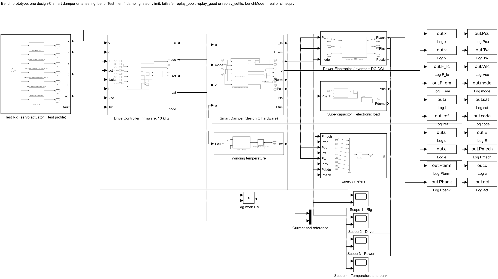
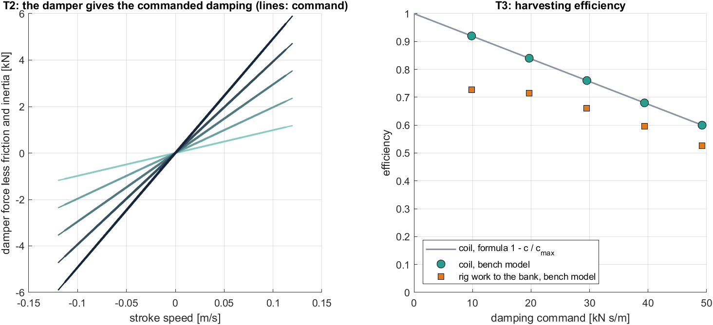
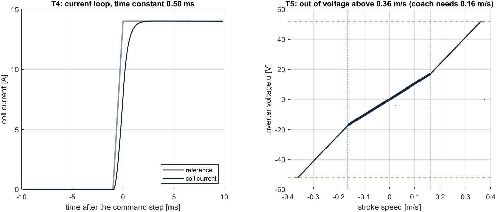
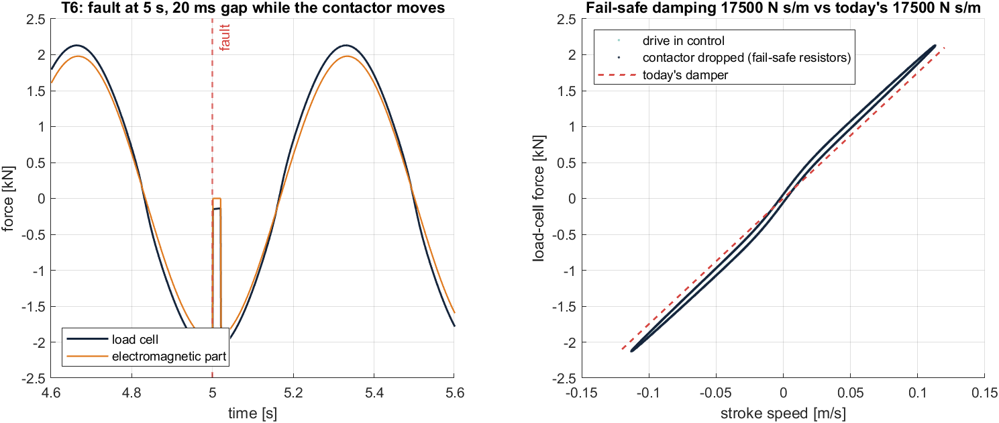
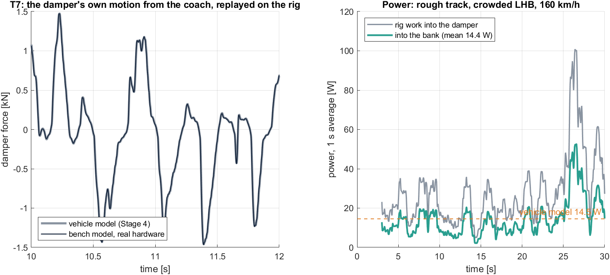
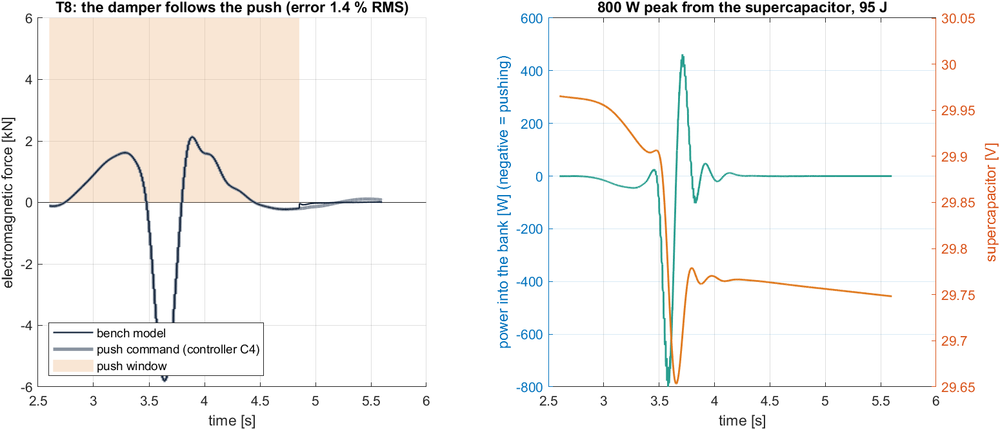
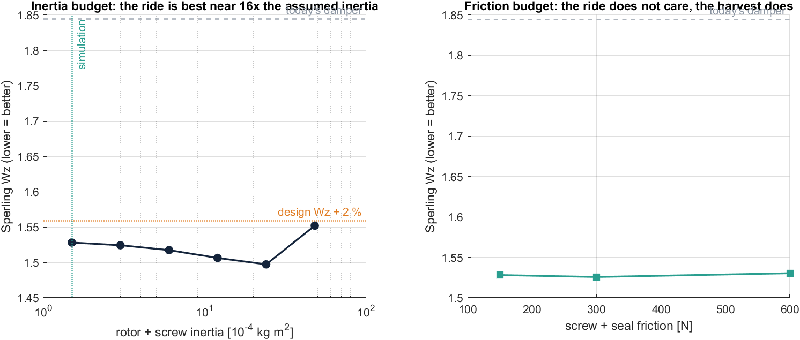

# Stage 5: The Bench Prototype in Simulink

**Project:** SwarmRide Bharat, a regenerative, load-adaptive, self-powered train suspension
**Model:** `models/SR_Bench.slx` (built by `scripts/build_bench.m`)
**Hardware package:** [`../Bench_Prototype/`](../Bench_Prototype/README.md)
**Status:** model complete and verified; hardware not built yet

> **In one line:** one design-C smart damper on a test rig, with everything the vehicle model simplified now made real: a 10 kHz current controller with a voltage limit, inverter and DC-DC losses, a contactor that takes 20 ms to drop, and a winding that heats up. It predicts what the lab must measure, **14.4 W into the bank on the replayed rough track** against the vehicle model's 14.5 W. It also shows that the fail-safe, the push and the heat are all within the hardware's ratings.

---

## Contents

1. [Objective](#1-objective)
2. [What was done](#2-what-was-done)
3. [How to run it](#3-how-to-run-it)
4. [The model, block by block](#4-the-model-block-by-block)
5. [From the coach to the rig: the damper's duty](#5-from-the-coach-to-the-rig-the-dampers-duty)
6. [Checks of the bench model](#6-checks-of-the-bench-model)
7. [Predicted bench results](#7-predicted-bench-results)
8. [Hardware margins](#8-hardware-margins)
9. [The firmware](#9-the-firmware)
10. [What it means, and the limits](#10-what-it-means-and-the-limits)

---

## 1. Objective

Stages 1–4 tested the whole coach with an **idealised** smart damper:
- an equivalent DC machine;
- a 2 ms first-order current loop with no voltage limit;
- fixed converter efficiencies;
- an instant fail-safe relay.

Before buying hardware we need to know:
1. **What exactly to buy:** the ratings of the motor, screw, inverter, resistors and bank.
2. **Do the idealisations hide a problem?** For example, a voltage limit, a gap in the fail-safe, heat, or rotor inertia.
3. **What the lab should measure,** so a real test can be judged against a number, not an impression.

## 2. What was done

| File | Role |
|---|---|
| `functions/bp_hardware.m` | Turns the simulated damper and its duty into hardware ratings (motor Kt, R, torque, speed; screw; inverter; resistors; bank) |
| `functions/bp_current_ref.m`, `bp_current_ctrl.m`, `bp_failsafe.m` | The drive firmware's algorithms (the C firmware is a line-by-line port) |
| `functions/bp_bench_profile.m` | The rig motion and commands for each test |
| `scripts/sr_params_bench.m` | Bench parameters; `benchMode = 'real'` or `'simequiv'` |
| `scripts/build_bench.m` | Builds `SR_Bench.slx` |
| `scripts/check_bench.m`, `plot_bench.m` | Duty, sizing, model checks, predicted T1–T9, margin study, figures |
| `scripts/bench_export.m` | Drive files for the rig, firmware gains (`sr_params_lhb.h`) and test vectors |
| `tests/test_bench.m` | Bench checks in the verification suite, including compiling and running the C firmware's host test |

## 3. How to run it

```matlab
stage = 'bench'; sr_setup                % opens models/SR_Bench.slx
benchTest = 'replay_poor';               % emf | damping | step | vlimit | failsafe | replay_poor | replay_good | replay_settle
benchMode = 'real';                      % real hardware | simequiv (simplified like the vehicle model)
% press Run: four scopes open (rig, drive, power, temperature and bank)
```

Full study: `run('scripts/check_bench.m')`. It writes `results/bench_report.txt`, the figures and the files in `../Bench_Prototype/`.

## 4. The model, block by block



| Block | What it does | Key parameters |
|---|---|---|
| **Test Rig** (servo actuator + test profile) | Moves the damper: stroke x, speed v, acceleration a from the drive file. Sends the drive the damping command c, push force F, push window and test fault | Drive files at 1 ms; the rig is assumed to track perfectly |
| **Drive Controller** (firmware, 10 kHz) | Samples every 100 µs. Fail-safe supervisor (latched) → current reference (damping law i = c v / Ke, or the push force) → PI current control with back-EMF feed-forward and voltage limit. The contactor drop-out delay decides the coil's connection | Kp = L/τ, Ki = Rc/τ, τ = 0.5 ms; Umax = (√3/2) × 60 V = 52 V; current limit 46 A; contactor 20 ms |
| **Smart Damper** (design C hardware) | Coil current: L di/dt = Ke v − Rc i − u (inverter), −i/τ_open (gates off, contactor moving), or Ke v − (Rc + R_fs) i (resistors). Force = Ke i + friction + inertance × a | Ke 175.4 V s/m, Rc 0.25 Ω, L 0.6 mH, R_fs 1.51 Ω, friction 150 N, inertance 59 kg |
| **Power Electronics** | Inverter losses (conduction + switching), then the DC-DC efficiency | Ron 6 mΩ, 0.18 W/A, 94% |
| **Supercapacitor + electronic load** | The bogie's 10 F supercapacitor, charged by this damper; 4 W load (half the bogie electronics); dump when full | 10 F, 12–48 V, starts at 30 V |
| **Winding temperature** | First-order heat balance: copper loss in, heat out to ambient | 0.8 K/W, 1500 J/K (20 min), 35 °C ambient |
| **Energy meters** | Integrates every power flow for the energy balance | — |

**Modes:**
- `real` is the hardware as designed.
- `simequiv` uses the vehicle model's simplifications (2 ms loop, no voltage limit, no inverter losses, instant contactor, 86 A limit). It checks that the bench model and the vehicle model agree.

## 5. From the coach to the rig: the damper's duty

The vehicle model (Stage 4, crowded LHB, 160 km/h, design C) gives one damper's duty:

| Case | Speed RMS / max | Force RMS / max | Current RMS / max | Into the bank |
|---|---|---|---|---|
| Rough track (C3) | 0.034 / 0.115 m/s | 1.07 / 5.04 kN | 5.6 / 27.9 A | 14.5 W |
| Smooth track (C3) | 0.020 / 0.068 m/s | 0.67 / 3.11 kN | 3.3 / 16.9 A | 5.3 W |
| Settlement with push (C4) | 0.014 / 0.163 m/s | 0.51 / 6.11 kN | 2.8 / 33.3 A | −1.9 W |

The hardware ratings follow from this in `bp_hardware.m`:
- **Motor:** Kt 0.40 N m/A rms; 14.1 N m peak and 3.9 N m continuous; 1,800 rpm.
- **Force:** 8 kN peak.
- **Drive:** 60 V DC link, 46 A.
- **Fail-safe resistors:** 3 × 1.0 Ω.

See [`Bench_Prototype/01_Requirements.md`](../Bench_Prototype/01_Requirements.md).

## 6. Checks of the bench model

| Check | Result |
|---|---|
| B1 Bench model in `simequiv` mode vs the vehicle model, same replayed motion | Force differs by **0.49% of peak**; terminal power 16.27 vs 16.26 W |
| B2 Energy balance, real hardware (rig work = friction + copper + fail-safe + inverter + DC-DC + bank + stored) | **0.0000%** of 820 J |
| B3 Time step 0.1 ms vs 0.05 ms | Power into the bank 14.351 vs 14.351 W |
| B4 Back-EMF test recovers the machine constant | 175.39 vs 175.39 V s/m |

The verification suite adds the bench checks (`tests/test_bench.m`), including **compiling the C firmware and running its host test**. See [VERIFICATION.md](VERIFICATION.md).

## 7. Predicted bench results

| Test | Prediction | Figure |
|---|---|---|
| **T1** Machine constant | 175.4 V s/m = 23.9 V rms per 1000 rpm line-to-line | — |
| **T2** Damping law | Measured = commanded within 0.1% from 20% to 100% of c_req; friction 150 N and inertance 59 kg recovered from the zero-current segment |  |
| **T3** Efficiency | Coil 0.92 → 0.60 (exactly 1 − c/c_max); rig work → bank 0.73 → 0.53 (friction and converters) | (same figure) |
| **T4** Current loop | Time constant 0.50 ms as designed, no overshoot |  |
| **T5** Voltage limit | Out of voltage at 0.362 m/s (formula 0.361); the 46 A limit caps the force above 0.163 m/s; the coach needs ≤ 0.163 m/s | (same figure) |
| **T6** Fail-safe | 17,500 N s/m after the fault = today's damper; **20 ms with no electromagnetic force** while the contactor moves; no spike |  |
| **T7** Harvest, replayed track | Rough: 27.6 W in → **14.4 W** into the bank (vehicle model 14.5 W). Smooth: 10.6 W → 5.1 W (vehicle model 5.3 W) |  |
| **T8** Push | **800 W** peak from the supercapacitor, 95 J per settlement; force follows the command within 1.4% RMS |  |
| **T9** Winding heat | 8.6 W average copper loss → 42 °C steady at 35 °C ambient; trip 120 °C | — |

**Why the bank gets almost exactly what the vehicle model said.** The vehicle model charged a fixed 95% for the inverter.
- **Rough track:** the modelled inverter (conduction + switching) loses 0.84 W of 16.3 W, which is 5.2%. So the bank gets 14.4 W against 14.5 W.
- **Smooth track:** the currents are small, so the switching loss takes a larger share, about 8% (0.46 W of 5.9 W). The bank gets 5.1 W against 5.3 W (−4%).

Light-load efficiency is therefore what to check in T3/T7. A lower PWM frequency at light load is an easy fix if needed.

## 8. Hardware margins

The vehicle model (crowded LHB, rough track, 160 km/h, C3) was rerun with the hardware values that are hardest to guarantee:



- **Rotor + screw inertia** (the ball screw turns rotor inertia into a mass at the rod: b = J (2π/lead)²):
  - The centre ride gets slightly **better** up to 16× the assumed inertia: 2.4 × 10⁻³ kg m², b = 947 kg, Wz 1.528 → 1.497.
  - It turns worse only at 32× (Wz 1.552, still within 2%).
  - The worst seat improves throughout.
  - The harvest falls slowly (−9% at 32×).

  **The motor does not need to be a special low-inertia type.** The target is J ≤ 2.4 × 10⁻³ kg m².
- **Friction:** 300 N and 600 N leave the ride unchanged but cut the harvest from 33.1 to 30.7 and 26.4 W per bogie. **Friction is the mechanical budget to control (≤ 300 N).**
- **Current limit of 8 kN** (46 A) instead of the vehicle model's 15 kN: no change in ride or harvest, and the settlement worst seat is still 0.196 m/s² with the push.

## 9. The firmware

The controller, drive and bank supervisor are written in C in [`../Bench_Prototype/firmware/`](../Bench_Prototype/firmware/README.md). `bench_export.m` writes:
- the gain tables for an LHB coach at 160 km/h;
- 2,700 test vectors computed by the MATLAB code.

The host test compiles the C code twice:
- in **double**, it matches MATLAB to rounding (worst LPV force error 2 × 10⁻⁶ N);
- in **float**, as on a Cortex-M4F microcontroller, it matches within 0.03 N.

**10 of 10 host checks pass in both builds, with no compiler warnings.**

## 10. What it means, and the limits

**Meaning:**
- The design-C damper can be built from **standard parts**: a 48 V-class servo motor, a 25 mm ball screw, a 60 V four-quadrant drive and a 10 F supercapacitor.
- The vehicle model's idealisations do **not** hide a problem. The real current loop is faster, the voltage limit is far above the coach's needs, the heat is small and the energy reaching the bank is the same.
- The one new behaviour is the **20 ms fail-safe gap**, which the bench must measure.

**Limits:**
- The motor is modelled on its q-axis (equivalent DC). There is no PWM ripple, magnetic saturation or cogging. PWM ripple needs a switching-level model; saturation and cogging will be measured in T1/T2.
- The rig is assumed to track its drive file perfectly. A real rig has a tracking error, so T7 also logs the rig's actual position.
- The thermal and loss parameters (0.8 K/W, 1,500 J/K, Ron, switching loss) are estimates to be replaced with the chosen parts' datasheets.
- The firmware's state observer and CAN interface are not written yet (see the firmware README).
